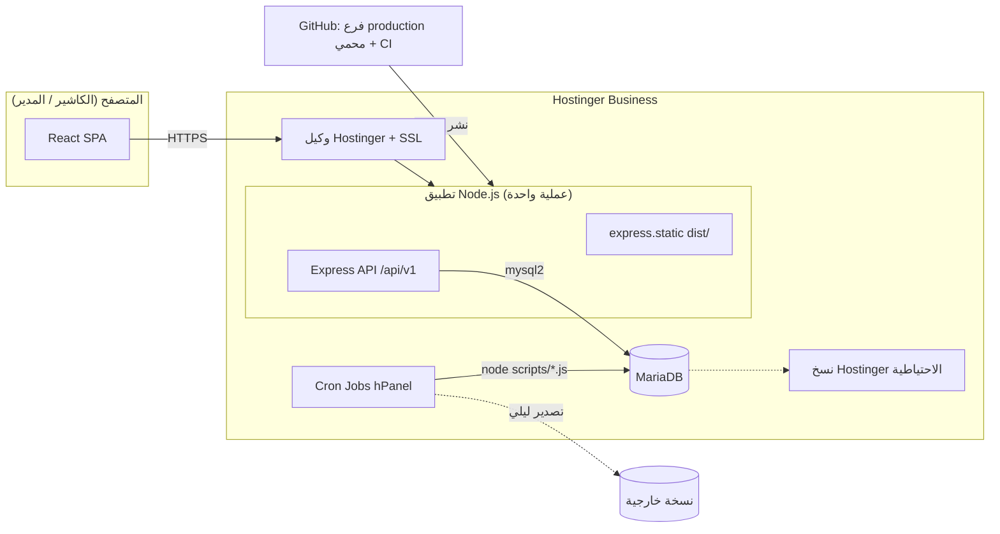
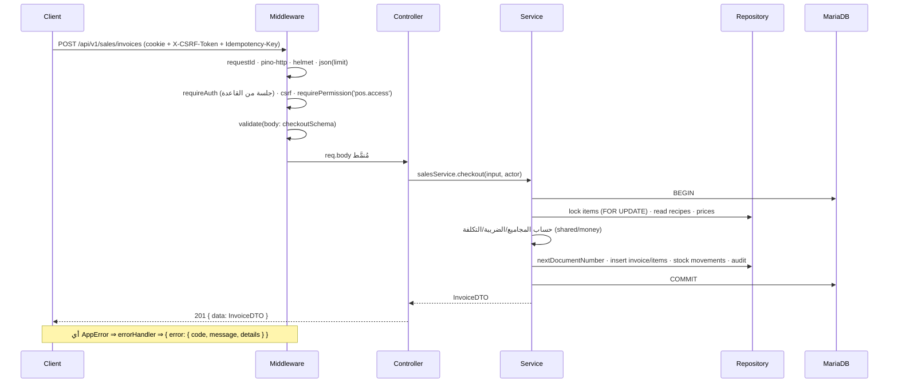
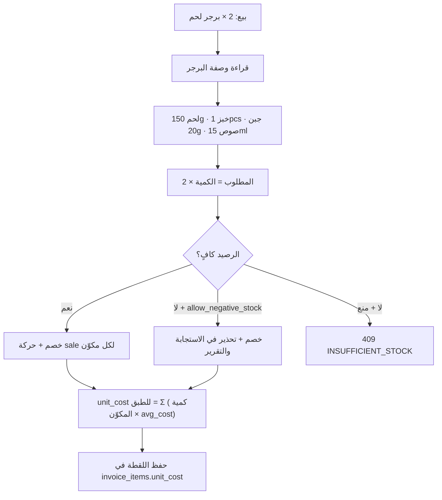
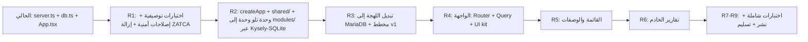

# الهيكلية المعمارية المقترحة — Mizan POS (مطعم واحد)

> **الحالة:** تصميم مقترح للمراجعة — **لم يُنفَّذ شيء منه**. كل خطوة تنفيذ تمر ببوابة موافقة (انظر [REFACTORING_ROADMAP.md](REFACTORING_ROADMAP.md)).
> **النطاق:** مطعم واحد · بلا تكامل ZATCA (QR محلي فقط) · مخزون بالوصفات · Hostinger Business + MariaDB · SaaS لاحقاً كمشروع منفصل.

---

## 1. الأهداف والقيود

### 1.1 الأهداف
1. منتج **قابل للتسليم** لمطعم واحد: صحيح مالياً، آمن على رابط عام، مختبَر.
2. كود **قابل للصيانة**: طبقات واضحة، وحدات صغيرة، اختبارات تحمي السلوك.
3. **قابلية التطور** إلى SaaS لاحقاً دون إعادة كتابة — بلا إضافة تعقيد SaaS الآن.

### 1.2 قيود المنصة (Hostinger Business — من صفحات الدعم الرسمية)
| القيد | الأثر المعماري |
|---|---|
| مجلد التطبيق `hbuilds/` يُستبدل عند كل نشر | **لا ملفات دائمة على القرص** (لا SQLite، لا رفع ملفات محلي) |
| قاعدة البيانات MariaDB | SQL متوافق مع MySQL/MariaDB فقط |
| لا WebSockets واردة | لا تحديث لحظي؛ polling عند الحاجة |
| لا Background Workers ولا مؤقتات دائمة | المهام الدورية = **Cron jobs** على hPanel (UTC، ≤ 30 دقيقة) |
| مهلة الطلب 120 ثانية | لا عمليات طويلة داخل الطلب؛ تقارير بتجميع SQL |
| لا منافذ مخصصة، لا Docker، لا Redis | Express يستمع على `PORT` من البيئة؛ لا طوابير خارجية |
| التثبيت والبناء على Hostinger (npm) | `npm run build` يجب أن ينجح دون أي خطوات يدوية |
| 2 CPU / 3GB RAM / NPROC 120 | عملية Node واحدة كافية لمطعم واحد |

### 1.3 ما لن نفعله الآن (عن قصد)
- لا Microservices، لا إعادة كتابة بإطار آخر (NestJS/Laravel)، لا Redis، لا Docker في الإنتاج.
- لا `tenant_id` ولا خطط اشتراك ولا فوترة (SaaS لاحقاً).
- لا تكامل ZATCA، لا طاولات، لا شاشة مطبخ، لا Modifiers.
- لا Design Patterns لمجرد استخدامها: Repository وService فقط حيث يفصلان SQL عن منطق الأعمال.

---

## 2. المبادئ
1. **التدرّج (Strangler Fig):** ننقل وحدة واحدة في كل مرة؛ التطبيق يعمل بعد كل خطوة؛ الاختبارات خضراء.
2. **منطق الأعمال على الخادم فقط:** الأسعار، الضريبة، الخصومات، المخزون، التكلفة، التقارير. الواجهة تعرض ما يحسبه الخادم.
3. **الخادم مصدر الحقيقة للصلاحيات:** كل قراءة وكتابة تمر بـ `requirePermission`؛ إخفاء الواجهة للتجربة فقط.
4. **المستندات المالية غير قابلة للحذف:** الإلغاء (void) أو المستند العكسي (إشعار دائن)، مع سجل تدقيق.
5. **المال بدقة عشرية:** لا `number` عائم للمبالغ المخزنة؛ تقريب موحّد في مكان واحد.
6. **الوقت:** تخزين UTC، وحساب "تاريخ العمل" بتوقيت الرياض (UTC+3).
7. **أبسط حل يعمل:** لا تجريد قبل أن يتكرر الاحتياج مرتين.

---

## 3. لماذا Modular Monolith؟

| الخيار | الإيجابيات | السلبيات | القرار |
|---|---|---|---|
| **Modular Monolith (Express + TypeScript)** | يبني على الكود الحالي؛ عملية واحدة تناسب Hostinger؛ بسيط في النشر والاختبار | يتطلب انضباطاً في حدود الوحدات | ✅ **المختار** |
| Microservices | عزل وتوسع مستقل | تعقيد هائل؛ غير ممكن على استضافة مشتركة | ❌ |
| إعادة كتابة بـ NestJS | بنية جاهزة | إعادة كتابة كاملة بلا مبرر؛ مخاطرة على الوظائف الحالية | ❌ |
| إعادة كتابة بـ Laravel (PHP) | يعمل على أي استضافة مشتركة | إعادة كتابة كاملة؛ Business يدعم Node فعلاً | ❌ |

---

## 4. نموذج التشغيل على Hostinger



- **نفس الأصل (same-origin):** Express يقدّم ملفات الواجهة المبنية والـ API معاً ⇒ لا CORS، والكوكيز `SameSite=Lax` تعمل ببساطة.
- **الترحيلات عند الإقلاع:** بقفل `GET_LOCK` في MariaDB؛ فشل الترحيل = رفض الإقلاع (Hostinger يحتفظ بآخر نسختين للتراجع).
- **المهام الدورية:** سكربتات Node صغيرة تُشغَّل بـ Cron: تنظيف الجلسات المنتهية، تصدير نسخة احتياطية، تنظيف محاولات الدخول القديمة.

---

## 5. هيكل المجلدات المستهدف

```
POS-folios/
├── server/
│   ├── src/
│   │   ├── app.ts                 ← createApp(): يبني Express (قابل للاختبار بلا listen)
│   │   ├── main.ts                ← نقطة الدخول: config → migrate → listen
│   │   ├── config/env.ts          ← متغيرات البيئة بتحقق zod
│   │   ├── db/
│   │   │   ├── kysely.ts          ← الاتصال + أنواع الجداول
│   │   │   ├── migrations/        ← 0001_init.ts, 0002_... (up/down)
│   │   │   └── seeds/dev.ts       ← بيانات تطوير فقط
│   │   ├── shared/
│   │   │   ├── errors.ts          ← AppError, NotFound, Forbidden, Validation, Conflict
│   │   │   ├── http.ts            ← ok(), created(), paginated(), errorHandler
│   │   │   ├── validate.ts        ← middleware zod للـ body/query/params
│   │   │   ├── auth.ts            ← requireAuth, requirePermission, csrf
│   │   │   ├── logger.ts          ← pino
│   │   │   ├── sequences.ts       ← nextDocumentNumber(trx, type)
│   │   │   ├── audit.ts           ← recordAudit(trx, …)
│   │   │   └── time.ts            ← businessDate() بتوقيت الرياض
│   │   └── modules/
│   │       ├── auth/              ← login, logout, me, setup (أول مدير)
│   │       ├── users/  roles/
│   │       ├── settings/
│   │       ├── customers/  suppliers/
│   │       ├── menu/              ← الفئات والأطباق
│   │       ├── inventory/         ← المكونات، الحركات، الهالك، الجرد
│   │       ├── recipes/
│   │       ├── purchases/         ← فواتير الشراء والدفعات
│   │       ├── sales/             ← البيع، الإشعارات الدائنة، الطلبات المعلقة
│   │       ├── vouchers/
│   │       ├── reports/           ← تقارير SQL
│   │       ├── receipts/          ← QR المرحلة الأولى (TLV بخمسة حقول)
│   │       └── public-invoice/
│   │           (كل وحدة: routes.ts · controller.ts · service.ts · repository.ts · schemas.ts · *.test.ts)
│   └── scripts/                   ← cron: cleanup-sessions.ts, backup-export.ts
├── web/                           ← (src/ الحالي بعد النقل)
│   ├── app/                       ← router.tsx, providers.tsx, AppLayout.tsx
│   ├── api/                       ← client.ts (fetch + CSRF + أخطاء موحّدة), queryKeys.ts
│   ├── features/
│   │   ├── auth/  pos/  sales/  menu/  inventory/  recipes/
│   │   ├── purchases/  vouchers/  reports/  settings/  users/  public-invoice/
│   │   │   (كل ميزة: pages/ · components/ · hooks/ · api.ts)
│   ├── ui/                        ← Modal, ConfirmDialog, DataTable, KpiStrip, Tabs, SearchInput, FormField, Toast
│   ├── i18n/                      ← ar.ts, en.ts (قاموس مُنمَّط), useT()
│   ├── lib/                       ← format.ts (مال/تاريخ الرياض), print.ts, csv.ts
│   └── main.tsx
├── shared/                        ← يُستورد من الطرفين
│   ├── types.ts  permissions.ts  money.ts  constants.ts
│   └── schemas/                   ← zod schemas مشتركة (تحقق في الخادم + النماذج)
├── e2e/                           ← Playwright
├── docs/  CLAUDE.md  .claude/skills/
└── package.json  (حزمة واحدة — بلا monorepo tooling)
```

> **لماذا حزمة واحدة؟** المشروع صغير نسبياً؛ أدوات Monorepo (workspaces/turbo) تعقيد غير ضروري. الفصل يتم بالمجلدات وقواعد ESLint للاستيراد (`web` لا يستورد من `server` والعكس؛ كلاهما يستورد من `shared`).

---

## 6. معمارية الخادم

### 6.1 الطبقات ومسؤولياتها

| الطبقة | المسؤولية | ممنوع فيها |
|---|---|---|
| `routes.ts` | ربط المسار بالـ middleware والـ controller | منطق، SQL |
| `controller.ts` | قراءة المدخلات المتحقق منها، استدعاء الخدمة، تشكيل الاستجابة | SQL، حسابات مالية |
| `service.ts` | منطق الأعمال، القواعد، الـ transactions، التدقيق | `req`/`res`، SQL مباشر |
| `repository.ts` | استعلامات Kysely فقط، تُرجع أنواعاً واضحة | قواعد أعمال |
| `schemas.ts` | zod schemas للمدخلات والمخرجات (DTO) | — |

### 6.2 دورة حياة الطلب



### 6.3 نموذج الأخطاء
```ts
// server/src/shared/errors.ts
export class AppError extends Error {
  constructor(public status: number, public code: string, message: string, public details?: unknown) { super(message); }
}
export const NotFound   = (what: string) => new AppError(404, 'NOT_FOUND', `${what} not found`);
export const Forbidden  = () => new AppError(403, 'FORBIDDEN', 'Permission denied');
export const Conflict   = (code: string, msg: string) => new AppError(409, code, msg);
export const Invalid    = (details: unknown) => new AppError(422, 'VALIDATION_FAILED', 'Invalid input', details);
// errorHandler: AppError ⇒ status+code؛ غير ذلك ⇒ 500 INTERNAL مع تسجيل كامل في pino دون كشفه للعميل
```

### 6.4 صيغة الـ API (v1)
- البادئة `/api/v1`؛ المسارات الحالية `/api/*` تبقى كأسماء بديلة مؤقتة حتى تنتقل الواجهة.
- النجاح: `{ "data": … }`، والقوائم: `{ "data": [...], "meta": { "page", "pageSize", "total" } }`.
- الخطأ: `{ "error": { "code": "INSUFFICIENT_STOCK", "message": "…", "details": {…} } }`.
- أكواد ثابتة قابلة للترجمة في الواجهة (لا نصوص عربية من الخادم).
- `Idempotency-Key` إلزامي في البيع: تكرار نفس المفتاح يعيد نفس الفاتورة بدل إنشاء ثانية.
- عمليات الكتابة تعيد **المورد المتأثر فقط**؛ الواجهة تُبطل الذاكرة المؤقتة للقوائم المرتبطة.
- مواصفة OpenAPI تُولَّد من zod schemas.

### 6.5 المصادقة والجلسات
- **معالج الإعداد الأول:** `POST /api/v1/auth/setup` يعمل فقط إذا لم يوجد أي مستخدم، ويتطلب `SETUP_TOKEN` من متغيرات البيئة.
- **الدخول:** scrypt غير متزامن؛ محاولات مسجلة في `login_attempts`؛ قفل مؤقت بعد 5 محاولات فاشلة/15 دقيقة للبريد، ومحدد معدل لكل IP في الذاكرة (عملية واحدة).
- **الجلسة:** cookie `sid` (`httpOnly; Secure; SameSite=Lax; Path=/`)، التوكن مخزن كـ SHA-256 في `user_sessions`، انتهاء انزلاقي (مثلاً 12 ساعة عمل)، إلغاء من شاشة المستخدم.
- **CSRF:** فحص `Origin` لكل طلب غير GET + توكن `X-CSRF-Token` (double-submit).
- **`trust proxy`:** يُضبط وفق وكيل Hostinger ليعمل الـ rate limit والكوكيز الآمنة.

### 6.6 الصلاحيات (RBAC)
- مفاتيح الصلاحيات في `shared/permissions.ts` (مصدر واحد)، وتُخزن مطبّعة في `role_permissions`.
- تُحذف `zatca.manage`. تُضاف عند الحاجة: `menu.manage`, `recipes.manage`, `inventory.stocktake`, `vouchers.void`.
- كل endpoint قراءة يعلن صلاحيته؛ اختبار مصفوفة (مسار × دور) في CI.

### 6.7 الـ Transactions والتزامن
- كل عملية تمس أكثر من جدول داخل `db.transaction().execute(async (trx) => …)`.
- قفل صفوف المخزون بـ `FOR UPDATE` بترتيب `id` تصاعدي (منع التداخل والـ deadlocks).
- الترقيم من `document_sequences` داخل نفس الـ transaction.

### 6.8 المال والضريبة
- `shared/money.ts`: الحساب بوحدة الهللة (أعداد صحيحة) أو مكتبة عشرية صغيرة، مع دالة تقريب واحدة (half-up إلى منزلتين).
- **وضع التسعير** (قرار): `prices_include_vat = 1` افتراضياً للمطعم ⇒ الضريبة تُستخرج من السعر: `vat = price × rate / (100 + rate)`.
- الخصم يُوزَّع على البنود بالتناسب قبل حساب ضريبة كل بند، ليتطابق مجموع البنود مع الإجمالي.

### 6.9 السجلات (Logging) والمراقبة
- pino إلى stdout (يظهر في سجلات Hostinger) + `requestId` لكل طلب.
- أخطاء 5xx تُرسل اختيارياً إلى Sentry (اتصال صادر مسموح).
- `GET /api/v1/health` (يفحص الاتصال بالقاعدة) لمراقبة خارجية.

### 6.10 المهام الدورية (بدون Workers)
| المهمة | التكرار المقترح (UTC) | السكربت |
|---|---|---|
| تنظيف الجلسات المنتهية ومحاولات الدخول القديمة | كل ساعة | `scripts/cleanup.ts` |
| تصدير نسخة احتياطية للقاعدة إلى تخزين خارجي | يومياً 00:30 UTC (03:30 الرياض) | `scripts/backup-export.ts` |

---

## 7. نموذج المجال للمطعم

### 7.1 الوحدات
| الوحدة | الكيانات | ملاحظات |
|---|---|---|
| menu | `menu_categories`, `menu_items` | الأطباق والمشروبات المعروضة للبيع |
| inventory | `inventory_items`, `stock_movements` | المكونات وأصناف إعادة البيع |
| recipes | `recipe_lines` | مكونات كل طبق بالوحدة الأساسية |
| purchases | `suppliers`, `purchases`, `purchase_items`, `purchase_payments` | شراء المكونات بوحدات الشراء |
| sales | `invoices`, `invoice_items`, `held_orders` | البيع، المرتجعات، الطلبات المعلقة |
| vouchers | `vouchers` | القبض والصرف (مع الإلغاء) |
| receipts | — | QR المرحلة الأولى (5 حقول TLV) + قوالب الطباعة |

### 7.2 خصم المكونات عند البيع



### 7.3 التكلفة
- **المتوسط المرجّح المتحرك** عند كل شراء: `avg_new = (qty_old × avg_old + qty_in × cost_in) / (qty_old + qty_in)` بالوحدة الأساسية.
- تكلفة الطبق تُحسب وقت البيع وتُحفظ كلقطة ⇒ الأرباح التاريخية لا تتغير بتغير الأسعار لاحقاً.
- طبق بلا وصفة يُسمح ببيعه بتكلفة صفر مع تنبيه في تقرير "أطباق بلا وصفة".

### 7.4 سياسات تحتاج اعتماداً (القيم المقترحة)
| السياسة | المقترح | البديل |
|---|---|---|
| المخزون السالب | مسموح مع تحذير (الجرد الفعلي يصحح) | منع البيع |
| المرتجع/الإشعار الدائن | لا يعيد المكونات للمخزون (الطعام لا يُعاد) | إرجاع اختياري بخيار في الشاشة |
| الأسعار | شاملة الضريبة | قبل الضريبة (الحالي) |
| الفاتورة الضريبية لشركة | مُبقاة (`invoice_kind = 'tax'` مع رقم ضريبي للعميل) | البسيطة فقط |
| رابط الفاتورة العامة `/i/:uuid` | زر "نسخ/مشاركة الرابط" فقط (الـ QR أصبح TLV) | حذف الميزة |

---

## 8. معمارية الواجهة

### 8.1 التوجيه (Routing)
- React Router: `/login`, `/setup`, `/pos`, `/sales`, `/menu`, `/inventory`, `/recipes`, `/purchases`, `/vouchers`, `/reports/:reportId`, `/settings`, `/users`, والعام `/i/:uuid`.
- حارس مسارات حسب الصلاحية (`<RequirePermission perm="reports.view">`).
- تحميل كسول (`React.lazy`) للتقارير والإعدادات لتخفيف شاشة الكاشير.

### 8.2 بيانات الخادم (Server State)
- **TanStack Query** بدل `bootstrap` + `setData`: لكل ميزة hooks مثل `useMenuItems()`, `useCheckout()`.
- `api/client.ts`: يضيف CSRF، يحوّل `{error}` إلى `ApiError` مُنمَّط **يُرمى** ⇒ المكونات لا تمسح النماذج أو السلة إلا عند النجاح.
- إبطال مستهدف بعد كل عملية كتابة (`invalidateQueries(['inventory'])`).

### 8.3 الجلسة
- لا توكن في JavaScript؛ الكوكيز httpOnly. عند التحميل: `GET /api/v1/auth/me` ⇒ تحديث الصفحة لا يُخرج المستخدم.

### 8.4 مكتبة الواجهة المشتركة (`web/ui`)
`Modal` (Escape، focus trap، `role="dialog"`)، `ConfirmDialog` (للإشعار الدائن وإلغاء السند)، `DataTable` (ترقيم من الخادم)، `KpiStrip`، `Tabs`، `SearchInput`، `FormField`، `MoneyInput`، `Toast`.

### 8.5 الترجمة والتنسيق
- قاموس مُنمَّط `ar.ts`/`en.ts` + `useT()`؛ إزالة نحو 1,000 تعبير `isAr ? … : …` تدريجياً مع كل شاشة تُنقل.
- `lib/format.ts`: `formatMoney`, `formatDate` بتوقيت `Asia/Riyadh` عبر `Intl`.
- الخطوط تُستضاف محلياً (لا Google Fonts) — يسهّل CSP.

### 8.6 الطباعة
- مكوّن قالب إيصال واحد يُستخدم للمعاينة والطباعة والصفحة العامة (بدل 3 نسخ).
- `lib/print.ts`: iframe واحد مع `sandbox`، بدل نسختين.
- QR الإيصال = TLV بخمسة حقول يُبنى على الخادم ويُخزن في الفاتورة.

### 8.7 معالجة الأخطاء والأداء
- `ErrorBoundary` على مستوى التطبيق وكل صفحة؛ `StrictMode`.
- لا حسابات تحليلية في المتصفح؛ القوائم مرقمة من الخادم؛ قوائم الاختيار الكبيرة ببحث.

---

## 9. الحزمة المشتركة (`shared/`)
- `types.ts`: DTOs الصادرة من الخادم (لا أنواع صفوف القاعدة).
- `permissions.ts`: مفاتيح ومجموعات الصلاحيات (موجود حالياً ✅ — يُنقل).
- `money.ts`: التقريب والحسابات الضريبية (يستخدمه الخادم؛ الواجهة للعرض التقديري فقط).
- `constants.ts`: `DOCUMENT_TYPES`, `INVOICE_KINDS`, `PAYMENT_METHODS`, `MOVEMENT_TYPES`.
- `schemas/`: zod schemas للمدخلات تُستخدم في الخادم للتحقق وفي النماذج للتحقق المسبق.

---

## 10. معمارية الاختبارات (ملخص)
| المستوى | الأداة | الهدف |
|---|---|---|
| Unit | Vitest | `shared/money`, حساب الضريبة، خصم الوصفات، المتوسط المرجّح، QR TLV، الترقيم |
| Integration | Vitest + MariaDB (خدمة في GitHub Actions / docker-compose محلياً) | المستودعات، القيود، الـ transactions، التزامن |
| API | Vitest + Supertest على `createApp()` | كل المسارات + مصفوفة الصلاحيات + أكواد الأخطاء |
| E2E | Playwright | دخول ⇒ بيع ⇒ إيصال ⇒ إشعار دائن ⇒ تحقق المخزون |
| خط الأساس | اختبارات توصيفية في R1 | حماية السلوك الحالي قبل أي Refactor |

---

## 11. سجل القرارات المعمارية (ADR)

| # | القرار | البدائل | المبرر | الحالة |
|---|---|---|---|---|
| ADR-001 | Modular Monolith على Express | NestJS، Microservices، Laravel | أقل تغيير، يناسب Hostinger | مقترح |
| ADR-002 | Express 5 | Fastify | يلتقط أخطاء async أصلاً؛ ترقية صغيرة من 4 | مقترح |
| ADR-003 | Kysely (+ mysql2) | Prisma، Drizzle، SQL خام | SQL مُنمَّط قريب من الحالي؛ يدعم SQLite وMySQL ⇒ انتقال تدريجي؛ بلا محرك native أو توليد كود؛ ترحيلات مدمجة | **يحتاج اعتماداً** |
| ADR-004 | MariaDB | SQLite، PostgreSQL | SQLite يُمسح عند النشر؛ MariaDB متاحة على الخطة | معتمد (قيود الاستضافة) |
| ADR-005 | Cookie sessions في القاعدة | JWT | إلغاء فوري، لا توكن في JS، بسيط مع same-origin | مقترح |
| ADR-006 | TanStack Query | Redux Toolkit، Context | المشكلة "بيانات خادم" لا "حالة عميل"؛ يحل التخزين المؤقت والإبطال والأخطاء | **يحتاج اعتماداً** |
| ADR-007 | zod schemas مشتركة | Joi، class-validator | أنواع TypeScript مستنتجة؛ تعمل في الطرفين | مقترح |
| ADR-008 | الترحيل عند الإقلاع بقفل | خطوة يدوية | Hostinger لا يتيح npm عبر SSH | مقترح (يُتحقق عند النشر) |
| ADR-009 | حزمة npm واحدة | Workspaces/Monorepo | حجم المشروع لا يبرر الأدوات | مقترح |
| ADR-010 | إزالة ZATCA مع QR محلي | الإبقاء معطلاً | قرار النطاق؛ يزيل أسراراً وكوداً ميتاً | معتمد |

---

## 12. مسار الانتقال من الحالي إلى المستهدف



في كل خطوة: الـ API القديم يبقى يعمل حتى تنتقل الواجهة، والاختبارات التوصيفية تبقى خضراء، ولا تُحذف وظيفة قبل توثيق أثرها والحصول على موافقة.
