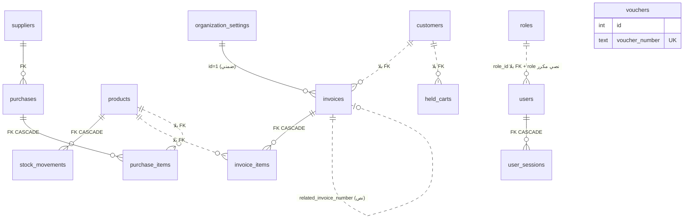
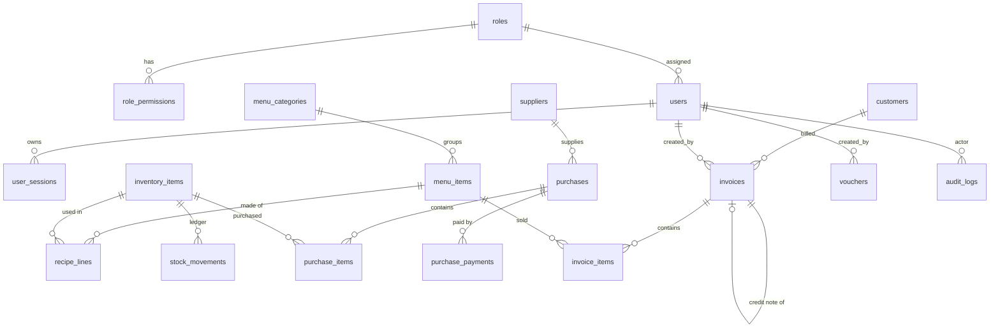

# مراجعة قاعدة البيانات — Mizan POS

> **الحالة:** تحليل فقط — لا ترحيلات ولا تعديلات منفذة.
> **المحرك الحالي:** SQLite (better-sqlite3 ^13.2، وضع WAL، `foreign_keys = ON`).
> **المحرك المستهدف:** **MariaDB** على Hostinger Business (متوافق مع MySQL؛ الإصدار يُتحقق منه بـ `SELECT VERSION();` في phpMyAdmin — المتوقع 10.11 أو 11.x).
> **البيانات الحالية:** تجريبية فقط ⇒ لا حاجة لترحيل بيانات، بل **مخطط جديد نظيف** بعد أخذ نسخة احتياطية.
> **مرتبط:** [PROJECT_ANALYSIS.md](PROJECT_ANALYSIS.md) · [ARCHITECTURE.md](ARCHITECTURE.md) · [REFACTORING_ROADMAP.md](REFACTORING_ROADMAP.md)

---

## 1. الملخص

| المحور | الحالة | أهم مشكلة |
|---|---|---|
| موقع التخزين | 🔴 | ملف `./data/mizan-pos.db` سيُمسح مع كل نشر على Hostinger |
| تصميم الجداول | 🟠 | مقبول لنظام تجزئة، غير مناسب لمطعم بوصفات، وإعدادات ZATCA مختلطة بإعدادات العرض |
| العلاقات (FKs) | 🟠 | 5 علاقات أساسية بلا FK |
| الفهارس | 🔴 | **لا يوجد أي فهرس** سوى قيود UNIQUE والمفاتيح الأساسية |
| القيود (Constraints) | 🟠 | لا CHECK على أي عمود حالة/نوع، المبالغ REAL |
| سلامة البيانات | 🔴 | ترقيم بـ COUNT، بذور تعود تلقائياً، حذف نهائي لمستندات مالية، دفتر حركات غير مطابق |
| الأداء | 🟠 | N+1، `SELECT *` يجلب XML والأسرار، قراءات مقتطعة تُبنى عليها التقارير |
| الترحيلات | 🔴 | فحوص `PRAGMA table_info` + `ALTER` يدوية بلا إصدارات |

---

## 2. الإعداد الحالي

- إنشاء الاتصال عند تحميل الوحدة (`src/server/db.ts:30-38`): المسار `path.resolve(process.cwd(), 'data')`.
- إنشاء الجداول في `initDatabase()` بـ `CREATE TABLE IF NOT EXISTS` (`db.ts:40-267`).
- "ترحيلات" بإضافة أعمدة مفقودة بعد فحص `PRAGMA table_info` (`db.ts:269-306`).
- بذور تُنفَّذ **كلما كان الجدول فارغاً** (`db.ts:310-459`).
- ملفا `data/mizan-pos.db-wal` (≈1MB) و`-shm` **مرفوعان إلى git**، بينما الملف الرئيسي غير مرفوع. الفحص أظهر أن ملف WAL يحتوي **7 مفاتيح خاصة PEM** وسجلات مستخدمين.

---

## 3. المخطط الحالي (ER)



الجداول الأربعة عشر: `organization_settings`, `products`, `stock_movements`, `customers`, `invoices`, `invoice_items`, `held_carts`, `suppliers`, `purchases`, `purchase_items`, `roles`, `users`, `user_sessions`, `vouchers`.

---

## 4. مراجعة الجداول جدولاً جدولاً

| الجدول | الملاحظات |
|---|---|
| `organization_settings` | صف واحد `CHECK (id = 1)`. يخلط بيانات المنشأة + إعدادات الطابعة/العرض + **أسرار ZATCA** (`private_key_pem`, `ccsid_secret`, `pcsid_secret`) + حالة التسلسل (`last_icv`, `last_pih`). يُقرأ بـ `SELECT *` ويُرسل للواجهة. معظم أعمدته ستُحذف مع إزالة ZATCA. |
| `products` | `sku UNIQUE` جيد؛ `cost_price`/`sell_price` REAL؛ `stock_qty INTEGER` (لا كسور)؛ `tax_category` نص حر بلا CHECK؛ `expiry_date` نص. حذف ناعم عبر `active`. لا يصلح كما هو للمطعم (يخلط الطبق والمكوّن). |
| `categories` | **أُضيف في R1.11ج.** `name_key` فريد (الاسم العربي بعد توحيد المسافات وحالة الأحرف)، `sort_order` لترتيب أزرار نقطة البيع. `products.category_id` يشير إليه (`ON DELETE SET NULL`، مفهرس)، والنصان `category_ar`/`category_en` نسخة عرض تُحدَّث عند إعادة التسمية حتى مخطط v1. الحذف ممنوع ما دامت عليه أصناف نشطة. |
| `stock_movements` | `type` نص بلا CHECK؛ `reference_no` نص حر بدل مرجع منظم؛ لا `created_by`؛ لا تكلفة وحدة؛ `ON DELETE CASCADE` من المنتجات (يُفقد التاريخ لو حُذف منتج نهائياً). لا فهرس على `product_id`. |
| `customers` | لا تحقق من صيغة الرقم الضريبي؛ لا حذف/تعطيل؛ لا `updated_at`. |
| `invoices` | `uuid`, `invoice_number`, `icv` UNIQUE ✔. `customer_id` بلا FK. `related_invoice_number` نص بدل FK. 8 أعمدة ZATCA (`icv`, `invoice_hash`, `previous_hash`, `qr_tlv_base64`, `xml_content`, `zatca_status`, `zatca_mode`, `zatca_response_json`). لا `created_by`. لا مفتاح منع التكرار (idempotency). |
| `invoice_items` | لقطات الاسم والسعر ✔ (حفظ تاريخي صحيح). `product_id` بلا FK. **لا لقطة للتكلفة** ⇒ الأرباح تُحسب بالتكلفة الحالية. `qty INTEGER`. لا فهرس على `invoice_id`. |
| `held_carts` | `items_json` يُخزَّن كما أرسله العميل بلا تحقق؛ لا مالك (`created_by`)؛ أي مستخدم بصلاحية `pos.hold` يحذف طلبات غيره. |
| `suppliers` | مماثل للعملاء؛ لا حذف/تعطيل. |
| `purchases` | الترقيم بـ COUNT؛ الدفعات تُجمع في `paid_amount` مباشرة **بلا سجل دفعات**؛ لا `created_by`. |
| `purchase_items` | `product_id` بلا FK؛ لا فهرس على `purchase_id`. |
| `roles` | الصلاحيات في `permissions_json` نصاً (غير مطبّع)؛ دور `admin` يُفرض بالكود. |
| `users` | عمودان للدور (`role` نصي + `role_id`) ⇒ تكرار وتعارض محتمل؛ `role_id` بلا FK؛ حذف نهائي. |
| `user_sessions` | التوكن مُجزّأ ✔؛ لا فهرس على `user_id` أو `expires_at`؛ الجلسات المنتهية تُحذف فقط عند دخول المستخدم نفسه. |
| `vouchers` | الترقيم بـ COUNT + **حذف نهائي** ⇒ تكرار رقم ⇒ فشل UNIQUE؛ لا `created_by`؛ لا حالة إلغاء. |

---

## 5. العلاقات والمفاتيح الأجنبية المفقودة

| العمود | يجب أن يشير إلى | السلوك المقترح عند الحذف |
|---|---|---|
| `invoices.customer_id` | `customers.id` | RESTRICT (العملاء يُعطَّلون ولا يُحذفون) |
| `invoice_items.product_id` | الصنف/الطبق | RESTRICT |
| `purchase_items.product_id` | الصنف المخزني | RESTRICT |
| `users.role_id` | `roles.id` | RESTRICT |
| `held_carts.customer_id` | `customers.id` | SET NULL |
| `invoices.related_invoice_number` (نص) | `invoices.id` (`related_invoice_id`) | RESTRICT |
| `stock_movements.product_id` | (موجود) لكن CASCADE | يُغيَّر إلى RESTRICT |

---

## 6. الفهارس المفقودة

| الجدول | الفهرس المقترح | السبب |
|---|---|---|
| `invoice_items` | `(invoice_id)` | جلب بنود الفاتورة (يُنفَّذ 100 مرة في كل تحميل) |
| `purchase_items` | `(purchase_id)` | نفس السبب |
| `stock_movements` | `(item_id, created_at)` + `(reference_type, reference_id)` | دفتر الصنف، تتبع المستند |
| `invoices` | `(business_date)`, `(customer_id)`, `(related_invoice_id)`, `(document_type, business_date)` | التقارير، كشف العميل، فحص وجود مرتجع |
| `purchases` | `(supplier_id)`, `(business_date)` | تقارير الموردين |
| `user_sessions` | `(user_id)`, `(expires_at)` | الإلغاء والتنظيف |
| `vouchers` | `(voucher_date)`, `(voucher_type, voucher_date)` | تقارير الصندوق |
| `login_attempts` (جديد) | `(email, created_at)`, `(ip, created_at)` | منع التخمين |

---

## 7. أنواع البيانات والقيود

- **المبالغ `REAL`** (فاصلة عائمة) ⇒ أخطاء تقريب تراكمية. المستهدف: `DECIMAL(12,2)` للمبالغ، `DECIMAL(14,6)` لتكلفة الوحدة الأساسية، `DECIMAL(5,2)` لنسبة الضريبة.
- **الكميات `INTEGER`** ⇒ مستحيل للمكونات (جرام، مل). المستهدف: `DECIMAL(14,3)`.
- **التواريخ نص ISO بتوقيت UTC** ⇒ التقارير اليومية خاطئة بين 00:00–03:00 بتوقيت الرياض. المستهدف: `DATETIME(3)` بتوقيت UTC + عمود `business_date DATE` محسوب بتوقيت الرياض (UTC+3 ثابت، بلا توقيت صيفي).
- **لا CHECK** على: `invoice_type_code`, `invoice_subtype`, `payment_method`, `zatca_status`, `stock_movements.type`, `payment_status`, `voucher_type`, `payment_channel`, `tax_category`. المستهدف: `CHECK (col IN (...))` (مدعوم في MariaDB ≥ 10.2).
- **لا قيود إيجابية:** لا `CHECK (qty > 0)`، `CHECK (grand_total >= 0)`، `CHECK (paid_amount <= grand_total)`.

---

## 8. مخاطر سلامة البيانات (فقدان أو تكرار)

| ID | الخطورة | المشكلة | الموقع | السيناريو |
|---|---|---|---|---|
| DB-01 | Critical | ملف القاعدة داخل مجلد التطبيق | `db.ts:30-36` | أول نشر على Hostinger يستبدل `hbuilds/` ⇒ **فقدان كل البيانات** |
| DB-02 | High | لا فهارس على FKs | المخطط | تدهور الأداء مع النمو |
| DB-03 | High | ترقيم `COUNT(*)+1` | `server.ts:568-571`, `1188-1190` | حذف سند ⇒ الرقم التالي يساوي رقماً موجوداً ⇒ خطأ UNIQUE ⇒ 500؛ الترقيم لا يبدأ من جديد كل سنة رغم بادئة السنة  — ✅ **أُصلح في R1.8** (`document_sequences`) |
| DB-04 | High | بذور تعود تلقائياً | `db.ts:437-459` | حذف كل السندات ⇒ إعادة تشغيل ⇒ ظهور 3 سندات وهمية بمبالغ في دفاتر المطعم — ✅ **أُصلح في R1.7** (فرع `r1/empty-start`): لا زرع تلقائي، والبيانات التجريبية في `src/server/demo-data.ts` عبر `npm run seed:dev` فقط |
| DB-05 | High | مبالغ REAL وكميات صحيحة | المخطط | فروق هللات؛ استحالة الوصفات |
| DB-06 | Medium | FKs وCHECK مفقودة | §5، §7 | قيم يتيمة أو غير صالحة |
| DB-07 | **Critical** | قراءات مقتطعة | `db.ts:850-894` (`LIMIT 100` للفواتير والمشتريات، 300 للسندات، 80 للحركات) | كل التقارير (ميزان المراجعة، الأرباح، الضريبة، الميزانية) تُحسب في المتصفح من آخر 100 فاتورة فقط ⇒ **أرقام مالية خاطئة** بعد أسابيع من التشغيل |
| DB-08 | Medium | N+1 و`SELECT *` | `db.ts:826-882` | 101 استعلام لكل تحميل؛ نقل XML وأسرار |
| DB-09 | High | لا لقطة تكلفة في بنود البيع | `invoice_items` | تعديل تكلفة صنف يغيّر أرباح الشهور السابقة |
| DB-10 | High | لا `created_by` + حذف نهائي | فواتير، سندات، مشتريات، حركات، مستخدمون | لا يمكن مساءلة الكاشير عن فرق الصندوق؛ حذف سند يمحو الأثر |
| DB-11 | Medium | دفتر حركات غير مطابق | `server.ts:1076-1089` | تسوية -10 على رصيد 4 ⇒ الرصيد 0 والحركة تقول -10 — ✅ **أُصلح في R1.10** (الخيار أ): التسوية تحت الصفر تُرفض (`INSUFFICIENT_STOCK` + المتاح)، ومجموع الحركات = الرصيد مُختبر |
| DB-12 | High | ترحيلات يدوية | `db.ts:269-306` | لا إصدار، لا تراجع، لا اختبار |
| DB-13 | Medium | إعدادات + أسرار + حالة تسلسل في صف واحد | `organization_settings` | تسريب عبر `SELECT *` |
| DB-14 | Low | تكرار الدور في `users` | `users.role` + `role_id` | تعارض بعد إعادة تسمية الدور |
| DB-15 | Medium | توقيت UTC بلا تاريخ عمل | كل الجداول | تقارير يومية خاطئة |
| DB-16 | Low | لا تنظيف للجلسات | `db.ts:1316-1333` | تضخم الجدول |
| DB-17 | Low | سلة معلقة بلا تحقق ولا مالك | `held_carts` | بيانات تالفة تكسر الاسترجاع (`JSON.parse` بلا حماية في الواجهة) |
| DB-18 | Medium | `ON DELETE CASCADE` على الحركات | `stock_movements` | فقدان التاريخ عند أي حذف نهائي مستقبلي |
| DB-19 | Medium | ربط المرتجع بالرقم النصي ومرتجع كامل فقط | `invoices.related_invoice_number` | لا مرتجع جزئي؛ ربط هش |
| DB-20 | High | ملفات WAL/SHM في git | `data/` | تسريب مفاتيح وبيانات مستخدمين |

**ملاحظة تزامن مهمة للمستقبل:** مع better-sqlite3 كل الاستعلامات **متزامنة** وNode أحادي الخيط، فلا يمكن لعمليتي بيع أن تتداخلا. بعد الانتقال إلى MariaDB (عميل غير متزامن) **يصبح التداخل ممكناً**؛ لذلك يجب قفل صفوف المخزون بـ `SELECT … FOR UPDATE` داخل transaction البيع، بترتيب ثابت (تصاعدي حسب `id`) لتجنب الـ deadlocks.

---

## 9. أداء الاستعلامات

| الاستعلام | المشكلة | الحل |
|---|---|---|
| `getAllInvoices()` (`db.ts:873-882`) | `SELECT *` (مع `xml_content`) + استعلام بنود لكل فاتورة | قائمة مختصرة مع pagination؛ البنود عند فتح الفاتورة فقط أو `IN (...)` |
| `getAllPurchases()` (`db.ts:850-859`) | N+1 | نفس الحل |
| `getOrganizationSettings()` (`db.ts:826-830`) | `SELECT *` بما فيه الأسرار | أعمدة محددة + DTO عام |
| الترقيم | `COUNT(*)` يفحص الجدول | جدول `document_sequences` |
| `getAllRoles()` | استعلام فرعي لعدّ المستخدمين لكل دور | مقبول (عدد الأدوار صغير) |
| التقارير | تُحسب في المتصفح | استعلامات تجميع SQL على الخادم مع فهارس `business_date` |

---

## 10. الترحيلات (Migrations)

**الحالي:** لا يوجد نظام ترحيل؛ `CREATE TABLE IF NOT EXISTS` + `ALTER TABLE ADD COLUMN` مشروط، بلا جدول إصدارات وبلا تراجع.

**المستهدف:**
- **Kysely Migrator** بملفات مرقّمة (`server/db/migrations/0001_init.ts`...)، كل ملف يحتوي `up` و`down`.
- جدول إصدارات يديره Kysely (`kysely_migration`).
- **تشغيل الترحيلات عند الإقلاع** (لأن Hostinger لا يتيح تشغيل npm عبر SSH) محمياً بقفل MariaDB: `SELECT GET_LOCK('mizan_migrations', 30)`؛ يرفض التطبيق الإقلاع إذا فشل ترحيل.
- أي ترحيل **مدمّر** (DROP/تعديل نوع) يتطلب: نسخة احتياطية مسبقة موثقة + خطة rollback + موافقة صريحة.
- اختبار في CI: تشغيل كل الترحيلات من الصفر على MariaDB، ثم `down` ثم `up`.

---

## 11. المخطط المستهدف — MariaDB Schema v1

### 11.1 مبادئ التصميم
- محرك InnoDB، ترميز `utf8mb4` وترتيب `utf8mb4_unicode_ci` (متوافق مع MariaDB 10.11/11.x وMySQL 8).
- مفاتيح أساسية `BIGINT UNSIGNED AUTO_INCREMENT`؛ أسماء الجداول جمع بصيغة `snake_case`.
- `created_at`/`updated_at` بنوع `DATETIME(3)` بتوقيت UTC (`SET time_zone = '+00:00'` عند الاتصال).
- `business_date DATE` على المستندات المالية (تاريخ الرياض) لتقارير دقيقة وقابلة للفهرسة.
- المبالغ `DECIMAL(12,2)`، الكميات `DECIMAL(14,3)`، تكلفة الوحدة الأساسية `DECIMAL(14,6)`.
- القيم المحدودة بـ `VARCHAR + CHECK` بدل `ENUM` (أسهل في الترحيل).
- لا حذف نهائي للمستندات المالية: حالة `void` مع سبب ومنفّذ ووقت.
- `created_by` على كل مستند مالي وحركة مخزون.
- **لا `tenant_id`** في هذه المرحلة (نظام مطعم واحد) — انظر SAAS_ARCHITECTURE.md للمستقبل.
- تجنّب ميزات غير محمولة بين MariaDB وMySQL (مثل `INSERT … RETURNING`)؛ الاعتماد على `insertId`.

### 11.2 مخطط العلاقات المستهدف



### 11.3 مسودة DDL (للمراجعة — ليست نهائية)

> **تقسيم التنفيذ:** هذا هو المخطط **النهائي بعد R5**. في **R3** يُنشأ المخطط على MariaDB **بنموذج المجال الحالي** (جدول `products` محسّناً بـ DECIMAL وFKs والفهارس ولقطة التكلفة وأعمدة التدقيق) لإثبات أن تبديل المحرك لا يغيّر السلوك؛ ثم في **R5** يُضاف ترحيل ينشئ `menu_categories` و`menu_items` و`inventory_items` و`recipe_lines` ويحوّل المراجع إليها (مع إعادة تهيئة البيانات التجريبية). متغير واحد في كل مرحلة.

```sql
-- الإعدادات (صف واحد لمطعم واحد)
CREATE TABLE settings (
  id                 TINYINT UNSIGNED PRIMARY KEY DEFAULT 1,
  name_ar            VARCHAR(150) NOT NULL,
  name_en            VARCHAR(150) NOT NULL DEFAULT '',
  vat_number         VARCHAR(15)  NOT NULL DEFAULT '',
  cr_number          VARCHAR(20)  NOT NULL DEFAULT '',
  address_ar         VARCHAR(255) NOT NULL DEFAULT '',
  city_ar            VARCHAR(80)  NOT NULL DEFAULT '',
  postal_code        VARCHAR(10)  NOT NULL DEFAULT '',
  prices_include_vat TINYINT(1)   NOT NULL DEFAULT 1,
  default_tax_rate   DECIMAL(5,2) NOT NULL DEFAULT 15.00,
  allow_negative_stock TINYINT(1) NOT NULL DEFAULT 1,
  thermal_width_mm   SMALLINT     NOT NULL DEFAULT 80,
  auto_print_receipt TINYINT(1)   NOT NULL DEFAULT 0,
  font_size          VARCHAR(10)  NOT NULL DEFAULT 'medium',
  table_page_size    SMALLINT     NOT NULL DEFAULT 10,
  public_base_url    VARCHAR(255) NOT NULL DEFAULT '',
  updated_at         DATETIME(3)  NOT NULL DEFAULT CURRENT_TIMESTAMP(3),
  updated_by         BIGINT UNSIGNED NULL,
  CONSTRAINT chk_settings_single CHECK (id = 1),
  CONSTRAINT chk_settings_vat CHECK (vat_number = '' OR vat_number REGEXP '^3[0-9]{13}3$'),
  CONSTRAINT chk_settings_width CHECK (thermal_width_mm IN (58, 80)),
  CONSTRAINT chk_settings_font CHECK (font_size IN ('small','medium','large')),
  CONSTRAINT chk_settings_page CHECK (table_page_size IN (5,10,20,50))
) ENGINE=InnoDB DEFAULT CHARSET=utf8mb4 COLLATE=utf8mb4_unicode_ci;

-- الأدوار والصلاحيات (مطبّعة)
CREATE TABLE roles (
  id             BIGINT UNSIGNED AUTO_INCREMENT PRIMARY KEY,
  slug           VARCHAR(60)  NOT NULL UNIQUE,
  name_ar        VARCHAR(60)  NOT NULL,
  name_en        VARCHAR(60)  NOT NULL,
  description_ar VARCHAR(255) NOT NULL DEFAULT '',
  description_en VARCHAR(255) NOT NULL DEFAULT '',
  is_system      TINYINT(1)   NOT NULL DEFAULT 0,
  created_at     DATETIME(3)  NOT NULL DEFAULT CURRENT_TIMESTAMP(3),
  updated_at     DATETIME(3)  NOT NULL DEFAULT CURRENT_TIMESTAMP(3) ON UPDATE CURRENT_TIMESTAMP(3)
) ENGINE=InnoDB DEFAULT CHARSET=utf8mb4 COLLATE=utf8mb4_unicode_ci;

CREATE TABLE role_permissions (
  role_id        BIGINT UNSIGNED NOT NULL,
  permission_key VARCHAR(64)     NOT NULL,   -- يُتحقق منه في التطبيق مقابل shared/permissions.ts
  PRIMARY KEY (role_id, permission_key),
  CONSTRAINT fk_rp_role FOREIGN KEY (role_id) REFERENCES roles(id) ON DELETE CASCADE
) ENGINE=InnoDB DEFAULT CHARSET=utf8mb4 COLLATE=utf8mb4_unicode_ci;

CREATE TABLE users (
  id             BIGINT UNSIGNED AUTO_INCREMENT PRIMARY KEY,
  full_name      VARCHAR(100) NOT NULL,
  email          VARCHAR(160) NOT NULL UNIQUE,
  phone          VARCHAR(30)  NOT NULL DEFAULT '',
  password_hash  VARCHAR(255) NOT NULL,
  role_id        BIGINT UNSIGNED NOT NULL,
  is_active      TINYINT(1)   NOT NULL DEFAULT 1,
  locked_until   DATETIME(3)  NULL,
  last_login_at  DATETIME(3)  NULL,
  created_at     DATETIME(3)  NOT NULL DEFAULT CURRENT_TIMESTAMP(3),
  updated_at     DATETIME(3)  NOT NULL DEFAULT CURRENT_TIMESTAMP(3) ON UPDATE CURRENT_TIMESTAMP(3),
  CONSTRAINT fk_users_role FOREIGN KEY (role_id) REFERENCES roles(id) ON DELETE RESTRICT
) ENGINE=InnoDB DEFAULT CHARSET=utf8mb4 COLLATE=utf8mb4_unicode_ci;

CREATE TABLE user_sessions (
  id            BIGINT UNSIGNED AUTO_INCREMENT PRIMARY KEY,
  user_id       BIGINT UNSIGNED NOT NULL,
  token_hash    CHAR(64)     NOT NULL UNIQUE,
  expires_at    DATETIME(3)  NOT NULL,
  last_seen_at  DATETIME(3)  NOT NULL DEFAULT CURRENT_TIMESTAMP(3),
  ip            VARCHAR(45)  NOT NULL DEFAULT '',
  user_agent    VARCHAR(255) NOT NULL DEFAULT '',
  created_at    DATETIME(3)  NOT NULL DEFAULT CURRENT_TIMESTAMP(3),
  KEY idx_sessions_user (user_id),
  KEY idx_sessions_expires (expires_at),
  CONSTRAINT fk_sessions_user FOREIGN KEY (user_id) REFERENCES users(id) ON DELETE CASCADE
) ENGINE=InnoDB DEFAULT CHARSET=utf8mb4 COLLATE=utf8mb4_unicode_ci;

CREATE TABLE login_attempts (
  id          BIGINT UNSIGNED AUTO_INCREMENT PRIMARY KEY,
  email       VARCHAR(160) NOT NULL,
  ip          VARCHAR(45)  NOT NULL,
  succeeded   TINYINT(1)   NOT NULL,
  created_at  DATETIME(3)  NOT NULL DEFAULT CURRENT_TIMESTAMP(3),
  KEY idx_login_email (email, created_at),
  KEY idx_login_ip (ip, created_at)
) ENGINE=InnoDB DEFAULT CHARSET=utf8mb4 COLLATE=utf8mb4_unicode_ci;

-- العملاء والموردون
CREATE TABLE customers (
  id          BIGINT UNSIGNED AUTO_INCREMENT PRIMARY KEY,
  name_ar     VARCHAR(150) NOT NULL,
  name_en     VARCHAR(150) NOT NULL DEFAULT '',
  vat_number  VARCHAR(15)  NOT NULL DEFAULT '',
  cr_number   VARCHAR(20)  NOT NULL DEFAULT '',
  address_ar  VARCHAR(255) NOT NULL DEFAULT '',
  phone       VARCHAR(30)  NOT NULL DEFAULT '',
  is_active   TINYINT(1)   NOT NULL DEFAULT 1,
  created_by  BIGINT UNSIGNED NULL,
  created_at  DATETIME(3)  NOT NULL DEFAULT CURRENT_TIMESTAMP(3),
  updated_at  DATETIME(3)  NOT NULL DEFAULT CURRENT_TIMESTAMP(3) ON UPDATE CURRENT_TIMESTAMP(3),
  CONSTRAINT chk_customers_vat CHECK (vat_number = '' OR vat_number REGEXP '^3[0-9]{13}3$'),
  CONSTRAINT fk_customers_creator FOREIGN KEY (created_by) REFERENCES users(id) ON DELETE SET NULL
) ENGINE=InnoDB DEFAULT CHARSET=utf8mb4 COLLATE=utf8mb4_unicode_ci;
-- suppliers: نفس البنية + email

-- المخزون (المكونات وأصناف إعادة البيع)
CREATE TABLE inventory_items (
  id                   BIGINT UNSIGNED AUTO_INCREMENT PRIMARY KEY,
  sku                  VARCHAR(40)  NULL UNIQUE,
  name_ar              VARCHAR(150) NOT NULL,
  name_en              VARCHAR(150) NOT NULL DEFAULT '',
  category_ar          VARCHAR(80)  NOT NULL DEFAULT '',
  category_en          VARCHAR(80)  NOT NULL DEFAULT '',
  base_unit            VARCHAR(10)  NOT NULL,            -- g | ml | pcs
  purchase_unit_ar     VARCHAR(30)  NOT NULL DEFAULT '', -- مثل: كيس 5 كجم
  purchase_unit_factor DECIMAL(14,3) NOT NULL DEFAULT 1, -- عدد الوحدات الأساسية في وحدة الشراء
  stock_qty            DECIMAL(14,3) NOT NULL DEFAULT 0, -- بالوحدة الأساسية
  avg_cost             DECIMAL(14,6) NOT NULL DEFAULT 0, -- متوسط مرجّح لكل وحدة أساسية
  min_stock            DECIMAL(14,3) NOT NULL DEFAULT 0,
  is_active            TINYINT(1)    NOT NULL DEFAULT 1,
  created_at           DATETIME(3)   NOT NULL DEFAULT CURRENT_TIMESTAMP(3),
  updated_at           DATETIME(3)   NOT NULL DEFAULT CURRENT_TIMESTAMP(3) ON UPDATE CURRENT_TIMESTAMP(3),
  CONSTRAINT chk_inv_unit CHECK (base_unit IN ('g','ml','pcs')),
  CONSTRAINT chk_inv_factor CHECK (purchase_unit_factor > 0)
) ENGINE=InnoDB DEFAULT CHARSET=utf8mb4 COLLATE=utf8mb4_unicode_ci;

-- قائمة الطعام والوصفات
CREATE TABLE menu_categories (
  id          BIGINT UNSIGNED AUTO_INCREMENT PRIMARY KEY,
  name_ar     VARCHAR(80) NOT NULL,
  name_en     VARCHAR(80) NOT NULL DEFAULT '',
  sort_order  INT         NOT NULL DEFAULT 0,
  is_active   TINYINT(1)  NOT NULL DEFAULT 1
) ENGINE=InnoDB DEFAULT CHARSET=utf8mb4 COLLATE=utf8mb4_unicode_ci;

CREATE TABLE menu_items (
  id           BIGINT UNSIGNED AUTO_INCREMENT PRIMARY KEY,
  category_id  BIGINT UNSIGNED NOT NULL,
  code         VARCHAR(40)  NULL UNIQUE,
  name_ar      VARCHAR(150) NOT NULL,
  name_en      VARCHAR(150) NOT NULL DEFAULT '',
  price        DECIMAL(12,2) NOT NULL,        -- يُفسَّر حسب settings.prices_include_vat
  tax_rate     DECIMAL(5,2)  NOT NULL DEFAULT 15.00,
  is_active    TINYINT(1)    NOT NULL DEFAULT 1,
  sort_order   INT           NOT NULL DEFAULT 0,
  created_at   DATETIME(3)   NOT NULL DEFAULT CURRENT_TIMESTAMP(3),
  updated_at   DATETIME(3)   NOT NULL DEFAULT CURRENT_TIMESTAMP(3) ON UPDATE CURRENT_TIMESTAMP(3),
  CONSTRAINT chk_menu_price CHECK (price >= 0),
  CONSTRAINT chk_menu_tax CHECK (tax_rate >= 0 AND tax_rate <= 100),
  CONSTRAINT fk_menu_category FOREIGN KEY (category_id) REFERENCES menu_categories(id) ON DELETE RESTRICT
) ENGINE=InnoDB DEFAULT CHARSET=utf8mb4 COLLATE=utf8mb4_unicode_ci;

CREATE TABLE recipe_lines (
  id                BIGINT UNSIGNED AUTO_INCREMENT PRIMARY KEY,
  menu_item_id      BIGINT UNSIGNED NOT NULL,
  inventory_item_id BIGINT UNSIGNED NOT NULL,
  qty               DECIMAL(14,3)   NOT NULL,   -- بالوحدة الأساسية للمكوّن
  UNIQUE KEY uq_recipe (menu_item_id, inventory_item_id),
  KEY idx_recipe_inventory (inventory_item_id),
  CONSTRAINT chk_recipe_qty CHECK (qty > 0),
  CONSTRAINT fk_recipe_menu FOREIGN KEY (menu_item_id) REFERENCES menu_items(id) ON DELETE CASCADE,
  CONSTRAINT fk_recipe_inv  FOREIGN KEY (inventory_item_id) REFERENCES inventory_items(id) ON DELETE RESTRICT
) ENGINE=InnoDB DEFAULT CHARSET=utf8mb4 COLLATE=utf8mb4_unicode_ci;

-- دفتر حركات المخزون
CREATE TABLE stock_movements (
  id                BIGINT UNSIGNED AUTO_INCREMENT PRIMARY KEY,
  inventory_item_id BIGINT UNSIGNED NOT NULL,
  movement_type     VARCHAR(20)   NOT NULL,
  qty_delta         DECIMAL(14,3) NOT NULL,
  balance_after     DECIMAL(14,3) NOT NULL,
  unit_cost         DECIMAL(14,6) NOT NULL DEFAULT 0,
  reference_type    VARCHAR(20)   NOT NULL DEFAULT '',  -- invoice | purchase | manual
  reference_id      BIGINT UNSIGNED NULL,
  reference_no      VARCHAR(40)   NOT NULL DEFAULT '',
  notes             VARCHAR(255)  NOT NULL DEFAULT '',
  created_by        BIGINT UNSIGNED NULL,
  created_at        DATETIME(3)   NOT NULL DEFAULT CURRENT_TIMESTAMP(3),
  KEY idx_mov_item_date (inventory_item_id, created_at),
  KEY idx_mov_ref (reference_type, reference_id),
  CONSTRAINT chk_mov_type CHECK (movement_type IN
    ('opening','purchase','sale','sale_return','adjustment','wastage','stocktake')),
  CONSTRAINT fk_mov_item FOREIGN KEY (inventory_item_id) REFERENCES inventory_items(id) ON DELETE RESTRICT,
  CONSTRAINT fk_mov_user FOREIGN KEY (created_by) REFERENCES users(id) ON DELETE SET NULL
) ENGINE=InnoDB DEFAULT CHARSET=utf8mb4 COLLATE=utf8mb4_unicode_ci;

-- المبيعات (فواتير وإشعارات دائنة)
CREATE TABLE invoices (
  id                 BIGINT UNSIGNED AUTO_INCREMENT PRIMARY KEY,
  uuid               CHAR(36)      NOT NULL UNIQUE,
  document_number    VARCHAR(30)   NOT NULL UNIQUE,
  document_type      VARCHAR(15)   NOT NULL DEFAULT 'invoice',     -- invoice | credit_note
  invoice_kind       VARCHAR(15)   NOT NULL DEFAULT 'simplified',  -- simplified | tax
  related_invoice_id BIGINT UNSIGNED NULL,
  customer_id        BIGINT UNSIGNED NULL,
  customer_name      VARCHAR(150)  NOT NULL DEFAULT '',
  customer_vat       VARCHAR(15)   NOT NULL DEFAULT '',
  payment_method     VARCHAR(10)   NOT NULL,
  cash_amount        DECIMAL(12,2) NOT NULL DEFAULT 0,
  card_amount        DECIMAL(12,2) NOT NULL DEFAULT 0,
  subtotal           DECIMAL(12,2) NOT NULL,
  discount_total     DECIMAL(12,2) NOT NULL DEFAULT 0,
  vat_total          DECIMAL(12,2) NOT NULL,
  grand_total        DECIMAL(12,2) NOT NULL,
  cost_total         DECIMAL(12,2) NOT NULL DEFAULT 0,   -- لقطة التكلفة
  qr_tlv_base64      VARCHAR(512)  NOT NULL DEFAULT '',  -- QR المرحلة الأولى (5 حقول)
  idempotency_key    VARCHAR(64)   NULL UNIQUE,
  business_date      DATE          NOT NULL,             -- تاريخ الرياض
  created_by         BIGINT UNSIGNED NOT NULL,
  created_at         DATETIME(3)   NOT NULL DEFAULT CURRENT_TIMESTAMP(3),
  KEY idx_inv_date (business_date),
  KEY idx_inv_type_date (document_type, business_date),
  KEY idx_inv_customer (customer_id),
  KEY idx_inv_related (related_invoice_id),
  CONSTRAINT chk_inv_doc CHECK (document_type IN ('invoice','credit_note')),
  CONSTRAINT chk_inv_kind CHECK (invoice_kind IN ('simplified','tax')),
  CONSTRAINT chk_inv_pay CHECK (payment_method IN ('cash','card','split')),
  CONSTRAINT chk_inv_totals CHECK (grand_total >= 0 AND vat_total >= 0 AND subtotal >= 0),
  CONSTRAINT chk_inv_tax_customer CHECK (invoice_kind = 'simplified' OR customer_vat <> ''),
  CONSTRAINT chk_inv_credit_ref CHECK (document_type = 'invoice' OR related_invoice_id IS NOT NULL),
  CONSTRAINT fk_inv_related  FOREIGN KEY (related_invoice_id) REFERENCES invoices(id) ON DELETE RESTRICT,
  CONSTRAINT fk_inv_customer FOREIGN KEY (customer_id) REFERENCES customers(id) ON DELETE RESTRICT,
  CONSTRAINT fk_inv_creator  FOREIGN KEY (created_by) REFERENCES users(id) ON DELETE RESTRICT
) ENGINE=InnoDB DEFAULT CHARSET=utf8mb4 COLLATE=utf8mb4_unicode_ci;

CREATE TABLE invoice_items (
  id             BIGINT UNSIGNED AUTO_INCREMENT PRIMARY KEY,
  invoice_id     BIGINT UNSIGNED NOT NULL,
  menu_item_id   BIGINT UNSIGNED NULL,
  name_ar        VARCHAR(150)  NOT NULL,   -- لقطة
  name_en        VARCHAR(150)  NOT NULL DEFAULT '',
  qty            DECIMAL(14,3) NOT NULL,
  unit_price     DECIMAL(12,2) NOT NULL,   -- لقطة
  discount       DECIMAL(12,2) NOT NULL DEFAULT 0,
  tax_rate       DECIMAL(5,2)  NOT NULL,
  line_subtotal  DECIMAL(12,2) NOT NULL,
  line_vat       DECIMAL(12,2) NOT NULL,
  line_total     DECIMAL(12,2) NOT NULL,
  unit_cost      DECIMAL(14,6) NOT NULL DEFAULT 0,  -- لقطة تكلفة الوصفة وقت البيع
  KEY idx_items_invoice (invoice_id),
  KEY idx_items_menu (menu_item_id),
  CONSTRAINT chk_items_qty CHECK (qty > 0),
  CONSTRAINT fk_items_invoice FOREIGN KEY (invoice_id) REFERENCES invoices(id) ON DELETE RESTRICT,
  CONSTRAINT fk_items_menu    FOREIGN KEY (menu_item_id) REFERENCES menu_items(id) ON DELETE RESTRICT
) ENGINE=InnoDB DEFAULT CHARSET=utf8mb4 COLLATE=utf8mb4_unicode_ci;

-- المشتريات + سجل الدفعات
-- purchases(id, document_number UK, supplier_id FK, supplier_invoice_no, status CHECK IN ('received','void'),
--           payment_status CHECK IN ('paid','partial','credit'), paid_amount, subtotal, vat_total, grand_total,
--           notes, business_date, created_by FK, created_at, CHECK (paid_amount <= grand_total))
-- purchase_items(id, purchase_id FK, inventory_item_id FK, qty_purchase_unit, unit_factor, qty_base,
--                unit_cost, tax_rate, line_subtotal, line_vat, line_total)
-- purchase_payments(id, purchase_id FK, amount CHECK > 0, method, paid_at, created_by FK)

-- السندات (إلغاء بدل حذف)
-- vouchers(id, document_number UK, voucher_type CHECK IN ('receipt','payment'),
--          payment_channel CHECK IN ('cash','bank'), party_name, category, amount CHECK > 0, notes,
--          voucher_date, status CHECK IN ('active','void'), void_reason, voided_by FK, voided_at,
--          created_by FK, created_at)

-- الطلبات المعلقة
-- held_orders(id, label, items JSON, discount, customer_id FK SET NULL, invoice_kind, created_by FK, created_at)

-- الترقيم الذري
CREATE TABLE document_sequences (
  doc_type     VARCHAR(20)      NOT NULL,   -- INV | CN | PO | RCV | PAY
  period_year  SMALLINT UNSIGNED NOT NULL,
  last_value   INT UNSIGNED     NOT NULL DEFAULT 0,
  PRIMARY KEY (doc_type, period_year)
) ENGINE=InnoDB;
-- الاستخدام داخل نفس transaction المستند:
-- INSERT INTO document_sequences (doc_type, period_year, last_value) VALUES ('INV', 2027, LAST_INSERT_ID(1))
--   ON DUPLICATE KEY UPDATE last_value = LAST_INSERT_ID(last_value + 1);
-- SELECT LAST_INSERT_ID();  ⇒ INV-2027-00042

-- سجل التدقيق (إلحاق فقط)
CREATE TABLE audit_logs (
  id            BIGINT UNSIGNED AUTO_INCREMENT PRIMARY KEY,
  actor_user_id BIGINT UNSIGNED NULL,
  action        VARCHAR(64)  NOT NULL,     -- invoice.create, voucher.void, user.update ...
  entity_type   VARCHAR(40)  NOT NULL,
  entity_id     BIGINT UNSIGNED NULL,
  before_json   JSON NULL,
  after_json    JSON NULL,
  ip            VARCHAR(45)  NOT NULL DEFAULT '',
  user_agent    VARCHAR(255) NOT NULL DEFAULT '',
  created_at    DATETIME(3)  NOT NULL DEFAULT CURRENT_TIMESTAMP(3),
  KEY idx_audit_entity (entity_type, entity_id),
  KEY idx_audit_date (created_at)
) ENGINE=InnoDB DEFAULT CHARSET=utf8mb4 COLLATE=utf8mb4_unicode_ci;
```

> **قرارات تحتاج اعتماداً قبل التنفيذ:** (1) الأسعار شاملة الضريبة افتراضياً؟ (2) السماح بالمخزون السالب مع تحذير؟ (3) المرتجع لا يعيد المكونات للمخزون افتراضياً؟ (4) الإبقاء على "الفاتورة الضريبية" للعملاء من الشركات (`invoice_kind = 'tax'`)؟

### 11.4 نمط البيع الآمن مع MariaDB

```text
BEGIN
  SELECT … FROM menu_items WHERE id IN (…)                        -- الأسعار والضرائب
  SELECT … FROM recipe_lines WHERE menu_item_id IN (…)            -- المكونات
  SELECT id, stock_qty, avg_cost FROM inventory_items
     WHERE id IN (…) ORDER BY id FOR UPDATE                       -- قفل بترتيب ثابت
  حساب المجاميع والضريبة والتكلفة على الخادم
  رقم المستند من document_sequences (نفس الـ transaction)
  INSERT invoices + invoice_items (unit_cost لقطة)
  UPDATE inventory_items + INSERT stock_movements لكل مكوّن
  INSERT audit_logs
COMMIT
```

---

## 12. خطة التحول من SQLite إلى MariaDB

لأن البيانات **تجريبية فقط**، التحول هو **إنشاء مخطط جديد** وليس ترحيل بيانات:

1. **نسخة احتياطية** من الوضع الحالي: نسخ مجلد `data/` + `VACUUM INTO 'backup.db'`، وحفظها خارج المستودع.
2. **بيئة تطوير محلية:** MariaDB بنفس إصدار Hostinger (docker-compose أو تثبيت محلي على Windows).
3. **ترحيلات Kysely** تنشئ المخطط v1 (§11) من الصفر؛ تُختبر في CI على خدمة MariaDB.
4. **تحويل المستودعات (Repositories)** من لهجة SQLite إلى MySQL في Kysely (بعد اكتمال R2 — كل الوصول للبيانات خلف Repositories).
5. **بذور تطوير فقط** (`npm run seed:dev`) ببيانات مطعم تجريبية؛ **لا بذور تلقائية في الإنتاج**.
6. **الإنتاج:** قاعدة فارغة ⇒ معالج الإعداد الأول (إنشاء المدير) ⇒ إدخال القائمة والمكونات والوصفات ⇒ الرصيد الافتتاحي عبر "جرد".
7. **إزالة** `better-sqlite3` ومجلد `data/` من المشروع.
8. **التراجع (Rollback):** قبل الإطلاق: الرجوع إلى وسم git السابق محلياً. بعد الإطلاق: نسخ Hostinger الاحتياطية + تصدير ليلي (انظر DevOps في ARCHITECTURE.md)؛ الترحيلات المدمرة لا تُنفَّذ بلا نسخة احتياطية موثقة.

**معايير القبول:** كل الترحيلات تعمل `up/down/up` على MariaDB في CI؛ اختبارات API الحالية تنجح على MariaDB؛ قيود CHECK/FK تمنع البيانات غير الصالحة (اختبارات سلبية)؛ اختبار تزامن لعمليتي بيع متوازيتين على نفس المكوّن لا ينتج رصيداً خاطئاً.

---

## 13. التوصيات حسب الأولوية

| الأولوية | التوصية | المرحلة |
|---|---|---|
| Critical | إيقاف إرسال الإعدادات الكاملة + تقارير من بيانات غير مقتطعة | R1.3 / R6.1 |
| Critical | الانتقال إلى MariaDB قبل أي نشر | R3 |
| High | جدول `document_sequences` + إلغاء بدل حذف السندات | R1.8 (SQLite) ثم R3 |
| High | بذور للتطوير فقط | R1.7 |
| High | إخراج `data/` من git | R1.7 |
| High | فهارس + FKs + CHECK + DECIMAL | R3.2 |
| High | `created_by` + `audit_logs` | R3.4 |
| High | لقطة التكلفة + جداول الوصفات | R3.2 / R5 |
| Medium | تاريخ العمل بتوقيت الرياض | R3.2 / R6 |
| Medium | ترحيلات بإصدارات عند الإقلاع مع قفل | R3.5 |
| Low | تنظيف الجلسات عبر Cron | R8.4 |
