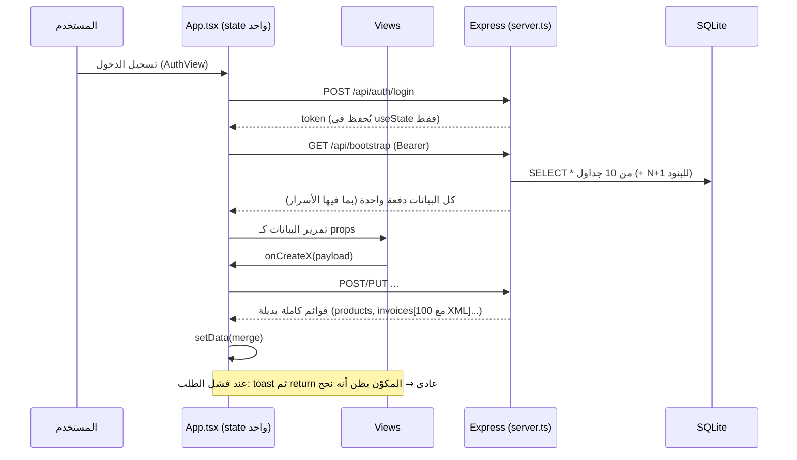
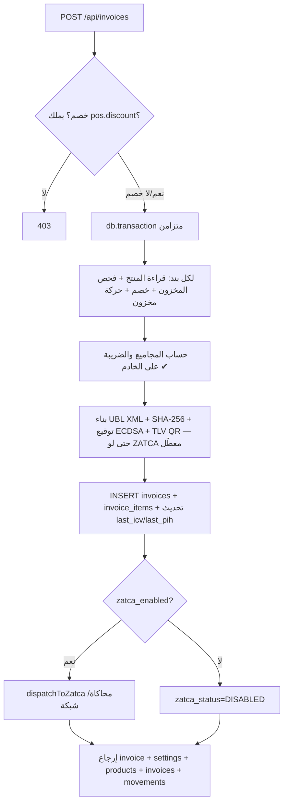

# تحليل المشروع الحالي — Mizan POS

> **الحالة:** مرحلة التحليل والتدقيق (R0) — لم يُعدَّل أي كود.
> **التاريخ:** 2026-11-24
> **النطاق المعتمد:** نظام لمطعم واحد (Single Restaurant)، **بدون** تكامل مع هيئة الزكاة (ZATCA) باستثناء QR محلي من المرحلة الأولى على الإيصال، استضافة **Hostinger Business**، وتأجيل التحول إلى SaaS لمشروع لاحق.
> **وثائق مرتبطة:** [DATABASE_AUDIT.md](DATABASE_AUDIT.md) · [SECURITY_AUDIT.md](SECURITY_AUDIT.md) · [ARCHITECTURE.md](ARCHITECTURE.md) · [REFACTORING_ROADMAP.md](REFACTORING_ROADMAP.md) · [SAAS_ARCHITECTURE.md](SAAS_ARCHITECTURE.md)

---

## 0. الملخص التنفيذي

Mizan POS نظام كاشير متكامل وُلِد كقالب من Google AI Studio وبُني كنظام **تجزئة/سوبرماركت** (باركود، تواريخ صلاحية، موردون، مشتريات) مع وحدة فوترة إلكترونية تحاكي ZATCA. يعمل النظام، وواجهته غنية ومدروسة (عربي/إنجليزي، RTL، طباعة حرارية 58/80mm وA4)، لكن **بنيته الحالية غير جاهزة للتسليم التجاري**:

| المحور | التقييم | الخلاصة |
|---|---|---|
| الوظائف | 🟢 جيد | تغطية واسعة: بيع، مرتجعات، مخزون، مشتريات، سندات، 25 تقريراً، مستخدمون وأدوار |
| المعمارية | 🔴 ضعيف | ملف خادم واحد 2,021 سطراً، مكونات واجهة تصل إلى 3,206 سطراً، لا طبقات |
| الأمان | 🔴 حرج | تسجيل مفتوح للجميع + تسريب كامل للبيانات والأسرار لأي مستخدم مسجّل |
| صحة البيانات | 🔴 حرج | التقارير المالية تُحسب من آخر 100 فاتورة فقط؛ ترقيم هش؛ بيانات تجريبية تعود تلقائياً |
| قاعدة البيانات | 🟠 ضعيف | SQLite بلا فهارس ولا FKs كافية، المبالغ REAL، ترحيلات يدوية |
| الاختبارات | 🔴 معدوم | لا توجد اختبارات ولا CI ولا ESLint، وTypeScript غير صارم |
| الجاهزية للاستضافة | 🔴 مانع | Hostinger يمسح مجلد التطبيق عند كل نشر ⇒ ملف SQLite سيُحذف |
| ملاءمة المطعم | 🟠 فجوة | لا وصفات ولا وحدات قياس ولا كميات عشرية |

**أخطر خمس مشكلات** (التفاصيل في الوثائق المرتبطة):
1. **أي شخص يستطيع إنشاء حساب** والوصول إلى كل البيانات (`server.ts:84-149`).
2. **`/api/bootstrap` يرسل كل شيء لكل دور** بما فيه الإعدادات بمفاتيحها السرية (`server.ts:233-248`، `src/server/db.ts:826-830`).
3. **التقارير المالية خاطئة** بمجرد تجاوز 100 فاتورة (`src/server/db.ts:850-894` + `ReportsCenterView.tsx:414-2312`).
4. **قاعدة البيانات ستُمسح** عند أول إعادة نشر على Hostinger (`src/server/db.ts:30-36`).
5. **فشل الدفع يفرّغ سلة الكاشير** (`App.tsx:300-303` + `PosTerminalView.tsx:268-283`).

---

## 1. نطاق التحليل والمنهجية

- **ما تمت قراءته بالكامل:** `server.ts`، `src/server/db.ts`، `src/server/zatca.ts`، `src/types.ts`، `src/permissions.ts`، `src/App.tsx`، وجميع المكونات الـ12 في `src/components/`، وملفات الإعداد (`package.json`، `tsconfig.json`، `vite.config.ts`، `.env.example`، `.gitignore`، `metadata.json`، `index.html`)، وسجل git، وملفات `data/` المرفوعة.
- **المصادر الخارجية:** صفحات الدعم الرسمية لـ Hostinger حول حدود Node.js وطريقة النشر وقاعدة البيانات (MariaDB).
- **ما لم يُنفَّذ:** لم تُثبَّت الحزم (`node_modules` غير موجود في المستودع)، لذلك **لم يُشغَّل** `tsc` أو `vite build` للحصول على خط أساس؛ هذا أول بند في المرحلة R1.
- **خارج النطاق:** `d:\React\LaunchFolio` — موقع Portfolio شخصي مستقل (مستودع git منفصل) لا يشارك أي كود مع النظام. انظر §17.

---

## 2. نظرة عامة على النظام

### 2.1 الوحدات الوظيفية الحالية

| الوحدة | الملفات الرئيسية | ماذا تفعل |
|---|---|---|
| المصادقة | `AuthView.tsx`, `server.ts:79-230` | تسجيل/دخول، أول مستخدم يصبح مديراً، جلسات 24 ساعة |
| نقطة البيع | `PosTerminalView.tsx` | شبكة أصناف، باركود، سلة، خصم، دفع نقدي/شبكة/مختلط، تعليق الطلبات، B2B/B2C |
| المبيعات والعملاء | `SalesView.tsx` | سجل الفواتير، تحليلات، إصدار فاتورة من الإدارة، إشعارات دائنة، إدارة العملاء، تصدير CSV |
| المخزون | `InventoryView.tsx` | الأصناف، الأسعار، حركات المخزون، التوريد/التسوية |
| المشتريات والموردون | `PurchasesView.tsx` | فواتير شراء، موردون، سداد آجل/جزئي |
| التقارير والسندات | `ReportsCenterView.tsx` | 25 تقريراً في 7 فئات + سندات قبض/صرف + تسجيل الهالك |
| الإعدادات | `InvoicesSettingsView.tsx` | بيانات المنشأة، الطابعة، حجم الخط، عدد الصفوف |
| المستخدمون والصلاحيات | `UsersPermissionsView.tsx`, `permissions.ts` | RBAC بـ16 صلاحية و4 أدوار افتراضية + أدوار مخصصة |
| الإيصالات | `InvoiceReceiptModal.tsx`, `QrCodeCanvas.tsx` | معاينة وطباعة حرارية/A4، QR، تنزيل XML |
| صفحة الفاتورة العامة | `PublicInvoicePage.tsx` | عرض الفاتورة عبر `/i/:uuid` بدون دخول |
| مركز ZATCA | `ZatcaCenterView.tsx`, `src/server/zatca.ts` | **محاكاة** للربط مع الهيئة — **سيُزال بالكامل** (انظر §15) |

### 2.2 الأصل والتوجه
- الحزمة اسمها `react-example` ووُلِّدت من **Google AI Studio** (`metadata.json`، تعليقات `vite.config.ts:12-14, 37-41`، `.env.example`).
- البيانات الافتراضية بقالة سعودية (حليب، أرز، تمور...) بأرقام ضريبية وهمية، وموردون بأسماء علامات تجارية حقيقية.
- سجل git يُظهر أنه أُضيف ثم حُذف **مُولِّد Laravel** كاملاً (`16836c1`: حذف 1,394 سطراً من `laravelGenerator.ts`).

---

## 3. التقنيات والإصدارات

| الطبقة | التقنية | الإصدار (package.json) | ملاحظات |
|---|---|---|---|
| لغة | TypeScript | ^7.0.2 | **بدون `strict`** في `tsconfig.json` |
| واجهة | React / React DOM | ^19.0.1 | بلا Router، بلا StrictMode، بلا Error Boundary |
| أداة البناء | Vite | ^8.3.0 | يُستخدم كـ middleware داخل Express في التطوير |
| CSS | Tailwind CSS | ^4.3.3 | عبر `@tailwindcss/vite` |
| أيقونات/حركة | lucide-react / motion | ^0.546 / ^12.23 | |
| خادم | Express | ^4.21.2 | Express 4 لا يلتقط أخطاء الدوال async |
| قاعدة بيانات | better-sqlite3 | ^13.2.0 | متزامنة (sync)، وحدة native |
| QR | qrcode | ^1.5.4 | |
| تشغيل التطوير | tsx | ^4.21 | `npm run dev` → `tsx server.ts` |
| حزم الخادم للإنتاج | esbuild | ^0.25 | `server.ts` → `server.js` |
| **غير مستخدم** | @google/genai | ^2.4.0 | لا يُستورد في أي ملف |
| مدير الحزم | — | — | يوجد `bun.lock` بينما السكربتات تفترض npm؛ لا يوجد `engines` |

---

## 4. بنية المشروع الحالية

```
POS-folios/                       (≈17,900 سطر TypeScript)
├── server.ts                     2,021  ← كل مسارات API + التحقق + منطق الأعمال + SQL
├── src/
│   ├── server/
│   │   ├── db.ts                 1,361  ← إنشاء الجداول + ترحيلات + بذور + استعلامات + جلسات + كلمات مرور
│   │   └── zatca.ts                609  ← XML + توقيع + TLV QR + محاكي الإرسال
│   ├── App.tsx                   1,221  ← الحالة العامة + 25 معالج API + التنقل + التخطيط
│   ├── components/
│   │   ├── ReportsCenterView.tsx 3,206  ← 25 تقريراً داخل useMemo واحد
│   │   ├── SalesView.tsx         1,702
│   │   ├── UsersPermissionsView  1,370
│   │   ├── PurchasesView.tsx     1,015
│   │   ├── PosTerminalView.tsx     861
│   │   ├── ZatcaCenterView.tsx     781  ← سيُحذف
│   │   ├── InventoryView.tsx       715
│   │   ├── InvoiceReceiptModal     689
│   │   ├── InvoicesSettingsView    626
│   │   ├── AuthView.tsx            421
│   │   ├── PublicInvoicePage       263
│   │   ├── TablePagination.tsx     152  ← المكوّن المشترك الوحيد
│   │   └── QrCodeCanvas.tsx         67
│   ├── types.ts 289 · permissions.ts 203 · i18n.ts 273 · index.css 60 · main.tsx 5
├── data/  mizan-pos.db-wal, -shm  ← مرفوعة إلى git (تحتوي مفاتيح وبيانات مستخدمين)
└── vite.config.ts · tsconfig.json · package.json · bun.lock · .env.example · metadata.json
```

**الملاحظة الجوهرية:** نقاط القوة المعمارية الوحيدة هي مشاركة `types.ts` و`permissions.ts` بين الخادم والواجهة. ما عدا ذلك لا توجد طبقات (Controllers/Services/Repositories) ولا مكونات واجهة مشتركة.

---

## 5. تدفق البيانات

### 5.1 التحميل والتحديث (النمط الحالي)



### 5.2 عملية البيع (Checkout)



---

## 6. جرد واجهات API (36 مساراً)

> لا توجد أي مسارات GET لقوائم الأعمال؛ كل القراءة تتم عبر `/api/bootstrap`.

| # | Method | المسار | الصلاحية على الخادم | ملاحظات |
|---|---|---|---|---|
| 1 | GET | `/api/public/invoices/:uuid` | عام | بلا rate limit؛ يكشف `customer_vat` |
| 2 | GET | `/api/auth/status` | عام | يكشف إن كان النظام مهيأً |
| 3 | POST | `/api/auth/register` | **عام** | 🔴 مفتوح دائماً؛ أول مستخدم = admin |
| 4 | POST | `/api/auth/login` | عام | بلا rate limit، scrypt متزامن |
| 5 | GET | `/api/auth/me` | مصادَق | غير مستخدم في الواجهة |
| 6 | POST | `/api/auth/logout` | مصادَق | |
| 7 | GET | `/api/bootstrap` | **مصادَق فقط** | 🔴 يعيد كل البيانات لكل دور |
| 8-11 | GET/POST/PUT/DELETE | `/api/users[/:id]` | users.manage | حذف نهائي للمستخدم |
| 12-15 | GET/POST/PUT/DELETE | `/api/roles[/:id]` | users.manage | |
| 16 | POST | `/api/vouchers` | vouchers.manage | ترقيم بـ COUNT(*) |
| 17 | DELETE | `/api/vouchers/:id` | vouchers.manage | حذف نهائي لسند مالي |
| 18 | PUT | `/api/settings` | settings.manage | |
| 19-21 | POST | `/api/zatca/generate-keys`, `/onboard`, `/decode-qr` | zatca.manage | ستُحذف |
| 22-24 | POST/PUT/DELETE | `/api/products[/:id]` | inventory.manage | PUT بلا تحقق |
| 25 | POST | `/api/inventory/movement` | inventory.adjust | |
| 26-27 | POST/PUT | `/api/suppliers[/:id]` | purchases.manage | PUT بلا تحقق |
| 28-29 | POST | `/api/purchases`, `/api/purchases/:id/pay` | purchases.manage | |
| 30-31 | POST/PUT | `/api/customers[/:id]` | customers.manage | |
| 32-33 | POST/DELETE | `/api/carts/hold[/:id]` | pos.hold | |
| 34 | POST | `/api/invoices` | pos.access | 🟠 يقبل نوع المستند من العميل |
| 35 | POST | `/api/invoices/:id/retry` | zatca.manage | سيُحذف |
| 36 | POST | `/api/invoices/:id/credit-note` | sales.return | async بلا try/catch |

(المجموع 36 مساراً: 4 عامة، و32 تتطلب جلسة صالحة؛ منها 4 خاصة بـ ZATCA ستُحذف.)

**صلاحيات معرّفة لكن لا يفحصها الخادم أبداً:** `sales.view`، `inventory.view`، `purchases.view`، `reports.view` — تُخفي عناصر الواجهة فقط (`App.tsx:142-163`).

---

## 7. التدقيق المعماري (Architecture Audit)

| السؤال | الإجابة |
|---|---|
| هل الهيكلية مناسبة لحجم المشروع؟ | **لا.** نحو 18 ألف سطر موزعة على ملفات عملاقة؛ لا يوجد فصل بين النقل (HTTP) والمنطق والبيانات. الحجم يستدعي **Modular Monolith** منظماً، لا Microservices. |
| هل توجد مسؤوليات مختلطة؟ | **نعم، في كل مكان.** `server.ts` يجمع التوجيه والتحقق والحسابات المالية وSQL والتكامل الخارجي. `db.ts` يجمع المخطط والترحيلات والبذور والاستعلامات والجلسات وتشفير كلمات المرور. `App.tsx` يجمع الحالة العامة وطبقة API والتنقل والتخطيط. |
| هل يوجد تكرار في الكود؟ | **نعم، كثيف.** 14 نافذة Modal منسوخة يدوياً؛ منطق المجاميع والضريبة مكرر في 4 أماكن (`PosTerminalView:226-246`، `SalesView:356-370`، `PurchasesView:138-149`، الخادم)؛ قوالب الإيصال مكررة 3 مرات؛ 25 معالج fetch متشابه في `App.tsx`؛ نحو **1,000** تعبير `isAr ? … : …` بدلاً من القاموس. |
| هل توجد Dependencies غير ضرورية؟ | **نعم:** `@google/genai` غير مستخدم؛ `@types/*` و`@vitejs/plugin-react` و`vite` في `dependencies` بدلاً من `devDependencies`؛ ملف قفل bun مع سكربتات npm. |
| مشاكل Separation of Concerns؟ | **جوهرية:** منطق الأعمال المالي (التقارير، ميزان المراجعة، الأرباح، تقييم المخزون) يُحسب في **المتصفح**؛ الصلاحيات تُطبَّق في الواجهة فقط لعمليات القراءة؛ قواعد العمل مكررة ومتعارضة بين الشاشات (تعريف "المخزون المنخفض"، الذمم، قيمة المخزون، فترات التقارير). |

---

## 8. تدقيق الخادم (Backend Audit)

### 8.1 Controllers & Services
- لا توجد طبقات: كل مسار هو دالة مجهولة داخل `server.ts` تقرأ `req.body` وتنفذ SQL مباشرة.
- منطق إنشاء الفاتورة (≈280 سطراً، `server.ts:1452-1733`) ومنطق الإشعار الدائن (`server.ts:1771-1972`) متطابقان تقريباً ومنسوخان.

### 8.2 تنظيم Business Logic
- ✔ **جيد:** الخادم يعيد التسعير من قاعدة البيانات ولا يثق بأسعار العميل (`server.ts:1515-1540`)، ويفحص المخزون داخل transaction.
- ✘ **سيئ:** يقبل `invoice_type_code` من العميل (`server.ts:1458-1461`) فيمكن إنشاء "إشعار دائن" يُنقص المخزون بلا مرجع.
- ✘ يقبل فاتورة B2B بلا عميل (`server.ts:1500-1503`).
- ✘ الإشعار الدائن كامل فقط (لا مرتجع جزئي)، ويعيد كل الكميات للمخزون دائماً.
- ✘ التسوية المخزنية تقصّ الرصيد عند 0 لكنها تسجّل الكمية المطلوبة في الحركة (`server.ts:1076-1089`) ⇒ دفتر الحركات لا يطابق الرصيد.

### 8.3 Validation
- تحقق يدوي متفاوت: جيد في `register`/`users`/`vouchers`، **معدوم** في `PUT /api/products/:id` (`server.ts:1011-1047`)، `PUT /api/suppliers/:id`، `PUT /api/customers/:id` (أسعار NaN أو سالبة، `tax_category` نص حر).
- لا توجد مكتبة schemas (zod أو غيرها)، ولا تحقق من صيغة الرقم الضريبي (15 رقماً).

### 8.4 Authentication & Authorization
- ✔ scrypt مع salt و`timingSafeEqual` (`src/server/db.ts:983-1002`)، توكن 32 بايت عشوائي يُخزَّن كـ SHA-256 (`db.ts:1316-1333`)، إلغاء الجلسات عند تغيير كلمة المرور أو التعطيل (`server.ts:409-411`)، حماية "آخر مدير" (`server.ts:358-394`).
- ✘ التسجيل مفتوح للجميع، لا rate limit، `scryptSync` يحجب الـ event loop، الحد الأدنى لكلمة المرور 6، صلاحيات القراءة غير مطبقة. التفاصيل في [SECURITY_AUDIT.md](SECURITY_AUDIT.md).

### 8.5 Exception Handling
- لا يوجد error handler مركزي. Express 4 يلتقط الأخطاء المتزامنة فقط ويعرض **stack trace بصيغة HTML** خارج وضع الإنتاج.
- مساران async بلا try/catch: `retry` (`server.ts:1736`) و`credit-note` (`server.ts:1771`). أي استثناء فيهما = **unhandled rejection** ⇒ في Node ≥ 15 تنهار العملية.
- إذا فشل تحديث حالة ZATCA بعد حفظ الفاتورة، يُعاد 400 "Checkout failed" رغم أن الفاتورة حُفظت فعلاً ⇒ خطر تكرار البيع.

### 8.6 API Response Structure
- غير موحّد: أحياناً `{ error }`، وأحياناً `{ users, roles }`، وأحياناً `{ product, products, movements }`.
- كل عملية كتابة تعيد **قوائم كاملة** بدل المورد المتأثر (مثلاً checkout يعيد 100 فاتورة مع `xml_content` لكل منها).
- لا توجد ترقيم صفحات (pagination) ولا فلترة على الخادم ولا إصدار (versioning) للـ API.

### 8.7 Database Transactions
- ✔ عمليات البيع والشراء والحركة والتسجيل داخل `db.transaction` (متزامن ⇒ ذري فعلاً في SQLite).
- ✘ الترقيم بـ `COUNT(*)+1` (`server.ts:568-571`، `server.ts:1188-1190`) هش، ويتعارض مع الحذف ⇒ أرقام مكررة. التفاصيل في [DATABASE_AUDIT.md](DATABASE_AUDIT.md).

### 8.8 Logging
- لا يوجد أي logging سوى `console.log` عند الإقلاع (`server.ts:2014`). لا request logs، لا error logs، لا audit trail.

---

## 9. تدقيق الواجهة (Frontend Audit)

### 9.1 تنظيم المكونات
- لا توجد مكونات مشتركة سوى `TablePagination`. كل شاشة "مكوّن إله" (God Component) يحتوي تبويبات ونماذج ونوافذ داخلية.
- `ReportsCenterView.tsx` (3,206 سطراً): 25 تقريراً داخل **`useMemo` واحد** يحتوي `switch` بنحو 1,800 سطر (`ReportsCenterView.tsx:414-2312`).
- `InvoicesSettingsView` اسمه مضلل: حاوية للتقارير والإعدادات والمستخدمين مع 24 prop.

### 9.2 إدارة الحالة (State)
- حالة واحدة `data: BootstrapPayload` في `App.tsx` تُمرَّر بالـ props (prop drilling حتى مستويين).
- لا Context ولا مكتبة لإدارة بيانات الخادم؛ كل تحديث يستبدل مصفوفات كاملة.
- التوكن في `useState` فقط ⇒ **تحديث الصفحة يُخرج المستخدم**.

### 9.3 التواصل مع API
- `apiFetch` في `App.tsx:233-244` يضيف `Authorization` ويعالج 401. **لكن** المعالجات تستدعي `res.json()` قبل فحص `res.ok`، وعند الفشل تعرض toast ثم **ترجع بشكل طبيعي** ⇒ المكونات لا تعرف أن العملية فشلت:
  - فشل الدفع يمسح السلة (`PosTerminalView.tsx:268-283`).
  - فشل تعليق الطلب يعرض "تم التعليق" ويمسح السلة (`PosTerminalView.tsx:289-303`).
  - النوافذ تُغلق والنماذج تُمسح رغم رفض الخادم.
- `ZatcaCenterView` يتجاوز `apiFetch` باستدعاء `fetch` مباشر مع كل ضغطة مفتاح.

### 9.4 معالجة الأخطاء
- لا Error Boundary؛ أي استثناء في render يُسقط التطبيق بالكامل (`main.tsx` بدون StrictMode).
- `navigator.clipboard.writeText` بلا try/catch (يفشل على HTTP غير الآمن).
- إخفاقات صامتة: `handleCreateCustomer` و`handleUpdateProduct` و`handleGenerateKeys` و`handleRetryInvoice`.

### 9.5 الأداء
- كل الحسابات التحليلية تعمل على كامل المصفوفات عند كل تغيير مدخلات؛ بعض الأعمدة تحسب `filter().reduce()` لكل صف بلا memo (`PurchasesView.tsx:506-508`).
- قوائم منسدلة تعرض كل المنتجات والعملاء بلا بحث أو virtualization.
- لا code splitting؛ شاشة التقارير الضخمة تُحمَّل مع شاشة الكاشير.

### 9.6 قابلية إعادة الاستخدام والتكرار
- منطق مكرر **ومتعارض** (من تقرير الاستكشاف):

| المفهوم | أماكن التكرار | التعارض |
|---|---|---|
| المخزون المنخفض | `InventoryView:67-69` / `ReportsCenterView:1753` | أحدهما يستبعد النافد والآخر يشمله |
| الذمم الدائنة | `PurchasesView:106-109` / `ReportsCenterView:460` | أحدهما يقصّ عند الصفر |
| قيمة المخزون | `InventoryView:63-66` / `ReportsCenterView:483-486,1450` | الإجمالي يقصّ السالب والصفوف لا |
| فترات التقارير | `SalesView:213-227` / `ReportsCenterView:2327-2348` | "7 أيام" ≠ "الأسبوع"، وكلاهما UTC |
| تكلفة البضاعة المباعة | `SalesView:137-143` / `ReportsCenterView:432-436` | كلاهما يستخدم **التكلفة الحالية** لا تكلفة وقت البيع |

- لا قاموس ترجمة موحد: نحو 1,000 تعبير `isAr ? … : …` (485 في التقارير وحدها).
- 14 نافذة `fixed inset-0 z-50` منسوخة بلا Escape ولا focus trap ولا `role="dialog"`.
- لا تأكيد قبل إصدار إشعار دائن (مستند مالي غير قابل للتراجع) أو حذف سند.

---

## 10. تدقيق الأداء (Performance Audit)

| المشكلة | الموقع | الأثر | الحل المقترح |
|---|---|---|---|
| N+1 Queries | `getAllInvoices` و`getAllPurchases` (`src/server/db.ts:850-882`) | 101 استعلام لكل تحميل/عملية | JOIN أو `WHERE invoice_id IN (...)` |
| حمولات ضخمة | `xml_content` في كل قائمة فواتير؛ كل كتابة تعيد قوائم كاملة | بطء الشبكة والذاكرة | DTOs مختصرة + إرجاع المورد المتأثر فقط |
| تحميل كل شيء مقدماً | `/api/bootstrap` | زمن تحميل يتزايد مع البيانات | endpoints مقسمة مع pagination |
| تجميع في المتصفح | `ReportsCenterView.tsx:414-2312`، `SalesView.tsx:157-343` | خطأ في النتائج + بطء | تقارير SQL على الخادم |
| فهارس مفقودة | كل أعمدة FK | فحص كامل للجداول | انظر DATABASE_AUDIT |
| `scryptSync` | `src/server/db.ts:985, 995` | يحجب الخادم أثناء الدخول | `crypto.scrypt` غير متزامن |
| إعادة الحساب في render | تقارير ومبيعات | تقطيع الواجهة | حسابات على الخادم + memo مستهدف |
| لا Code Splitting | `App.tsx` | حزمة واحدة كبيرة | `React.lazy` لكل مسار |
| فرص التخزين المؤقت | الإعدادات تُقرأ في كل checkout | ضئيل حالياً | cache بسيط في الذاكرة مع إبطال عند التعديل |

---

## 11. جودة الكود (Code Quality)

- `tsconfig.json` **بدون `strict`**؛ تحويلات `as` كثيفة على نتائج SQL.
- لا ESLint ولا Prettier في هذا المستودع (سكربت `lint` هو `tsc --noEmit` فقط).
- سلاسل سحرية للأنواع: `'388'`، `'381'`، `'0100000'`، `'0200000'` منتشرة (فحص `invoice_type_code === '381'` يتكرر 19 مرة).
- قيم مُرمَّزة: "VAT (15%)" في الإيصالات رغم أن لكل صنف نسبته؛ شجرة حسابات ثابتة داخل التقرير (`ReportsCenterView.tsx:505-565`).
- كل التواريخ بتوقيت UTC (`toISOString().slice(0,10)`) ⇒ "اليوم" خاطئ بين 00:00 و03:00 بتوقيت الرياض.
- لا تعليقات توثيقية للمنطق المالي، ولا TODOs (لا دليل على ديون تقنية معروفة موثقة).

---

## 12. الاعتماديات والإعدادات

| البند | الحالة | التوصية |
|---|---|---|
| `@google/genai` | غير مستخدم | حذف |
| `@types/better-sqlite3`, `@types/qrcode` | في dependencies | نقل إلى devDependencies |
| `vite`, `@vitejs/plugin-react`, `@tailwindcss/vite` | في dependencies | devDependencies (يحتاجها البناء فقط) |
| `better-sqlite3` | native module | ستُستبدل بـ `mysql2` (MariaDB) في R3 |
| `bun.lock` مع سكربتات npm | تضارب | اعتماد npm + `package-lock.json` (Hostinger يدعم npm/yarn/pnpm) |
| `engines` | غير موجود | `"node": ">=22"` لمطابقة Hostinger |
| `.env.example` | `GEMINI_API_KEY`, `APP_URL` فقط | استبداله بمتغيرات حقيقية (DB, SESSION_SECRET, ...) مع تحقق zod |
| `vite.config.ts` plugin `copy-unbundled-src-assets` | ينسخ `src/assets` غير الموجود | حذف |
| `DISABLE_HMR` | خاص بـ AI Studio | حذف |
| `metadata.json` | خاص بـ AI Studio | حذف |
| `clean` script | `rm -rf` (لا يعمل على Windows) | `rimraf` أو سكربت Node |
| `.gitignore` | لا يستثني `data/` | إضافة `data/` و`*.db*` |

---

## 13. الاختبارات الحالية

**لا توجد اختبارات من أي نوع**، ولا إطار اختبار مثبت، ولا CI. أي Refactoring الآن بلا شبكة أمان؛ لذلك أول مهمة في R1 هي بناء **اختبارات توصيفية (Characterization Tests)** للـ API الحالي قبل تعديل السلوك.

---

## 14. فجوة التجزئة ⇄ المطعم

| الحاجة في المطعم | الوضع الحالي | الفجوة |
|---|---|---|
| أطباق تُباع ولا تُخزَّن | كل صنف له `stock_qty` | يلزم فصل "صنف قائمة" عن "صنف مخزني" |
| خصم المكونات حسب الوصفة | غير موجود | **مطلوب (نطاق معتمد)** |
| كميات عشرية (كجم، لتر) | `INTEGER` فقط | تغيير النوع إلى DECIMAL |
| وحدات قياس وتحويلها (كيس 5كجم ← 200جم) | غير موجود | جدول/حقول تحويل |
| تكلفة الطبق وهامش الربح | تكلفة ثابتة يدوية للصنف | تكلفة محسوبة من الوصفة + لقطة وقت البيع |
| هالك المكونات وجرد فعلي | تسوية عامة فقط | حركات هالك وجرد مخصصة |
| أسعار شاملة للضريبة (معتاد في المطاعم) | السعر قبل الضريبة | قرار مطلوب (الافتراضي المقترح: شامل) |
| الباركود والصلاحية | محور الواجهة | تصبح اختيارية للمكونات |

**خارج النطاق المعتمد:** الطاولات، تذاكر المطبخ، الإضافات (Modifiers).

---

## 15. أثر قرار إزالة ZATCA

النظام يبني XML ويوقّعه بالمفتاح الخاص **في كل عملية بيع حتى لو كان ZATCA معطلاً** (`server.ts:1581-1606`). الإزالة تمس **13 ملف TypeScript (≈380 موضعاً)** إضافة إلى وصف الصفحة في `index.html` و`metadata.json`:

| الملف | ما سيتأثر |
|---|---|
| `src/server/zatca.ts` | يُحذف، ويبقى منه `encodeTlvTag` + منشئ QR بخمسة حقول في ملف صغير جديد |
| `src/components/ZatcaCenterView.tsx` | يُحذف (781 سطراً) |
| `server.ts` | الاستيرادات (33-39)، مسارات `/api/zatca/*` (717، 740، 922) و`/retry` (1736)، كتل XML/التوقيع/الإرسال في البيع (1581-1606، 1685-1717) والإشعار الدائن (1833-1859، 1939-1962)، حقول الإعدادات (623-631، 689-691) |
| `src/server/db.ts` | أعمدة ZATCA في `organization_settings` و`invoices`، توليد المفاتيح عند الإقلاع (321)، XML في البذور (591-616) |
| `src/types.ts` | `ZatcaMode`, `ZatcaStatus`, `DecodedTlvTag` وحقول الإعدادات والفاتورة |
| `src/permissions.ts` | صلاحية `zatca.manage` |
| `src/App.tsx` | عنصر التنقل والقسم، `handleGenerateKeys`, `handleOnboardStep`, `handleRetryInvoice`, `zatcaEnabled` |
| `InvoiceReceiptModal.tsx` | منطق QR (66-76)، النصوص (285، 449، 583-587، 653-660) وعبارة "ZATCA Phase 1 & 2 Compliant" |
| `InvoicesSettingsView.tsx` | بطاقة حالة ZATCA (585-620) |
| `PosTerminalView.tsx`, `SalesView.tsx`, `PublicInvoicePage.tsx` | خاصية `zatcaEnabled` ونص زر الدفع؛ رموز `0100000/0200000` تُستبدل بـ `invoice_kind` |
| `src/i18n.ts` | نحو 20 مفتاح ترجمة |
| `index.html` | وصف الصفحة `description` و`og:description` (السطران 7 و9) يذكران ZATCA |
| `metadata.json` | الوصف يذكر ZATCA — الملف نفسه سيُحذف في R1.11 (من بقايا AI Studio) |

**ما يبقى:** QR محلي بخمسة حقول TLV (اسم البائع، الرقم الضريبي، الوقت، الإجمالي، الضريبة) على الإيصال المبسّط — بلا أي اتصال حكومي. **يُرجى تأكيد المتطلب النظامي مع المحاسب.**

---

## 16. الملاءمة مع استضافة Hostinger Business

| قيد المنصة (من صفحات Hostinger الرسمية) | الوضع الحالي | الأثر |
|---|---|---|
| مجلد التطبيق `hbuilds/` يُستبدل عند كل نشر | SQLite في `./data` | 🔴 **فقدان البيانات** — الانتقال إلى MariaDB إلزامي |
| قاعدة البيانات المتاحة MariaDB | SQLite | ترحيل في R3 |
| لا WebSockets واردة | غير مستخدمة | ✔ لا أثر |
| لا Background Workers / مؤقتات دائمة | لا توجد | ✔ — المهام الدورية تصبح Cron |
| مهلة الطلب 120 ثانية | لا عمليات طويلة | ✔ مع مراقبة التقارير |
| لا منافذ مخصصة | `PORT` من البيئة | ✔ يلزم التحقق عند النشر |
| البناء والتثبيت يتمان على Hostinger | `npm run build` يبني الواجهة والخادم | ✔ مع ضبط Entry file = `server.js` |
| وحدات native غير مذكورة في التوثيق | `better-sqlite3` native | خطر — يزول بالانتقال إلى `mysql2` |
| 2 CPU / 3GB RAM / NPROC 120 | خادم Node واحد | ✔ كافٍ لمطعم واحد |

---

## 17. نقاط القوة (يجب الحفاظ عليها)

1. استعلامات SQL **مُعامَلة بالكامل** (prepared statements) — لم يُعثر على SQL Injection.
2. تشفير كلمات المرور بـ scrypt + salt + مقارنة آمنة زمنياً.
3. توكنات جلسة عشوائية تُخزَّن مُجزّأة، وتُلغى عند تغيير كلمة المرور أو التعطيل.
4. RBAC على الخادم لعمليات الكتابة، مع حماية آخر مدير ومنع حذف/تعطيل الذات.
5. عملية البيع داخل transaction، مع إعادة التسعير من قاعدة البيانات وفحص المخزون.
6. ترميز (escaping) صحيح لـ XML وHTML الطباعة؛ لا `dangerouslySetInnerHTML`.
7. مشاركة الأنواع والصلاحيات بين الخادم والواجهة.
8. واجهة ثنائية اللغة RTL، وضع ليلي، طباعة حرارية 58/80mm وA4، اختصارات لوحة مفاتيح للكاشير.
9. حذف ناعم (soft delete) للأصناف، ولقطات أسماء/أسعار الأصناف داخل بنود الفواتير (حفظ تاريخي صحيح).
10. معرّف الفاتورة العامة UUID v4 عشوائي (لا يمكن تخمينه).

---

## 18. فهرس المشكلات (مرجع موحد)

| ID | الخطورة | المشكلة | التفاصيل | المهمة |
|---|---|---|---|---|
| C1 | Critical | قاعدة البيانات تُمسح عند النشر على Hostinger | §16، DATABASE_AUDIT | R3 |
| C2 | Critical | تسجيل مفتوح للجميع | SECURITY_AUDIT SEC-01 | R1.2 |
| C3 | Critical | صلاحيات القراءة غير مطبقة + bootstrap يكشف كل شيء والأسرار | SEC-02, SEC-03 | R1.3 |
| C4 | Critical | التقارير المالية تُحسب من بيانات مقتطعة (LIMIT 100) | DB-07 | R1.3 (تخفيف) + R6.1 |
| H1 | High | فشل الدفع/التعليق يفرّغ السلة | §9.3 | R1.6 |
| H2 | High | الخادم يقبل نوع المستند من العميل + B2B بلا عميل | SEC-09 | R1.5 |
| H3 | High | ادعاءات امتثال مضللة + توقيع XML دائم | SEC-21 | R1.4 |
| H4 | High | بذور تجريبية في الإنتاج وتعود تلقائياً | DB-04 | R1.7 |
| H5 | High | ترقيم بـ COUNT(*) + حذف نهائي | DB-03 | R1.8 |
| H6 | High | لا سجل تدقيق ولا مُنشئ للمستندات | SEC-16 | R3.4 |
| H7 | High | ضعف المصادقة (rate limit، scrypt متزامن، 6 أحرف، الجلسة في الذاكرة) | SEC-05..07, SEC-18 | R1.9 + R4.3 |
| H8 | High | أخطاء async قد تُسقط العملية | SEC-08 | R1.5 + R2.1 |
| H9 | High | الأرباح بتكلفة اليوم لا بتكلفة البيع | DB-09 | R3.2 + R5.3 |
| H10 | High | بنية متجانسة بلا اختبارات ولا CI | §7، §13 | R1.1 + R2 + R4 |
| H11 | High | ملف WAL بمفاتيح وبيانات مستخدمين في git | SEC-04 | R1.7 |

---

## 19. ملاحظة حول LaunchFolio

`d:\React\LaunchFolio` موقع شخصي من صفحة واحدة (Vite + React، JSX بلا TypeScript)، مستودع git مستقل (`github.com/mozamil41e/LaunchFolio`)، لا يشارك أي شيء مع Mizan POS. ملاحظات سريعة للعلم فقط: ملف `i.html` نموذج HTML أولي متروك، تحميل Tailwind عبر CDN التجريبي، سكربت في `index.html` يعمل قبل تحميل React فيفشل، استخدام `class=` بدل `className` في `Nav.jsx` و`Footer.jsx`، ومجلد باسم `Navdar` (خطأ إملائي). **خارج نطاق هذا المشروع.**
