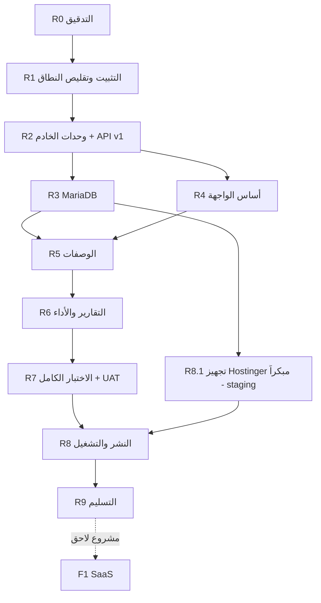

# خطة إعادة الهيكلة والتنفيذ — Mizan POS

> **الحالة:** خطة مقترحة للمراجعة والاعتماد. **لم يبدأ أي تنفيذ.**
> **الهدف:** تسليم نظام لمطعم واحد على Hostinger Business — صحيح مالياً، آمن، مختبَر، قابل للصيانة — ثم (لاحقاً وكمشروع منفصل) التحول إلى SaaS.
> **مرتبط:** [PROJECT_ANALYSIS.md](PROJECT_ANALYSIS.md) · [SECURITY_AUDIT.md](SECURITY_AUDIT.md) · [DATABASE_AUDIT.md](DATABASE_AUDIT.md) · [ARCHITECTURE.md](ARCHITECTURE.md) · [SAAS_ARCHITECTURE.md](SAAS_ARCHITECTURE.md)

---

## 1. قواعد التنفيذ

### 1.1 بوابة الموافقة (إلزامية لكل مهمة)
قبل تنفيذ أي مهمة تمس الكود:
1. **مراجعة المتطلب** ومقارنته بالهيكلية والكود الحاليين.
2. **تحديد الأثر:** الملفات والدوال/المسارات/الجداول المتأثرة.
3. **عرض ملخص واضح** للتعديلات المقترحة والمخاطر وخطة الاختبار.
4. **انتظار موافقة صريحة** من صاحب المشروع (الموافقة على مهمة لا تشمل غيرها).
5. **التنفيذ** على فرع مستقل.
6. **التحقق بالاختبارات** وعرض النتائج الفعلية (بما فيها الإخفاقات إن وجدت).
7. **تقرير** موجز بما أُنجز وما تبقى.

### 1.2 القواعد الهندسية
- لا إعادة كتابة شاملة بلا مبرر؛ لا كسر للوظائف الحالية؛ لا حذف قبل فهم الأثر وتوثيقه.
- تغييرات تدريجية صغيرة قابلة للمراجعة؛ فصل منطق الأعمال عن العرض.
- لا Overengineering ولا أنماط بلا حاجة؛ SOLID حيث يفيد.
- اختبارات للوظائف المهمة **قبل** تعديل سلوكها.
- مراجعة أثر كل تغيير على القاعدة والـ API والواجهة.
- لا ترحيل مدمّر بلا نسخة احتياطية وخطة تراجع وموافقة.
- **كل مرحلة تنتهي بتقرير** في `docs/reports/RX-report.md` (المنجز، الاختبارات ونتائجها، المشكلات المتبقية).

### 1.3 مقاييس الحجم
S = حتى يوم عمل · M = 2–4 أيام · L = أسبوع تقريباً · XL = أكثر من أسبوع. (تقديرات نسبية للتخطيط، ليست التزاماً زمنياً.)

---

## 2. نظرة عامة على المراحل

| المرحلة | الاسم | دورة الحياة | الأولوية | الحجم | مانعة للإطلاق؟ |
|---|---|---|---|---|---|
| R0 | الفهم والتدقيق (هذه الوثائق) | Understand + Audit | — | — | — |
| **R1** | التثبيت وتقليص النطاق | Stabilize | Critical | L | ✅ |
| **R2** | تقسيم الخادم إلى وحدات + API v1 | Refactor | High | XL | ✅ |
| **R3** | الانتقال إلى MariaDB | Refactor | Critical | L | ✅ |
| **R4** | أساس الواجهة | Refactor | High | XL | ✅ |
| **R5** | مجال المطعم: المخزون بالوصفات | Refactor (ميزة) | High | XL | ✅ |
| **R6** | التقارير على الخادم والأداء | Refactor | Critical | L | ✅ |
| **R7** | استراتيجية الاختبار الكاملة + UAT | Test | High | L | ✅ |
| **R8** | النشر والتشغيل على Hostinger | Deploy & Operate | Critical | M | ✅ |
| **R9** | التسليم | Deploy & Operate | High | M | ✅ |
| F1 | التحول إلى SaaS | SaaS Transformation | — | — | مشروع لاحق |
| F2 | تكامل ZATCA الحقيقي (اختياري) | — | — | — | مشروع لاحق |

**تغيير الترتيب عن المقترح الأصلي ومبرراته:**
- **API Standardization دُمج في R2** لأن كل مسار سيُعاد كتابته مرة واحدة أثناء التقسيم.
- **قاعدة البيانات بعد تقسيم الخادم (R3 بعد R2):** الـ transactions المتزامنة لـ better-sqlite3 مكتوبة داخل نحو 30 معالجاً؛ تبديل المحرك قبل عزلها خلف Repositories يعني إعادة كتابتها مرتين.
- **فصل "تبديل المحرك" (R3) عن "تغيير المجال" (R5):** متغير واحد في كل مرة — نفس الاختبارات تثبت أن MariaDB تعطي نفس السلوك، ثم ننتقل لنموذج المطعم.
- **الاختبارات ليست مرحلة متأخرة فقط:** شبكة الأمان تبدأ في R1.1، وR7 يكمل الاستراتيجية.
- **SaaS والفوترة خارج هذا المشروع** بقرار صاحب المشروع.

---

## 3. R1 — التثبيت وتقليص النطاق (Stabilize)

**الهدف:** إغلاق الثغرات الحرجة، تصحيح الأخطاء التي تفقد البيانات أو تضلل، إزالة ZATCA، وبناء شبكة أمان — **بأقل تعديل ممكن على البنية الحالية** (SQLite باقٍ مؤقتاً).

**ترتيب التنفيذ داخل R1** (يختلف عن الترقيم بسبب الاعتماديات):
`R1.1 → R1.2 → R1.3 → R1.5 → R1.8 → R1.4 → R1.6 → R1.7 → R1.9 → R1.10 → R1.11 → R1.12`
(R1.4 إزالة ZATCA تعتمد على R1.8 لأن رقم الفاتورة الحالي مشتق من عدّاد ZATCA `last_icv`.)

### R1.1 شبكة الأمان والأدوات
| الحقل | التفاصيل |
|---|---|
| المشكلة | لا اختبارات، لا CI، لا ESLint، الحزم غير مثبتة، لا خط أساس للبناء والأنواع |
| السبب | المشروع مولَّد من قالب AI Studio دون بنية هندسية |
| الحل | اعتماد npm؛ تثبيت الحزم؛ تسجيل خط الأساس (`tsc`, `vite build`)؛ جعل الخادم قابلاً للاختبار (تصدير `app` وعدم `listen` عند الاستيراد، ومسار القاعدة من `DB_PATH`)؛ اختبارات توصيفية بـ Vitest + Supertest؛ ESLint؛ GitHub Actions |
| الملفات | `package.json`، `server.ts` (التصدير وحارس `listen`)، `src/server/db.ts:30-36` (`DB_PATH`)، جديد: `vitest.config.ts`، `tests/api/*.test.ts`، `eslint.config.js`، `.github/workflows/ci.yml`، حذف `bun.lock` |
| التغييرات | لا تغيير في السلوك؛ فقط قابلية الاختبار والأدوات |
| المخاطر | `tsc` قد يكشف أخطاء ⇒ تسجيلها كخط أساس لا إصلاحها الآن (النتيجة الفعلية: 0 أخطاء، وTS 7 يعمل بوضع strict افتراضياً)؛ اختلاف سلوك npm عن bun في الإصدارات |
| الأولوية | Critical (مُمكِّن لكل ما بعده) |
| الاختبارات | ≥ 25 اختباراً توصيفياً: التسجيل/الدخول/الخروج/me، شكل bootstrap، البيع (المجاميع، خصم المخزون، نقص المخزون، الخصم بلا صلاحية)، الإشعار الدائن، الشراء والسداد، السند، مصفوفة صلاحيات الكتابة |
| معايير القبول | `npm ci && npm run lint && npm run typecheck && npm test && npm run build` تنجح محلياً وفي CI؛ تقرير خط الأساس في `docs/reports/R1-baseline.md` |

### R1.2 إغلاق التسجيل المفتوح (SEC-01)
| الحقل | التفاصيل |
|---|---|
| المشكلة | أي زائر ينشئ حساباً ويصل لكل البيانات؛ أول من يسجّل في تثبيت جديد يصبح مديراً |
| السبب | `POST /api/auth/register` عام دائماً (`server.ts:84-149`) |
| الحل | التسجيل مسموح فقط إذا لم يوجد أي مستخدم، ويشترط `SETUP_TOKEN` من البيئة إن وُجد؛ بعدها 403؛ الواجهة تعرض "إعداد أول" فقط عند `hasUsers=false`؛ سكربت طوارئ لإنشاء مدير |
| الملفات | `server.ts:79-149`، `src/components/AuthView.tsx`، جديد: `scripts/create-admin.ts` |
| التغييرات | سلوك جديد: لا تسجيل ذاتي بعد الإعداد الأول |
| المخاطر | فقدان الوصول إذا عُطّل كل المدراء ⇒ سكربت الطوارئ |
| الأولوية | Critical |
| الاختبارات | التسجيل مع وجود مستخدمين ⇒ 403؛ الإعداد الأول ينشئ مديراً؛ رمز إعداد خاطئ ⇒ 403 |
| معايير القبول | لا يمكن إنشاء أي حساب دون مدير بعد الإعداد الأول؛ الاختبارات تمر |
| الحالة | ✅ **منجز** على فرع `r1/close-registration` (2026-11-24): `POST /api/auth/register` للإعداد الأول فقط (فحص داخل الـ transaction)، `SETUP_TOKEN` اختياري يُفرض عند ضبطه، شاشة الدخول بلا تسجيل ذاتي، سكربت `npm run admin:create`؛ 75 اختباراً ناجحاً. **قبل الدمج في `main`:** ضبط `SETUP_TOKEN` في hPanel |

### R1.3 صلاحيات القراءة على الخادم + DTO الإعدادات (SEC-02، SEC-03، C4)
| الحقل | التفاصيل |
|---|---|
| المشكلة | bootstrap يعيد كل البيانات والأسرار لكل دور؛ صلاحيات `*.view` غير مطبقة |
| السبب | `/api/bootstrap` بلا فحص (`server.ts:233-248`)؛ `getOrganizationSettings` = `SELECT *` (`db.ts:826`) |
| الحل | `getPublicSettings()` بقائمة سماح تُستخدم في **كل** استجابة تتضمن الإعدادات؛ bootstrap يبني الحمولة حسب الصلاحيات (المنتجات لمن يملك pos/inventory، المشتريات والموردون لـ purchases.*، الفواتير لـ sales.view/reports.view، السندات لـ vouchers/reports، الحركات لـ inventory/reports)؛ إخفاء `cost_price` عمّن لا يملك صلاحية تكلفة |
| الملفات | `server.ts:233-248` وكل مسار يعيد `settings`، `src/server/db.ts:826-830`، `src/types.ts` (`BootstrapPayload` حقول اختيارية)، `src/App.tsx` (التعامل مع الحقول الغائبة) |
| التغييرات | حمولة bootstrap تختلف حسب الدور |
| المخاطر | شاشات تفترض وجود مصفوفات ⇒ قيم افتراضية `?? []` واختبارها |
| الأولوية | Critical |
| الاختبارات | كاشير لا يستلم purchases/vouchers/suppliers/cost_price؛ لا أي حقل سري في أي استجابة (اختبار يبحث عن `private_key`/`secret` في كل الاستجابات) |
| معايير القبول | مصفوفة (دور × حقل) مطابقة للتصميم؛ صفر أسرار في الاستجابات |
| الحالة | ✅ **منجز** على فرع `r1/read-permissions` (2026-11-24): قواعد `DATA_VISIBILITY` و`COST_VIEW_PERMISSIONS` في `src/permissions.ts`؛ `src/server/visibility.ts` (`scopeForUser`، `toPublicSettings`)؛ bootstrap و16 استجابة مُرشَّحة؛ التكلفة والربح مخفيان عن الكاشير (D11)؛ 83 اختباراً ناجحاً |
| ملاحظة C4 | التقارير المقتطعة (LIMIT 100) **لا أثر إنتاجي لها الآن** (البيانات تجريبية)؛ الإصلاح الحقيقي R6.1 **مانع للإطلاق**؛ يُضاف اختبار يوثق القيد الحالي |

### R1.4 إزالة تكامل ZATCA مع الإبقاء على QR المرحلة الأولى (H3، SEC-03/12/15/21)
| الحقل | التفاصيل |
|---|---|
| المشكلة | كود محاكاة يطبع ادعاء امتثال غير صحيح، ويوقّع كل فاتورة بمفتاح خاص مخزّن، ويكشف أسراراً؛ خارج النطاق المعتمد |
| السبب | قالب أصلي موجه للامتثال |
| الحل | حذف المركز والمسارات والتوقيع وXML والتسلسل والإعدادات؛ استبدال QR بـ TLV من 5 حقول (اسم البائع، الرقم الضريبي، الوقت، الإجمالي، الضريبة)؛ تحويل رموز ZATCA إلى قيم مجال (`invoice_kind`, `document_type`) |
| الملفات | حذف `src/components/ZatcaCenterView.tsx` و`src/server/zatca.ts` (يبقى `src/server/vatQr.ts` ≈40 سطراً)؛ `server.ts` (33-39، 717-930، 1581-1606، 1685-1717، 1736-1768، 1833-1859، 1939-1962، 623-631، 689-691)؛ `src/server/db.ts` (أعمدة ZATCA، 321، 591-616)؛ `src/types.ts`؛ `src/permissions.ts` (`zatca.manage`)؛ `src/App.tsx`؛ `InvoiceReceiptModal.tsx`؛ `InvoicesSettingsView.tsx` (585-620)؛ `PosTerminalView.tsx`؛ `SalesView.tsx`؛ `PublicInvoicePage.tsx`؛ `src/i18n.ts`؛ `index.html` (وصف الصفحة 7، 9) |
| التغييرات | الإيصال يحمل QR بخمسة حقول؛ لا شاشة ZATCA؛ القاعدة التجريبية تُعاد تهيئتها بعد نسخة احتياطية (الأعمدة تُحذف من تعريف الجداول) |
| المخاطر | كسر الطباعة أو صفحة الفاتورة العامة؛ نسيان مواضع ⇒ Grep للتحقق (13 ملف TS/TSX ≈380 موضعاً + `index.html` + `metadata.json`) |
| الأولوية | High |
| الاختبارات | وحدة: QR يُفك إلى 5 حقول صحيحة (اختبار round-trip)؛ API: البيع لا ينتج XML ولا hash؛ Grep: صفر مواضع لـ `zatca|csid|xml_content|private_key` في `src/` و`server.ts` |
| معايير القبول | التطبيق يعمل بلا أي كود ZATCA؛ الإيصال 58/80/A4 يطبع مع QR صالح؛ لا نص "Compliant"؛ الاختبارات تمر |
| الحالة | ✅ **منجز** على فرع `r1/remove-zatca` (2026-11-24): حُذف `zatca.ts` و`ZatcaCenterView.tsx` و4 مسارات وصلاحية `zatca.manage`؛ البيع والإشعار الدائن بلا XML/توقيع/ICV/PIH؛ QR الإيصال = رابط الفاتورة العامة (D1، D8)؛ صفحة الفاتورة العامة تُطبع بعرض كامل من الهاتف؛ ترحيل D13-أ (نسخة احتياطية تلقائية + إعادة بناء `invoices` + حذف أعمدة الإعدادات) مُختبر على قاعدة بالمخطط القديم؛ 114 اختباراً ناجحاً |
| يعتمد على | R1.8 (مصدر رقم الفاتورة) |
| قرار مطلوب | الإبقاء على رابط الفاتورة العامة `/i/:uuid` كزر "نسخ/مشاركة" فقط؟ |

### R1.5 أخطاء async وصحة البيع والإشعار الدائن (H2، H8، SEC-08/09/10)
| الحقل | التفاصيل |
|---|---|
| المشكلة | معالجات async قد تُسقط العملية؛ stack traces مكشوفة؛ `/api/invoices` يقبل 381/383؛ فاتورة B2B بلا عميل؛ رد "فشل" رغم حفظ الفاتورة |
| السبب | Express 4 + غياب error handler + ثقة بمدخلات العميل |
| الحل | `asyncHandler` لكل المعالجات async؛ error middleware يعيد JSON موحداً ويسجّل التفاصيل؛ `/api/invoices` يُنشئ فواتير بيع فقط؛ التحقق من عميل الفاتورة الضريبية؛ فصل "حفظ الفاتورة" عن الخطوات اللاحقة بحيث لا يُعاد خطأ بعد الحفظ |
| الملفات | `server.ts` (1452-1733، 1736-1768، 1771-1972، نهاية الملف للـ middleware) |
| التغييرات | رموز خطأ أوضح؛ رفض أنواع مستندات غير مسموحة (400) |
| المخاطر | منخفضة؛ الواجهة لا ترسل 381 أصلاً |
| الأولوية | High |
| الاختبارات | خطأ داخل الإشعار الدائن ⇒ 500 JSON والعملية تبقى حية؛ إرسال 381 ⇒ 400؛ B2B بلا عميل ⇒ 400؛ لا HTML stack في أي استجابة |
| معايير القبول | لا unhandled rejection في سجلات الاختبار؛ كل الأخطاء JSON |
| الحالة | ✅ **منجز** على فرع `r1/error-handling` (2026-11-24): `asyncHandler` على 4 مسارات async؛ معالج أخطاء مركزي (JSON بلا stack: `INVALID_JSON` 400، `PAYLOAD_TOO_LARGE` 413، `INTERNAL` 500)؛ شبكة أمان `unhandledRejection`؛ البيع لفواتير 388 فقط؛ B2B يتطلب عميلاً موجوداً برقم ضريبي صحيح (D12) مع فحص مسبق في الواجهة؛ لا "فشل" بعد حفظ الفاتورة؛ أكواد الأعمال المعروفة فقط تمر كـ 400؛ 93 اختباراً ناجحاً |

### R1.6 عقد العمليات في الواجهة وسلامة الكاشير (H1)
| الحقل | التفاصيل |
|---|---|
| المشكلة | فشل الدفع يمسح السلة؛ فشل التعليق يعرض نجاحاً؛ النوافذ تُغلق رغم الرفض؛ نقر مزدوج يكرر العمليات؛ لا تأكيد للإشعار الدائن وحذف السند |
| السبب | معالجات `App.tsx` تعرض toast ثم ترجع بشكل طبيعي (`App.tsx:300-303` وأمثالها) |
| الحل | المعالجات **ترمي** `ApiError` عند الفشل (أو تعيد `{ok:false}`)؛ المكونات تمسح السلة/النموذج عند النجاح فقط؛ حالة `submitting` تعطل الأزرار؛ `ConfirmDialog` بسيط للإشعار الدائن وإلغاء السند؛ التعامل الآمن مع `JSON.parse` و`clipboard` |
| الملفات | `src/App.tsx` (كل المعالجات)، `PosTerminalView.tsx` (268-303، 305-326)، `SalesView.tsx`، `PurchasesView.tsx`، `InventoryView.tsx`، `ReportsCenterView.tsx` (2506-2545، 2906)، `InvoiceReceiptModal.tsx` |
| التغييرات | سلوك واجهة أكثر أماناً؛ لا تغيير في الخادم |
| المخاطر | تغيير توقيعات props ⇒ TypeScript يكشف المواضع |
| الأولوية | High |
| الاختبارات | اختبار مكوّن (Vitest + Testing Library) للسلة: فشل الدفع يُبقي البنود؛ اختبار يدوي موثق للنقر المزدوج |
| معايير القبول | لا فقدان للسلة عند أي فشل؛ لا تكرار عمليات بالنقر المزدوج؛ تأكيد قبل المستندات غير القابلة للتراجع |
| توسيع معتمد | بعد بلاغ المالك: (1) إخفاء أزرار الكتابة حسب صلاحية المسار نفسها (الكاشير لا يرى إضافة/تعديل الصنف ولا التوريد ولا الإشعار الدائن ولا الخصم)؛ (2) نموذج إضافة مستخدم لا يملأ المتصفح فيه البريد داخل حقل الجوال |
| الحالة | ✅ **منجز** على فرع `r1/ui-safety` (2026-11-24): مساعد `callApi` في `App.tsx` يوحّد الطلبات (فشل HTTP أو JSON أو الشبكة ⇒ رسالة + `null`)، وكل المعالجات تعيد `boolean` (أو رقم العميل/المورد، و0 عند الفشل)؛ السلة والنماذج والنوافذ لا تُمسح ولا تُغلق إلا بعد النجاح؛ أزرار الحفظ معطّلة أثناء الإرسال؛ `window.confirm` قبل الإشعار الدائن وقبل استبدال السلة بفاتورة معلقة أو حذفها (نافذة تأكيد حقيقية مع UI kit في R4)؛ الفاتورة المعلقة تُحذف من القائمة **قبل** استرجاعها حتى لا تُسترجع مرتين؛ `JSON.parse` و`clipboard` محميان؛ الإشعار الدائن من الإيصال يعرض إيصاله بدل إغلاق النافذة؛ تمرير `currentUser` لخمس شاشات + التقارير مع `hasPermission` بنفس مفاتيح الخادم؛ حقل الجوال `type="tel"` و`autoComplete` (`off` / `new-password`)؛ 25 اختبار واجهة (jsdom + Testing Library) والمجموع 139 ناجحاً. ملاحظة: `minLength` لكلمة المرور ما زال 6 حتى R1.9 |

### R1.7 نظافة البيانات (H4، H11، SEC-04، SEC-20)
| الحقل | التفاصيل |
|---|---|
| المشكلة | ملفات القاعدة في git (بمفاتيح وبيانات مستخدمين)؛ بذور وهمية في الإنتاج تعود تلقائياً |
| السبب | `.gitignore` لا يستثني `data/`؛ البذور مشروطة بـ "الجدول فارغ" (`db.ts:356-459`) |
| الحل | `git rm --cached data/*` + `.gitignore`؛ البذور تُنقل إلى سكربت `npm run seed:dev` لا يعمل إلا بـ `NODE_ENV=development`؛ بيانات تطوير بطابع مطعم وبلا أسماء علامات حقيقية؛ (اختياري، بموافقة منفصلة) تنظيف تاريخ git |
| الملفات | `.gitignore`، `src/server/db.ts:308-824`، `package.json`، جديد: `scripts/seed-dev.ts` |
| التغييرات | قاعدة جديدة تبدأ فارغة (إعداد أول) |
| المخاطر | تنظيف التاريخ يعيد كتابة git ويحتاج force push — **لا يُنفذ إلا بموافقة صريحة**، وقد لا يلزم لأن البيانات تجريبية |
| الأولوية | High |
| الاختبارات | الإقلاع بقاعدة فارغة لا ينشئ أي بيانات أعمال؛ حذف كل السندات ثم إعادة الإقلاع ⇒ لا سندات |
| معايير القبول | `git ls-files data` فارغ؛ الإنتاج لا يحتوي بذوراً |
| الحالة | ✅ **منجز** على فرع `r1/empty-start` (2026-11-24)، بالخيار (أ) المعتمد "فارغ دائماً": `initDatabase()` ينشئ المخطط والأدوار الأربعة وصف إعدادات محايداً ("اسم المطعم"، بلا رقم ضريبي) فقط؛ البيانات التجريبية نُقلت إلى `src/server/demo-data.ts` (`seedDemoData`) ولا تُحمَّل إلا بـ `npm run seed:dev` على قاعدة تطوير فارغة (يرفض في `NODE_ENV=production` وعلى قاعدة فيها بيانات أعمال)؛ لا زرع تلقائي ⇒ ما يُحذف لا يعود (DB-04)؛ أسماء الموردين والعملاء والأرقام الضريبية التجريبية وهمية الآن (الكميات والأسعار كما هي)؛ حزمة الخادم لا تحتوي البيانات التجريبية؛ الاختبارات تحمّلها صراحة (`createTestApp`، الخيار `demoData: false` لبداية حقيقية)؛ كل التقارير الـ25 والشاشات تعمل بقوائم فارغة؛ 177 اختباراً ناجحاً. جزء git من المهمة (`data/` خارج المستودع) أُنجز في تنظيف D2 |

### R1.8 ترقيم ذري للمستندات وإلغاء السندات بدل حذفها (H5، SEC-17)
| الحقل | التفاصيل |
|---|---|
| المشكلة | `COUNT(*)+1` + حذف نهائي ⇒ أرقام مكررة وأخطاء 500؛ رقم الفاتورة مرتبط بعدّاد ZATCA |
| السبب | `server.ts:568-571`، `1188-1190`، `1488`، `1806`؛ `DELETE` في `server.ts:606` |
| الحل | جدول `document_sequences (doc_type, period_year, last_value)` يُحدَّث داخل نفس الـ transaction؛ صيغة `INV-2027-00001`، `CN-…`، `PO-…`، `RCV-…`، `PAY-…` تبدأ من جديد كل سنة؛ السندات: `status='void'` + سبب + منفّذ + وقت بدل الحذف؛ الواجهة تعرض "ملغى" |
| الملفات | `src/server/db.ts` (جدول جديد + أعمدة السندات)، `server.ts` (مسارات الفواتير والمشتريات والسندات)، `ReportsCenterView.tsx` (استبعاد الملغاة)، `src/types.ts` |
| التغييرات | `DELETE /api/vouchers/:id` يصبح إلغاءً (يُبقى المسار مع تغيير الدلالة أو `POST /:id/void`) |
| المخاطر | التقارير يجب أن تستبعد الملغى ⇒ اختبار |
| الأولوية | High |
| الاختبارات | 50 إنشاء متتالي بلا تكرار؛ إلغاء ثم إنشاء ⇒ رقم جديد غير مكرر؛ تغيير السنة ⇒ يبدأ من 1 |
| معايير القبول | لا تكرار أرقام في أي سيناريو؛ لا حذف نهائي لأي سند |
| الحالة | ✅ **منجز** على فرع `r1/numbering` (2026-11-24): جدول `document_sequences` و`src/server/sequences.ts` (`nextDocumentNumber`، السنة بتوقيت الرياض، مزامنة عند الإقلاع)؛ INV وCN وPO وRCV وPAY بتسلسلات مستقلة داخل transaction المستند؛ البذور بالسنة الحالية؛ السندات تُلغى بسبب (`POST /api/vouchers/:id/void`) و`DELETE` يعيد 405؛ الملغى خارج كل المجاميع؛ تحقق ترقية قاعدة قديمة؛ 103 اختبارات ناجحة |

### R1.9 تقوية المصادقة والترويسات (H7، SEC-05/06/07/11/14/22)
| الحقل | التفاصيل |
|---|---|
| المشكلة | لا حماية من التخمين؛ scrypt متزامن؛ 6 أحرف؛ لا ترويسات أمان؛ المسار العام بلا حد |
| الحل | محدد معدل في الذاكرة لـ login/setup/public (مثلاً `express-rate-limit`)؛ قفل مؤقت بعد 5 محاولات فاشلة للبريد؛ `crypto.scrypt` غير متزامن؛ حد أدنى 8 أحرف؛ `helmet` مع CSP مبدئية؛ `trust proxy` قابل للضبط من البيئة؛ `X-Robots-Tag: noindex` وإزالة `customer_vat` من المسار العام |
| الملفات | `server.ts` (65-193 والإعداد العام)، `src/server/db.ts:983-1002`، `AuthView.tsx`، `UsersPermissionsView.tsx` (قواعد كلمة المرور)، `package.json` |
| المخاطر | CSP قد تحجب خطوط Google ⇒ السماح بها مؤقتاً حتى استضافتها محلياً (R4.5) |
| الأولوية | High |
| الاختبارات | المحاولة السادسة ⇒ 429؛ كلمة مرور 7 أحرف ⇒ 400؛ وجود ترويسات helmet |
| معايير القبول | الهجمات الآلية على الدخول تُحجب؛ لا حجب للخادم أثناء الدخول |
| الحالة | ✅ **منجز** على فرع `r1/auth-hardening` (2026-11-24) بالأرقام المعتمدة من المالك: (1) قفل البريد بعد **5** محاولات خاطئة خلال 15 دقيقة لمدة **15 دقيقة** حتى بكلمة المرور الصحيحة (`src/server/login-guard.ts`، جدول `login_attempts`)؛ البريد غير الموجود يُعامل بالمثل مع مقارنة scrypt وهمية لتوحيد الزمن؛ الدخول الناجح يصفّر العدّاد، وتعيين المدير كلمة مرور جديدة أو `npm run admin:create` يفك القفل؛ الرد 429 `LOGIN_LOCKED` + `retryAfterSeconds` + `Retry-After`، و401 يحمل `attemptsLeft`. (2) حدود IP في الذاكرة (`express-rate-limit`): الدخول 30 فاشلة/15 دقيقة، الإعداد الأول 10 فاشلة/15 دقيقة، الصفحة العامة 60/دقيقة. (3) `crypto.scrypt` غير متزامن بنفس الصيغة (الكلمات القديمة تعمل). (4) 8 أحرف للكلمات الجديدة فقط، والدخول يقبل الكلمات الأقصر القديمة. (5) `helmet` لكل الردود + CSP لصفحات الإنتاج (بلا `upgrade-insecure-requests` كي يعمل `npm start` محلياً). (6) `TRUST_PROXY` (الافتراضي 1 في الإنتاج). (7) الصفحة العامة: `X-Robots-Tag` على `/api/public` و`/i/*`، وقائمة سماح بلا `customer_vat` ولا معرّفات. الواجهة: عدّاد تنازلي وزر معطّل أثناء الإيقاف، وعدد المحاولات المتبقية. 164 اختباراً ناجحاً. **نُشر في `main` (2026-11-24) وتُحقق منه:** ترويسات helmet وCSP على الموقع، و`noindex`، وحد الصفحة العامة، وأن حد IP يرى IP العميل الحقيقي ويتجاهل `X-Forwarded-For` المزيفة (`TRUST_PROXY=1` صحيح). **يتبقى من المالك:** تجربة الطباعة تحت CSP |

### R1.10 التحقق من مدخلات PUT وتصحيح دفتر الحركات (SEC-19، DB-11)
| الحقل | التفاصيل |
|---|---|
| المشكلة | PUT للمنتجات والموردين والعملاء بلا تحقق؛ التسوية تسجل كمية غير الفعلية |
| الحل | دوال تحقق مؤقتة (أو zod مبكراً) للأسعار ≥ 0، النسب المسموحة، الفئات الضريبية؛ تسجيل `qty_delta` الفعلي بعد القص أو رفض التسوية التي تُنزل تحت الصفر |
| الملفات | `server.ts:1011-1047`، `1056-1104`، `1135-1160`، `1386-1426` |
| الأولوية | Medium |
| الاختبارات | سعر سالب ⇒ 400؛ تسوية أكبر من الرصيد ⇒ الحركة تطابق الرصيد |
| معايير القبول | لا بيانات غير صالحة عبر PUT؛ مجموع الحركات = الرصيد لكل صنف |
| الحالة | ✅ **منجز** على فرع `r1/input-validation` (2026-11-25)، بقرارات المالك: (أ) رفض التسوية تحت الصفر، الضريبة 15% (S) أو 0% (Z/E) فقط، فحص صيغة الرقم الضريبي. `src/server/input-rules.ts` (`InputError` ⇒ المعالج المركزي يعيد 400 `VALIDATION_FAILED` + `field` + `reason`) لإضافة وتعديل الأصناف والعملاء والموردين وحركة المخزون؛ الإعدادات تفحص صيغة الرقم الضريبي؛ تكرار الباركود 409 `SKU_EXISTS` (كان 500 في التعديل)؛ تاريخ الانتهاء يبقى `null` إن لم يُرسل؛ المنتج غير الموجود في الحركة 404؛ الواجهة تعرض رسائل عربية للرموز (`src/api-errors.ts`) وقيود `min`/`maxLength` في نموذج الصنف؛ اختبار يثبت أن مجموع الحركات = الرصيد لكل صنف؛ 206 اختبارات ناجحة. ملاحظة: الإشعار الدائن ما زال يعيد الأصناف للمخزون حتى تطبيق D5 مع الوصفات (R5) |

### R1.11 إزالة بقايا القالب ونظافة الاعتماديات (SEC-23)
| الحقل | التفاصيل |
|---|---|
| الحل | حذف `@google/genai` و`GEMINI_API_KEY` و`metadata.json` و`DISABLE_HMR` وإضافة `copy-unbundled-src-assets`؛ تسمية الحزمة `mizan-pos`؛ نقل الأنواع وأدوات البناء إلى devDependencies (مع التأكد أن بناء Hostinger يثبت devDependencies)؛ `engines: { node: ">=22" }`؛ `clean` متوافق مع Windows؛ `.env.example` بالمتغيرات الحقيقية |
| الملفات | `package.json`، `vite.config.ts`، `.env.example`، `metadata.json` |
| المخاطر | Hostinger قد لا يثبت devDependencies عند البناء ⇒ **يُتحقق منه في R8.1 قبل النقل**، وإلا تبقى أدوات البناء في dependencies |
| الأولوية | Low |
| معايير القبول | `npm ls` نظيف؛ البناء ينجح؛ `npm audit --omit=dev` بلا ثغرات عالية |
| الحالة | ✅ **منجز** على فرع `r1/template-cleanup` (2026-11-25): حُذفت `@google/genai` و`motion` و`dotenv` و`autoprefixer` (لا يستوردها أي ملف)؛ نُقلت `@types/better-sqlite3` و`@types/qrcode` إلى devDependencies، وبقيت أدوات البناء في dependencies لأن Hostinger يبني على الخادم (لا فائدة من نقلها)؛ الحزمة `mizan-pos` 0.1.0 و`engines.node >= 22`؛ `clean` يعمل على Windows؛ **7 صور مرجعية من AI Studio كانت تُنشر للعموم من `public/assets/aistudio/`** نُقلت إلى `docs/design-references/`؛ حُذف `metadata.json` و`favicon.ico` المكرر في الجذر؛ `vite.config.ts` بلا بقايا AI Studio؛ `tsconfig` بـ `"strict": true` صريح وبلا decorators و`allowJs`؛ `.env.example` بالمتغيرات الفعلية (التطبيق لا يقرأ ملف `.env`)؛ CI يفحص `npm audit`. تثبيت نظيف بـ `npm ci` + 206 اختبارات + بناء ناجح |

### R1.11ب الإشعار الدائن لا يعيد المخزون (D5)
| الحقل | التفاصيل |
|---|---|
| المشكلة | الإشعار الدائن كان يعيد كميات الأصناف إلى المخزون، والطبق المرتجع في المطعم لا يعود مادة خام (دجاج، رز) قابلة للبيع ⇒ رصيد منفوخ يُكتشف عند الجرد |
| القرار | D5 من المالك (2026-11-25، طُبّق مبكراً بدل انتظار R5): الإشعار الدائن يعكس الإيراد والضريبة فقط؛ الاستثناء (صنف مغلق سليم) يُسجَّل يدوياً كحركة "إعادة صنف سليم للمخزون" بصلاحية `inventory.adjust` |
| الملفات | `server.ts` (مسار الإشعار الدائن)، نص التأكيد في `SalesView.tsx` و`InvoiceReceiptModal.tsx`، تسمية خيار الحركة في `InventoryView.tsx`، الاختبارات |
| المخاطر | تقرير الأرباح في الواجهة يفترض عودة البضاعة فقد يُظهر تكلفة المرتجع أقل من الواقع ⇒ يُصحَّح مع التقارير على الخادم (R6) |
| الحالة | ✅ **منجز** على فرع `r1/template-cleanup` (2026-11-25): لا تحديث للرصيد ولا حركة عند الإشعار الدائن؛ رسالة التأكيد تذكر أن الأصناف لا تعود للمخزون؛ اختبار يثبت ثبات الرصيد وعدد الحركات، واختبار مطابقة الدفتر محدَّث؛ 206 اختبارات ناجحة |

### R1.12 تقرير المرحلة
`docs/reports/R1-report.md`: المنجز، نتائج الاختبارات، الحالة الأمنية (لا Critical مفتوح)، ما تبقى. **بوابة مراجعة قبل R2.**

---

## 4. R2 — تقسيم الخادم إلى وحدات + API v1

| الحقل | التفاصيل |
|---|---|
| المشكلة | `server.ts` (2,021 سطراً) و`db.ts` (1,361) يخلطان كل المسؤوليات؛ استجابات غير موحدة؛ bootstrap شامل |
| السبب | غياب الطبقات منذ البداية |
| الحل | Strangler: نقل وحدة تلو وحدة إلى `server/src/modules/<domain>/` (routes/controller/service/repository/schemas) فوق Kysely (لهجة SQLite مؤقتاً)، مع إصدار `/api/v1` |
| الملفات | `server.ts`، `src/server/db.ts` ⇒ `server/src/**`؛ `src/types.ts`، `src/permissions.ts` ⇒ `shared/` |
| المخاطر | انحراف السلوك أثناء النقل ⇒ الاختبارات التوصيفية من R1.1 إلزامية قبل وبعد كل وحدة؛ المساران القديم والجديد متعايشان مؤقتاً |
| الأولوية | High |
| الاختبارات | الاختبارات التوصيفية خضراء بعد كل وحدة + اختبارات خدمات جديدة |
| معايير القبول | `server.ts` يصبح نقطة دخول صغيرة؛ لا SQL خارج repositories (قاعدة ESLint)؛ كل مسار v1 له schema وصلاحية واختبار |

| المهمة | المحتوى | الحجم | القبول |
|---|---|---|---|
| R2.1 | الأساس: Express 5، `config/env.ts` (zod)، pino، `AppError` + errorHandler، `createApp()`، requestId | M | التطبيق يعمل على Express 5؛ إعدادات ناقصة تمنع الإقلاع برسالة واضحة |
| R2.2 | `shared/`: نقل الأنواع والصلاحيات، `money.ts` (تقريب موحد + اختبارات)، `constants.ts`، zod schemas | S | الطرفان يستوردان من `shared/`؛ اختبارات المال تغطي حالات التقريب |
| R2.3 | طبقة البيانات: Kysely بلهجة SQLite فوق better-sqlite3، أنواع الجداول، مساعد transactions | M | استعلام نموذجي يعمل عبر Kysely داخل transaction |
| R2.4 | نقل الوحدات بالترتيب: auth → users/roles → settings → customers/suppliers → products/inventory → purchases → vouchers → sales (البيع، الإشعار الدائن، المعلقة) → public-invoice | XL | كل وحدة: اختبارات خضراء، المسار القديم يستدعي الخدمة الجديدة أو يُحوَّل |
| R2.5 | عقد API v1: الغلاف `{data}`/`{error}`، ترقيم الصفحات، endpoints قراءة لكل مورد بدل bootstrap، `Idempotency-Key` للبيع، OpenAPI من zod | L | مواصفة OpenAPI منشورة في `docs/api/`؛ البيع المكرر بنفس المفتاح لا ينشئ فاتورتين |
| R2.6 | جلسات cookie + CSRF في الخادم (وضع مزدوج مع Bearer حتى R4.3) | M | الدخول يضبط cookie httpOnly؛ طلب كتابة بلا CSRF ⇒ 403 |

---

## 5. R3 — الانتقال إلى MariaDB

| الحقل | التفاصيل |
|---|---|
| المشكلة | SQLite في مجلد التطبيق سيُمسح عند النشر على Hostinger (C1)؛ مخطط بلا فهارس/FKs/DECIMAL؛ ترحيلات يدوية |
| السبب | قالب أولي محلي |
| الحل | مخطط v1 على MariaDB عبر ترحيلات Kysely، تبديل اللهجة إلى `mysql2`، **مع نفس نموذج المجال الحالي** (المنتجات)؛ نموذج المطعم يأتي في R5 |
| الملفات | `server/src/db/**`، كل `repository.ts`، `package.json`، `docker-compose.yml` (تطوير)، `.github/workflows/ci.yml` |
| المخاطر | فروق لهجة (أنواع الأرقام العشرية تُعاد كنصوص من mysql2، التواريخ، الحساسية لحالة الأحرف)؛ **التزامن** (عمليتا بيع متوازيتان) ⇒ أقفال `FOR UPDATE` |
| الأولوية | Critical (مانع للنشر) |
| الاختبارات | كل الاختبارات التوصيفية والخدمية تمر على MariaDB؛ اختبار ترحيل `up/down/up`؛ اختبار تزامن للبيع |
| معايير القبول | لا اعتماد على better-sqlite3؛ المخطط يطابق DATABASE_AUDIT §11 (عدا جداول المطعم)؛ CI يشغّل MariaDB |

| المهمة | المحتوى | الحجم |
|---|---|---|
| R3.1 | بيئة MariaDB محلية بنفس إصدار Hostinger (docker-compose أو تثبيت Windows) + خدمة MariaDB في CI + متغيرات الاتصال | S |
| R3.2 | ترحيلات المخطط v1: DECIMAL، FKs، فهارس، CHECK، `business_date`، `document_sequences`، لقطة التكلفة في البنود، `login_attempts`، أعمدة التدقيق | L |
| R3.3 | تبديل اللهجة، تحويل المستودعات، أقفال المخزون، إزالة better-sqlite3 ومجلد `data/`، `seed:dev` على MariaDB | M |
| R3.4 | سجل التدقيق: `created_by` على كل مستند وحركة + `audit_logs` لكل عملية مالية وإدارية (SEC-16، H6) | M |
| R3.5 | الترحيل عند الإقلاع بقفل `GET_LOCK`، ورفض الإقلاع عند الفشل، وإجراء نسخة احتياطية قبل أي ترحيل مدمّر | S |

---

## 6. R4 — أساس الواجهة

| الحقل | التفاصيل |
|---|---|
| المشكلة | مكونات ضخمة، حالة واحدة شاملة، لا Router، لا Error Boundary، تكرار هائل، ~1,000 تعبير ترجمة مضمّن، الجلسة تضيع بالتحديث |
| السبب | نمو عضوي من قالب |
| الحل | Router + TanStack Query + عميل API موحد + جلسة cookie + مكتبة UI + قاموس ترجمة + تقسيم الشاشات إلى `web/features/*` |
| الملفات | `src/**` ⇒ `web/**` |
| المخاطر | انحدار بصري/وظيفي ⇒ نقل شاشة واحدة في كل مرة + اختبارات E2E دخان (smoke) |
| الأولوية | High |
| الاختبارات | اختبارات مكونات لـ UI kit؛ Playwright smoke لكل شاشة منقولة |
| معايير القبول | لا مكوّن > 400 سطر (هدف إرشادي)؛ لا `isAr ?` في الشاشات المنقولة؛ تحديث الصفحة يحافظ على الجلسة؛ لا bootstrap |

| المهمة | المحتوى | الحجم |
|---|---|---|
| R4.1 | `web/api/client.ts` + TanStack Query + hooks لكل ميزة | M |
| R4.2 | React Router + حراسة المسارات بالصلاحيات + تحميل كسول + المسار العام `/i/:uuid` | S |
| R4.3 | الجلسة عبر cookie و`/auth/me` + إلغاء التوكن من الحالة + إيقاف وضع Bearer في الخادم | S |
| R4.4 | `web/ui`: Modal (a11y)، ConfirmDialog، DataTable، KpiStrip، Tabs، SearchInput، FormField، MoneyInput، Toast | M |
| R4.5 | `web/i18n` + `lib/format` (توقيت الرياض) + الثوابت + ErrorBoundary + StrictMode + خطوط محلية + طباعة موحدة بـ sandbox | M |
| R4.6 | تقسيم الشاشات: POS، المبيعات، المشتريات، المخزون، المستخدمون، الإعدادات (التقارير في R6) | XL |

---

## 7. R5 — مجال المطعم: المخزون بالوصفات

| الحقل | التفاصيل |
|---|---|
| المشكلة | النموذج الحالي تجزئة: الصنف المباع هو الصنف المخزّن، كميات صحيحة، لا وصفات ولا وحدات |
| السبب | القالب الأصلي سوبرماركت |
| الحل | فصل `menu_items` (يُباع) عن `inventory_items` (يُخزَّن)، `recipe_lines`، وحدات أساسية مع معامل وحدة الشراء، خصم المكونات عند البيع، متوسط التكلفة المرجح، الهالك والجرد، لقطة تكلفة الطبق |
| الملفات | ترحيلات جديدة؛ `modules/menu|inventory|recipes|purchases|sales`؛ `web/features/menu|inventory|recipes|pos|purchases` |
| المخاطر | أداء البيع مع وصفات كثيرة المكونات (يُقاس)؛ دقة الوحدات (اختبارات)؛ قبول المستخدم لطريقة إدخال الوصفات (نموذج أولي يُعرض قبل التنفيذ الكامل) |
| الأولوية | High |
| الاختبارات | وحدة: خصم الوصفة، المتوسط المرجح، تحويل الوحدات؛ تكامل: البيع يخصم المكونات ويقفلها؛ E2E: إنشاء مكوّن ⇒ وصفة ⇒ شراء ⇒ بيع ⇒ تقرير الاستهلاك |
| معايير القبول | بيع طبق يخصم مكوناته بدقة 3 منازل؛ تكلفة الطبق محفوظة وقت البيع؛ تقرير هامش الربح لكل طبق صحيح على بيانات اختبار معروفة |

| المهمة | المحتوى | الحجم |
|---|---|---|
| R5.1 | **اعتماد سياسات المجال** (قرار صاحب المشروع): المخزون السالب، المرتجع والمخزون، الأسعار شاملة الضريبة، الفاتورة الضريبية للشركات، الوحدات المعتمدة | S |
| R5.2 | ترحيل: `menu_categories`, `menu_items`, `inventory_items`, `recipe_lines`، وتحويل `invoice_items`/`purchase_items`/`stock_movements` للمراجع الجديدة (إعادة تهيئة البيانات التجريبية) | M |
| R5.3 | الخدمات: خصم الوصفة داخل البيع مع الأقفال، المتوسط المرجح عند الشراء، الهالك، الجرد (فرق الجرد كحركة)، لقطة التكلفة | L |
| R5.4 | الواجهة: إدارة القائمة، المكونات، محرر الوصفات، شاشة POS مبنية على القائمة، الشراء بوحدات الشراء | L |
| R5.5 | تقارير المطعم: هامش كل طبق، استهلاك المكونات، المكونات المنخفضة، الأطباق بلا وصفة، فروق الجرد | M |

---

## 8. R6 — التقارير على الخادم والأداء

| الحقل | التفاصيل |
|---|---|
| المشكلة | 25 تقريراً تُحسب في المتصفح من بيانات مقتطعة (C4)؛ افتراضات محاسبية مدمجة (حقوق ملكية "موازنة"، كل مدفوعات الموردين بنكية)؛ ملف 3,206 أسطر؛ CSV قابل للحقن |
| السبب | تجميع البيانات في الواجهة بدل الخادم |
| الحل | وحدة `reports` على الخادم باستعلامات تجميع SQL على `business_date` مع فهارس؛ مكوّن واجهة لكل تقرير؛ مراجعة قائمة التقارير المحاسبية مع صاحب المشروع (إبقاء/تبسيط) |
| الملفات | `src/components/ReportsCenterView.tsx` ⇒ `web/features/reports/**`؛ `server/src/modules/reports/**` |
| المخاطر | اختلاف الأرقام عن السابق (مقصود لأن السابق خاطئ) ⇒ بيانات اختبار ثابتة بنتائج محسوبة يدوياً |
| الأولوية | **Critical (مانع للإطلاق)** |
| الاختبارات | لكل تقرير: بيانات fixture ⇒ أرقام متوقعة محسوبة يدوياً؛ اختبار أداء: تقرير شهر بـ 10,000 فاتورة < 2 ثانية |
| معايير القبول | لا حسابات مالية في الواجهة؛ نتائج مطابقة للـ fixtures؛ كل تقرير < 120 ثانية بفارق كبير |

| المهمة | المحتوى | الحجم |
|---|---|---|
| R6.1 | endpoints التقارير (SQL) + تقسيم الواجهة + استبعاد الملغى + تكلفة من اللقطة + توقيت الرياض | L |
| R6.2 | مراجعة التقارير المحاسبية (ميزان المراجعة، الميزانية، المركز المالي) مع صاحب المشروع/المحاسب: توثيق القواعد أو تبسيطها | S |
| R6.3 | الأداء: `EXPLAIN` للاستعلامات الساخنة، تقليص الحمولات، code splitting، تحليل حجم الحزمة | M |
| R6.4 | تصدير CSV آمن ومشترك (حماية من حقن الصيغ، أعمدة رقمية خام) (SEC-13) | S |

---

## 9. R7 — استراتيجية الاختبار الكاملة + UAT

| الحقل | التفاصيل |
|---|---|
| الهدف | ثقة كافية للإطلاق: كل التدفقات الحرجة مؤتمتة، وموافقة المطعم على سيناريوهات حقيقية |
| الحل | هرم اختبارات: Unit (Vitest) ⇒ Integration (MariaDB) ⇒ API (Supertest + مصفوفة الصلاحيات) ⇒ E2E (Playwright) + UAT |
| المخاطر | اختبارات هشة ⇒ بيانات fixtures ثابتة، معرّفات `data-testid` |
| الأولوية | High |
| معايير القبول | تغطية ≥ 80% لملفات `service.ts` و`shared/money.ts`؛ كل سيناريوهات E2E الحرجة خضراء في CI؛ قائمة UAT موقعة |

| المهمة | المحتوى |
|---|---|
| R7.1 | Unit: المال، الضريبة (شامل/غير شامل)، الخصم الموزع، QR TLV، الترقيم، الوصفات، المتوسط المرجح |
| R7.2 | Integration: المستودعات، القيود (اختبارات سلبية)، الأقفال والتزامن، الترحيلات |
| R7.3 | API: كل المسارات + مصفوفة (مسار × دور) + أكواد الأخطاء + idempotency |
| R7.4 | E2E: دخول ⇒ بيع نقدي/شبكة/مختلط ⇒ طباعة ⇒ تعليق واسترجاع ⇒ إشعار دائن ⇒ شراء مكونات ⇒ تقرير يومي ⇒ إلغاء سند |
| R7.5 | بوابات CI: lint + typecheck + unit + integration + API + E2E؛ عتبات التغطية |
| R7.6 | UAT مع المطعم: سيناريوهات يوم عمل كامل، فتح وإغلاق الصندوق، جرد، أخطاء متوقعة |

---

## 10. R8 — النشر والتشغيل على Hostinger Business

| الحقل | التفاصيل |
|---|---|
| الهدف | نشر آمن ومتكرر مع نسخ احتياطية ومراقبة وخطة استعادة |
| القيود | انظر ARCHITECTURE §1.2؛ لا Docker في الإنتاج؛ Cron بدل Workers |
| المخاطر | سلوك منصة غير موثق (npm devDependencies، الاتصال بـ MariaDB، mysqldump) ⇒ **R8.1 مبكراً على staging** بعد R3 |
| الأولوية | Critical |
| معايير القبول | نشر من فرع `production` بعد CI ناجح؛ استعادة نسخة احتياطية مُجرَّبة فعلياً؛ `/health` مراقب؛ دليل تشغيل (runbook) مكتوب |

| المهمة | المحتوى |
|---|---|
| R8.1 | تجهيز Hostinger: تطبيق Node من GitHub (Entry: `server.js`، Build: `npm run build`، Node 22/24)، قاعدة MariaDB ومستخدمها، الدومين وSSL، متغيرات البيئة في hPanel، تطبيق staging على نطاق فرعي. **عناصر للتحقق:** إصدار MariaDB، الاتصال عبر localhost، توفر SSH، تثبيت devDependencies أثناء البناء، `mysqldump` في Cron، المنفذ/الوكيل |
| R8.2 | إعداد الإنتاج: `NODE_ENV=production`، `trust proxy`، cookies آمنة، helmet/CSP، ضغط، ترويسات التخزين المؤقت للملفات الثابتة |
| R8.3 | الترحيل عند الإقلاع + نسخة احتياطية قبل كل نشر يتضمن ترحيلاً |
| R8.4 | مهام Cron: تنظيف الجلسات ومحاولات الدخول (كل ساعة)، تصدير نسخة احتياطية يومية إلى تخزين خارجي |
| R8.5 | المراقبة: `/health` + مراقبة توفر خارجية، Sentry (اختياري)، مراجعة السجلات |
| R8.6 | النسخ الاحتياطي والاستعادة: نسخ Hostinger + التصدير الخارجي، تمرين استعادة موثق، أهداف RPO/RTO للمطعم |
| R8.7 | عملية الإصدار: PR ⇒ CI ⇒ staging ⇒ اختبار دخان ⇒ دمج إلى `production` ⇒ نشر تلقائي؛ التراجع (نسخ Hostinger السابقة + نسخة القاعدة) |

---

## 11. R9 — التسليم

| المهمة | المحتوى | القبول |
|---|---|---|
| R9.1 | دليل المدير ودليل الكاشير (عربي) | مراجعة واعتماد المطعم |
| R9.2 | تجهيز الإطلاق: الإعداد الأول، المستخدمون والأدوار، القائمة، المكونات، الوصفات، الرصيد الافتتاحي (جرد) | بيانات حقيقية مدخلة ومراجعة |
| R9.3 | التدريب (جلسة للكاشير وجلسة للمدير) | حضور وتنفيذ سيناريو بيع كامل |
| R9.4 | الاعتماد النهائي + فترة دعم مكثف (مقترح: أسبوعان) | محضر قبول موقّع |

---

## 12. مشاريع لاحقة (خارج هذا النطاق)

- **F1 — التحول إلى SaaS:** انظر [SAAS_ARCHITECTURE.md](SAAS_ARCHITECTURE.md). يتطلب استضافة غير مشتركة.
- **F2 — تكامل ZATCA للمرحلة الثانية (اختياري):** CSR حقيقي (PKCS#10 بمعرّفات الهيئة)، توقيع XAdES داخل UBLExtensions، تجزئة C14N، QR بتسعة حقول، اختبارات الامتثال، CSID لكل جهاز، طابور إرسال مع إعادة المحاولة — يتطلب Workers.

---

## 13. سجل القرارات

### 13.1 قرارات معتمدة (2026-11-24)

| # | القرار المعتمد | الأثر على الخطة |
|---|---|---|
| D1 | **مسح QR الإيصال بكاميرا هاتف العميل يفتح صفحة الفاتورة العامة** `/i/:uuid` وتعرض تفاصيل الفاتورة، مع **إمكانية طباعتها من الهاتف** | R1.4: الـ QR يحمل رابطاً مطلقاً (`public_base_url` + `/i/:uuid`)؛ صفحة الفاتورة العامة تحتاج تنسيق طباعة مناسباً للهاتف (حالياً مقيد بعرض 80mm في `index.css`)؛ انظر التعارض D8 |
| D2 | **المستودع Public على GitHub**؛ تنظيفه بالكامل من البيانات الحساسة والمفاتيح وملفات القواعد، وبتاريخ git نظيف إن لزم؛ **الإبقاء على آلية النشر الحالية** (Push إلى الفرع المرتبط بـ Hostinger = نشر تلقائي) والتأكد من سلامتها؛ عرض خطة التنظيف قبل أي خطوة مدمرة | مهمة جديدة **R1.0** قبل R1.1؛ استبدال مقترح "فرع production جديد" بحماية الفرع المرتبط حالياً |
| D3 | **Kysely** لطبقة البيانات | ADR-003 معتمد |
| D4 | **TanStack Query** لحالة الـ API في React | ADR-006 معتمد |
| D5 | (1) **منع بيع أي وجبة** إذا كانت أي مادة خام غير متوفرة بالكمية الكافية — التحقق من **جميع** المكونات قبل إتمام البيع مع **توضيح كل المواد الناقصة**؛ (2) **المرتجع لا يعيد المكونات للمخزون**؛ (3) **أسعار القائمة شاملة ضريبة القيمة المضافة** | R5.1 محسوم؛ R5.3 يتحقق من كل المكونات ويعيد قائمة النواقص؛ لا إعداد "السماح بالمخزون السالب" |
| D11 | **سعر التكلفة والربح مخفيان عن الكاشير:** لا يراهما إلا من يملك `inventory.manage` أو `purchases.view/manage` أو `reports.view` (`COST_VIEW_PERMISSIONS`) | R1.3 — الخادم يحذف `cost_price`، وشاشتا المبيعات والمخزون تخفيان الربح والتكلفة |
| D12 | **فاتورة B2B (ضريبية لمنشأة) تتطلب عميلاً مسجلاً برقم ضريبي صحيح** (15 رقماً يبدأ وينتهي بـ 3) | R1.5 — الخادم يرفض بـ `CUSTOMER_REQUIRED` / `CUSTOMER_VAT_INVALID`، والواجهة تتحقق قبل الإرسال (`src/validation.ts`) |

| D8 | **QR الإيصال يحمل رابط صفحة الفاتورة العامة وحده** الآن؛ يُضاف QR ضريبي (5 حقول TLV) لاحقاً عند تأكيد المحاسب (D7) | R1.4 |
| D13 | **إزالة أعمدة ZATCA بإعادة بناء جدول الفواتير** مع نسخة احتياطية تلقائية قبل التحويل (الخيار أ) | R1.4 — `removeZatcaSchema()` في `src/server/db.ts` |
| D14 | **إبقاء الرموز الداخلية `388/381` و`0100000/0200000`** حتى R3 (تُستبدل بـ `document_type` / `invoice_kind` مع المخطط الجديد) | R3 |
### 13.2 قرارات مفتوحة (غير محسومة)

| # | القرار | المقترح | يُحتاج قبل |
|---|---|---|---|
| D6 | قائمة التقارير المحاسبية المطلوب الإبقاء عليها (ميزان المراجعة، الميزانية، المركز المالي...) | مراجعة مع المحاسب | R6.2 |
| D7 | تأكيد متطلب QR المرحلة الأولى (5 حقول TLV) على الإيصال المبسط مع المحاسب | تأكيد نظامي | R1.4 |
| D9 | بقاء المستودع Public بعد التنظيف أم تحويله Private؟ (يعتمد على طريقة ربط Hostinger بـ GitHub) | Private إن كان الربط عبر GitHub App/OAuth | R1.0 |
| D10 | الإبقاء على "الفاتورة الضريبية" لعملاء الشركات (`invoice_kind = 'tax'` مع رقمهم الضريبي)؟ | الإبقاء | R5.1 |

### 13.3 معلومات مطلوبة (ليست قرارات)

| # | المعلومة | لماذا |
|---|---|---|
| I1 | ✅ **وصلت (سجل بناء Hostinger، 2026-11-24):** الفرع `main`، Node 22، npm 10 (`npm install` ويثبّت devDependencies)، Build `npm run build`، Entry `server.js`، Express، بلا `.env`. Hostinger يعيد المحاولة بـ `--legacy-peer-deps` عند فشل التثبيت — وهو ما كان يخفي تعارض esbuild | للحفاظ على آلية النشر الحالية |
| I2 | هل الموقع المنشور حالياً يعمل؟ وما رابطه؟ | للتحقق من النشر بعد كل تغيير |
| I3 | هل استُخدمت أي كلمة مرور حقيقية (مستخدمة في حسابات أخرى) لحسابات التجربة؟ | ملف WAL المكشوف يحتوي تجزئات كلمات المرور |
