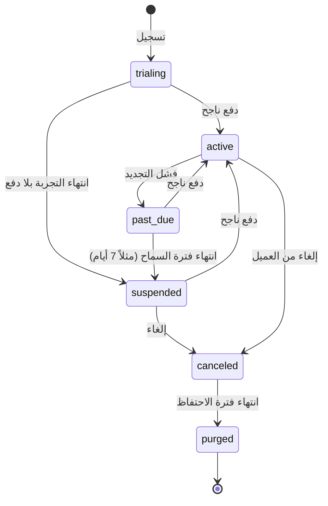

# تصميم التحول إلى SaaS — Mizan POS (مرحلة مستقبلية)

> ⚠️ **هذه وثيقة مرجعية لمشروع لاحق منفصل.** القرار المعتمد: إكمال النظام لمطعم واحد واختباره وتسليمه **أولاً**، ثم بدء التحول إلى SaaS متعدد المطاعم.
> **لا يُنفَّذ أي شيء من هذه الوثيقة في المرحلة الحالية** — لا `tenant_id`، لا خطط، لا فوترة، لا لوحة Super Admin.
> **مرتبط:** [ARCHITECTURE.md](ARCHITECTURE.md) · [REFACTORING_ROADMAP.md](REFACTORING_ROADMAP.md)

---

## 1. شروط البدء (Entry Criteria)

لا يبدأ مشروع SaaS إلا بعد:
1. تسليم النسخة الحالية للمطعم واعتمادها (R9) وتشغيلها مستقرة لفترة كافية (مقترح: 60 يوماً بلا أخطاء Critical/High).
2. اكتمال الهيكلية المستهدفة: كل الوصول للبيانات خلف Repositories، كل المنطق في Services، كل المسارات محمية.
3. تغطية اختبارات للخدمات المالية ≥ 80% واختبارات E2E للتدفقات الحرجة.
4. قرار تجاري موثق: التسعير، السوق المستهدف، وهل سيعود تكامل ZATCA (يصبح ضرورياً غالباً لبيع النظام تجارياً في السعودية).

---

## 2. أثر الاستضافة

استضافة **Hostinger Business المشتركة لا تناسب SaaS متعدد المستأجرين**:
- لا Background Workers ⇒ لا طوابير للفوترة الدورية وWebhooks وإرسال البريد.
- لا WebSockets، وNPROC محدود بـ 120 لكل الخطة، وموارد ثابتة (2 CPU / 3GB).
- لا Redis ولا Docker.

**الانتقال المقترح عند بدء SaaS:** Hostinger VPS أو Cloud أعلى، أو منصة سحابية (مع MariaDB/MySQL مُدارة، Redis للطوابير والـ rate limiting الموزع، وعمليات Worker منفصلة).

---

## 3. مقارنة نماذج Multi-Tenancy

> **ملاحظة MariaDB/MySQL:** في MySQL/MariaDB مصطلح "Schema" يساوي "Database"؛ لذا "مخطط منفصل لكل مستأجر" يعني عملياً "قاعدة بيانات منفصلة على نفس الخادم".

| المعيار | قاعدة مشتركة + مخطط مشترك (`tenant_id`) | قاعدة مشتركة + مخطط منفصل | قاعدة منفصلة لكل مستأجر |
|---|---|---|---|
| تكلفة التشغيل | 🟢 الأقل | 🟡 متوسطة | 🔴 الأعلى |
| تعقيد الترحيلات | 🟢 ترحيل واحد | 🔴 ترحيل × عدد المستأجرين | 🔴 ترحيل × عدد المستأجرين |
| قوة العزل | 🟡 منطقي (يعتمد على الكود) | 🟢 قوي | 🟢 الأقوى |
| خطر التسرب بين المستأجرين | 🔴 خطأ استعلام واحد يكفي | 🟢 منخفض | 🟢 شبه معدوم |
| التقارير عبر المستأجرين (للمنصة) | 🟢 سهلة | 🔴 صعبة | 🔴 صعبة |
| استعادة مستأجر واحد من نسخة احتياطية | 🔴 صعبة (تتطلب أدوات تصدير/استيراد) | 🟢 سهلة | 🟢 سهلة |
| التوسع لآلاف المستأجرين | 🟢 ممتاز | 🔴 حدود الاتصالات والجداول | 🔴 مكلف جداً |
| ملاءمة حجم المشروع (مطاعم صغيرة/متوسطة) | 🟢 | 🟡 | 🔴 |

### القرار المقترح
**قاعدة مشتركة + مخطط مشترك مع `tenant_id`** في كل جدول أعمال، مع ضوابط عزل متعددة الطبقات (§5)، و**مخرج طوارئ**: نقل مستأجر كبير (سلسلة مطاعم) إلى قاعدة منفصلة لاحقاً بنفس المخطط (hybrid silo).

---

## 4. تصميم المحاور الأربعة عشر

### 4.1 Multi-Tenant Architecture
- **التسلسل الهرمي:** `Tenant` (منشأة قانونية/سجل تجاري) ← `Branch` (فرع) ← `Device` (جهاز كاشير، يلزم لاحقاً إن عاد ZATCA لأن لكل جهاز تسلسل فواتير).
- **تحديد المستأجر:** من الجلسة (المستخدم ينتمي لمستأجر واحد)؛ النطاق الفرعي `restaurant.mizan.app` للهوية البصرية فقط، لا كمصدر للثقة.
- **سياق المستأجر:** `AsyncLocalStorage` يحمل `tenantId` طوال الطلب، ويُقرأ في طبقة Repository.

### 4.2 Tenant Registration
- صفحة تسجيل عامة ⇒ التحقق من البريد ⇒ إنشاء `tenant` + فرع افتراضي + مستخدم مالك + نسخ أدوار القوالب + إعدادات افتراضية ⇒ معالج إعداد (بيانات المطعم، الضريبة، القائمة).
- حماية: CAPTCHA، rate limit، تحقق البريد، فترة تجريبية دون بطاقة.

### 4.3 Tenant Isolation
انظر §5.

### 4.4 User Management
- v1: المستخدم ينتمي لمستأجر واحد؛ البريد فريد عالمياً (دخول بسيط بلا اختيار مستأجر).
- لاحقاً عند الحاجة: جدول `memberships` (مستخدم ⇄ عدة مستأجرين).
- دعوة الموظفين بالبريد، تعطيل لا حذف، إلغاء الجلسات عند التعطيل.

### 4.5 Roles & Permissions
- الأدوار لكل مستأجر (`roles.tenant_id`)، تُنسخ من قوالب النظام عند التسجيل.
- نفس مفاتيح `shared/permissions.ts` + نطاق فرع اختياري (`user_branch_access`).
- **مسؤولو المنصة** في جدول منفصل `platform_admins` بمصادقة منفصلة و2FA إلزامي.

### 4.6 Subscription Plans
- `plans` (الرمز، السعر الشهري/السنوي، العملة) + `plan_features` (مفاتيح ميزات وحدود): عدد المستخدمين، الفروع، الأجهزة، الفواتير/شهر، التقارير المتقدمة، المخزون بالوصفات.
- أمثلة: **Starter** (فرع واحد، 3 مستخدمين)، **Pro** (3 فروع، وصفات، تقارير متقدمة)، **Business** (غير محدود، دعم أولوية).

### 4.7 Subscription Lifecycle

- **past_due:** الوصول كامل مع تنبيه. **suspended:** قراءة وتصدير فقط + صفحة الفوترة. **canceled:** البيانات محفوظة للتصدير خلال فترة الاحتفاظ.
- **الحذف النهائي** يجب أن يحترم مدة حفظ السجلات الضريبية النظامية في السعودية (يُتحقق منها قانونياً قبل التنفيذ).

### 4.8 Feature Limits
- `requireFeature('recipes')` و`enforceLimit('users')` كـ middleware على الخادم، مع `usage_counters` (فواتير الشهر، عدد المستخدمين...).
- الواجهة تعرض الحدود والاستهلاك، لكن **الخادم وحده** يفرضها.

### 4.9 Billing Integration
- طبقة محوّل (adapter) لمزوّد دفع يعمل في السعودية (مثل Moyasar أو Tap أو HyperPay؛ Stripe إن توفر).
- Webhooks بمعالجة **idempotent** (جدول `billing_events` بمعرّف الحدث الفريد).
- **ملاحظة مهمة:** فواتير الاشتراك الصادرة من المنصة نفسها لعملائها هي فواتير ضريبية سعودية ⇒ ستحتاج المنصة امتثال الفوترة الإلكترونية كبائع.

### 4.10 Super Admin Dashboard
- قائمة المستأجرين، الخطة، الحالة، الاستهلاك، آخر نشاط.
- تعليق/تفعيل، تمديد التجربة، أعلام الميزات (feature flags).
- **انتحال الهوية (impersonation)** للدعم: محدود زمنياً، يتطلب سبباً، مُسجَّل في سجل التدقيق، ومرئي للمستأجر.

### 4.11 Tenant Dashboard
- الاشتراك والفواتير وطرق الدفع، الاستهلاك مقابل الحدود، الفروع والأجهزة، المستخدمون والأدوار، تصدير البيانات.

### 4.12 Audit Logs
- جدول `audit_logs` (سيُبنى في المرحلة الحالية لمطعم واحد ✅) + `tenant_id` عند التحول.
- إلحاق فقط (append-only)، لا تعديل ولا حذف؛ يُعرض للمستأجر (عملياته) وللمنصة (كل العمليات).

### 4.13 SaaS Security
- اختبارات عزل آلية في CI (مستأجر A لا يرى بيانات B عبر كل endpoint).
- rate limiting لكل IP ولكل مستأجر (Redis).
- 2FA للمالكين ومسؤولي المنصة؛ سياسات كلمات مرور؛ إدارة الجلسات.
- تشفير الأسرار الخاصة بكل مستأجر (مثل مفاتيح ZATCA إن عادت) بتشفير مغلف (envelope encryption) بمفتاح خارج القاعدة.
- فصل بيئات staging/production، وأسرار في مدير أسرار.

### 4.14 Backup & Recovery
- نسخ تلقائية يومية + **Point-in-Time Recovery** عبر binlog (يتطلب استضافة مُدارة/VPS).
- أداة تصدير/استيراد **لمستأجر واحد** (ضرورية مع المخطط المشترك).
- أهداف موثقة: RPO ≤ 15 دقيقة، RTO ≤ 4 ساعات (مقترح)، وتمارين استعادة دورية.

---

## 5. ضوابط عزل المستأجرين (Defense in Depth)

| الطبقة | الضابط |
|---|---|
| السياق | `tenantId` من الجلسة فقط، في `AsyncLocalStorage`؛ لا يُقبل من body أو query |
| Repository | قاعدة أساسية تضيف `where tenant_id = ?` تلقائياً؛ قاعدة ESLint تمنع استعلامات Kysely خارج Repositories |
| المخطط | `tenant_id NOT NULL` + مفاتيح مركبة فريدة `(tenant_id, document_number)`, `(tenant_id, sku)` + فهارس تبدأ بـ `tenant_id` |
| المفاتيح الأجنبية | FKs مركبة `(tenant_id, x_id)` حيث يلزم لمنع الربط عبر المستأجرين |
| الاختبارات | مجموعة اختبارات تسرب إلزامية لكل endpoint جديد |
| المراقبة | تسجيل `tenantId` في كل سطر log؛ تنبيه عند أي وصول عبر مستأجرين |

---

## 6. إضافات المخطط (عند التحول — ليس الآن)

```text
tenants(id, slug UK, legal_name, vat_number, status, created_at)
branches(id, tenant_id FK, name, address, is_active)
plans(id, code UK, name, price_monthly, price_yearly, currency, is_active)
plan_features(plan_id FK, feature_key, limit_value NULL, PRIMARY KEY(plan_id, feature_key))
subscriptions(id, tenant_id FK UK, plan_id FK, status, trial_ends_at, current_period_end, provider_ref)
usage_counters(tenant_id, metric, period, value, PRIMARY KEY(tenant_id, metric, period))
billing_events(id, provider_event_id UK, type, payload JSON, processed_at)
platform_admins(id, email UK, password_hash, totp_secret_enc, is_active)
-- + tenant_id NOT NULL على: settings (يصبح صفاً لكل مستأجر), users, roles, customers, suppliers,
--   menu_*, inventory_items, recipe_lines, stock_movements, purchases*, invoices*, vouchers,
--   held_orders, document_sequences (PK يصبح tenant_id, doc_type, period_year), audit_logs
```

---

## 7. ضمانات "بلا ندم" في المرحلة الحالية (لا تضيف تعقيد SaaS)

ممارسات جيدة نتبعها الآن **لأنها صحيحة لمطعم واحد أصلاً**، وتسهّل التحول لاحقاً:
1. كل الوصول للبيانات عبر Repositories (لا SQL في Controllers أو Services).
2. الإعدادات تُقرأ عبر `settingsService` لا عبر `WHERE id = 1` منتشرة في الكود.
3. الترقيم عبر `document_sequences` (يُضاف له `tenant_id` لاحقاً بترحيل واحد).
4. `audit_logs` و`created_by` من الآن.
5. لا ملفات على القرص المحلي؛ لا حالة أعمال في متغيرات عامة داخل العملية.
6. لا افتراضات ضمنية بوجود "مدير واحد" أو "فرع واحد" داخل منطق الأعمال؛ الصلاحيات دائماً عبر الأدوار.

**ما لا نفعله الآن:** إضافة `tenant_id`، جداول الخطط والاشتراكات، طبقة سياق المستأجر، لوحة المنصة.

---

## 8. خطة التحول المستقبلية (مختصرة)

1. **F1.1** الانتقال إلى استضافة تدعم Workers وRedis (VPS/Cloud) + مراجعة التكاليف.
2. **F1.2** ترحيل: إضافة `tenants` + `tenant_id` لكل الجداول (backfill بالمستأجر رقم 1 = المطعم الحالي) + المفاتيح المركبة.
3. **F1.3** سياق المستأجر + قاعدة Repository + اختبارات العزل.
4. **F1.4** التسجيل الذاتي والإعداد الأول للمستأجر.
5. **F1.5** الخطط والحدود والاشتراكات + مزود الدفع + Webhooks.
6. **F1.6** لوحة المنصة ولوحة المستأجر.
7. **F1.7** النسخ الاحتياطي لكل مستأجر، المراقبة، اختبارات الحمل.
8. **F2** (اختياري) تكامل ZATCA الحقيقي للمرحلة الثانية لكل مستأجر/جهاز.
