# مراجعة الأمان — Mizan POS

> **الحالة:** تدقيق فقط — لم تُطبَّق أي إصلاحات.
> **سياق التهديد:** النظام سيُنشر على **رابط عام على الإنترنت** (Hostinger Business) لمطعم واحد، ويتعامل مع نقد ومبيعات ومخزون وبيانات موظفين.
> **التصنيف:** Critical / High / Medium / Low، مع ربط بـ OWASP Top 10 (2021).
> **مرتبط:** [PROJECT_ANALYSIS.md](PROJECT_ANALYSIS.md) · [DATABASE_AUDIT.md](DATABASE_AUDIT.md) · [REFACTORING_ROADMAP.md](REFACTORING_ROADMAP.md)

---

## 1. الملخص

| الفئة | الحكم |
|---|---|
| SQL Injection | ✅ **لم يُعثر عليه** — كل الاستعلامات prepared statements بمعاملات `?` |
| XSS | ✅ **لم يُعثر عليه** — React يهرّب المخرجات؛ HTML الطباعة يمر عبر `escapeHtml`؛ لا `dangerouslySetInnerHTML` (خطر متبقٍ منخفض: iframe الطباعة بلا `sandbox`) |
| CSRF | ⚪ **غير منطبق حالياً** — التوكن في ترويسة `Authorization` وليس cookie. **يصبح منطبقاً** عند الانتقال إلى cookie sessions (مخطط له مع حماية) |
| Broken Access Control | 🔴 **Critical** — تسجيل مفتوح + صلاحيات القراءة غير مطبقة + bootstrap يكشف كل شيء |
| Authentication | 🟠 **High** — لا حماية من التخمين، scrypt متزامن، كلمات مرور قصيرة |
| Sensitive Data Exposure | 🔴 **Critical** — المفاتيح الخاصة وأسرار CSID تصل لكل مستخدم؛ ملف WAL في git |
| Insecure File Uploads | ⚪ **لا يوجد رفع ملفات** في النظام |
| Secrets Management | 🟠 **High** — أسرار داخل قاعدة البيانات بنص صريح، ملف `.env` غير مستخدم فعلياً |
| Tenant Data Leakage | ⚪ **غير منطبق** (مطعم واحد) — ضوابط مستقبلية في SAAS_ARCHITECTURE.md |
| Hosting-specific | 🟠 — إعداد `trust proxy`، الكوكيز الآمنة، الأخطاء المكشوفة خلف وكيل Hostinger |

**بعد قرار إزالة ZATCA** تسقط ثغرات المفاتيح الخاصة وحقن XML وادعاءات الامتثال تلقائياً — بشرط **حذف** الأعمدة والكود لا مجرد إخفائها.

---

## 2. جدول النتائج

| ID | الخطورة | OWASP | الموقع | الوصف | سيناريو الاستغلال | الإصلاح | المرحلة |
|---|---|---|---|---|---|---|---|
| SEC-01 | **Critical** | A01, A07 | `server.ts:84-149`, `AuthView.tsx` | التسجيل مفتوح دائماً؛ كل حساب جديد يُمنح دور كاشير وجلسة فورية | أي زائر للرابط العام يسجّل حساباً ثم يستدعي `/api/bootstrap` فيحصل على كل الفواتير والعملاء والموردين والسندات والإعدادات. على تثبيت جديد: أول من يسجّل **يصبح مديراً** | التسجيل يُسمح فقط عند عدم وجود مستخدمين (معالج إعداد أول، ويُفضَّل برمز إعداد من متغير بيئة)؛ بعدها المدير وحده ينشئ المستخدمين؛ إخفاء تبويب التسجيل | R1.2 |
| SEC-02 | **Critical** | A01 | `server.ts:196-248`, `App.tsx:142-163` | صلاحيات `sales.view`, `inventory.view`, `purchases.view`, `reports.view` لا تُفحص على الخادم؛ bootstrap يعيد كل البيانات لكل دور | كاشير يقرأ المشتريات والتكاليف والأرباح وسندات الصرف وبيانات الموردين عبر DevTools | bootstrap مُرشَّح حسب الصلاحيات الآن (R1.3)؛ ثم endpoints قراءة منفصلة بـ `requirePermission` (R2) | R1.3, R2 |
| SEC-03 | **Critical** | A02, A04 | `src/server/db.ts:826-830`, `server.ts:237, 713, 1724` | `getOrganizationSettings()` = `SELECT *` يرسل `private_key_pem`, `ccsid_secret`, `pcsid_secret`, `pcsid_token` لكل مستخدم مصادَق | سرقة مفتاح التوقيع وبيانات الاعتماد | إزالة ZATCA وحذف الأعمدة؛ DTO عام للإعدادات بقائمة سماح (allowlist) | R1.3, R1.4 |
| SEC-04 | High | A02, A05 | `data/mizan-pos.db-wal`, `.gitignore` | ملفا WAL/SHM مرفوعان؛ الفحص وجد **7 مفاتيح PEM خاصة** وسجلات مستخدمين | أي شخص يملك وصولاً للمستودع يستخرج المفاتيح وتجزئات كلمات المرور | `git rm --cached data/*`؛ إضافة `data/` و`*.db*` إلى `.gitignore`؛ **تنظيف التاريخ اختياري** (البيانات تجريبية والمفاتيح لن تُستخدم) — يتطلب موافقة صريحة لأنه يعيد كتابة التاريخ؛ تحديد إن كان المستودع عاماً | R1.7 |
| SEC-05 | High | A07 | `server.ts:151-193` | لا rate limit ولا قفل حساب على تسجيل الدخول | تخمين كلمات المرور آلياً (خصوصاً مع حد أدنى 6 أحرف) | محدِّد معدل لكل IP (ذاكرة) + عدّاد محاولات لكل بريد في القاعدة مع قفل مؤقت؛ رسائل موحدة | R1.9 |
| SEC-06 | Medium | A07 | `server.ts:98, 275, 339`, `AuthView.tsx:96` | الحد الأدنى لكلمة المرور 6 أحرف، بلا فحص كلمات شائعة | كلمات مرور ضعيفة للموظفين | 8+ أحرف، رفض قائمة كلمات شائعة، تغيير إلزامي لكلمة المرور المؤقتة | R1.9 |
| SEC-07 | Medium | A04 | `src/server/db.ts:985, 995` | `crypto.scryptSync` يحجب حلقة الأحداث | طلبات دخول متتالية تُجمّد الخادم لكل المستخدمين (DoS) | `crypto.scrypt` غير المتزامن (promisified) | R1.9 |
| SEC-08 | High | A04 | `server.ts:1736-1768`, `1771-1972` | معالجات async بلا try/catch تحت Express 4 | أي استثناء ⇒ unhandled rejection ⇒ انهيار العملية في Node ≥ 15 ⇒ توقف الكاشير | `asyncHandler` مؤقتاً + error middleware مركزي؛ ثم Express 5 | R1.5, R2.1 |
| SEC-09 | High | A04 (منطق الأعمال) | `server.ts:1458-1461`, `1500-1503` | الخادم يقبل `invoice_type_code` (381/383) من العميل، ويقبل فاتورة B2B بلا عميل | إنشاء "إشعار دائن" يُنقص المخزون بلا مرجع؛ تلاعب بالسجلات المالية | `/api/invoices` يُنشئ فواتير بيع فقط؛ المرتجعات عبر مسارها؛ التحقق من عميل الفاتورة الضريبية | R1.5 |
| SEC-10 | Medium | A05 | Express الافتراضي، `server.ts:1323, 1730` | خارج وضع الإنتاج تُعرض stack traces بصيغة HTML؛ رسائل الأخطاء الداخلية (`err.message`) تُعاد للعميل | كشف بنية الكود والمسارات | error handler مركزي يعيد `{error:{code,message}}` فقط ويسجل التفاصيل داخلياً؛ ضمان `NODE_ENV=production` | R1.5 |
| SEC-11 | Medium | A05 | `server.ts:61-62`, `index.html` | لا ترويسات أمان (CSP, HSTS, X-Frame-Options, nosniff, Referrer-Policy) | Clickjacking، تحميل موارد غير متوقعة | `helmet` بسياسة CSP مضبوطة (مع خطوط Google أو استضافة الخطوط محلياً) | R1.9 / R8.2 |
| SEC-12 | Low | A03 | `src/server/zatca.ts:221, 237` | `tax_category` يُدرج في XML بلا ترميز، ويمكن تعديله بحرية عبر `PUT /api/products/:id` | حقن عناصر XML في فاتورة موقّعة | يسقط بإزالة ZATCA؛ مع ذلك `CHECK` على القيم في المخطط الجديد | R1.4 |
| SEC-13 | Medium | A03 | `SalesView.tsx:380-411`, `ReportsCenterView.tsx:154, 2350-2370` | تصدير CSV لا يحمي من حقن الصيغ (`= + - @`) | اسم عميل مثل `=HYPERLINK(...)` يُنفَّذ عند فتح الملف في Excel | دالة تصدير مشتركة تسبق القيم الخطرة بـ `'` وتهرّب كل الحقول | R6.4 |
| SEC-14 | Low | A01, A04 | `server.ts:65-77`, `src/server/db.ts:896-981` | المسار العام بلا rate limit، ويعيد `customer_vat` دون عرضه، ولا `noindex` | جمع بيانات آلي إن تسرّبت روابط | rate limit، إزالة الحقول غير المعروضة، `X-Robots-Tag: noindex` | R1.9 / R2 |
| SEC-15 | Medium | A02 | `organization_settings.private_key_pem` | مفاتيح خاصة بنص صريح في القاعدة | تسريب كامل عند أي نسخة احتياطية مسربة | يسقط بإزالة ZATCA وحذف الأعمدة | R1.4 |
| SEC-16 | High | A09 | المخطط (`invoices`, `vouchers`, `purchases`, `stock_movements`) | لا `created_by` ولا سجل تدقيق | لا يمكن معرفة من أصدر فاتورة أو حذف سنداً أو عدّل مخزوناً ⇒ إنكار (repudiation) واختلاس دون أثر | `created_by` + جدول `audit_logs` إلحاقي + تسجيل كل العمليات المالية والإدارية | R3.4 |
| SEC-17 | Medium | A04, A09 | `server.ts:600-608`, `420-441` | حذف نهائي للسندات والمستخدمين | محو أثر مالي؛ حذف موظف يكسر الإسناد مستقبلاً | إلغاء (void) بسبب للسندات، تعطيل للمستخدمين | R1.8, R3 |
| SEC-18 | Medium | A07 | `App.tsx:45`, `src/server/db.ts:1316-1351` | التوكن في الذاكرة (تحديث الصفحة = خروج)، مدة ثابتة 24 ساعة بلا تجديد، لا عرض/إلغاء للجلسات | تجربة سيئة تدفع لحلول غير آمنة (حفظ التوكن في localStorage) | cookie `httpOnly; Secure; SameSite=Lax` + انتهاء انزلاقي + CSRF (Origin check + double-submit token) + إلغاء الجلسات من شاشة المستخدم | R2.6, R4.3 |
| SEC-19 | Medium | A03, A04 | `server.ts:1011-1047`, `1135-1160`, `1386-1426` | مسارات PUT بلا تحقق | أسعار سالبة/NaN، نسب ضريبة عشوائية، بيانات تالفة | zod schemas لكل مسار (أولاً يدوياً في R1، ثم منهجياً في R2) | R1.10, R2 |
| SEC-20 | Medium | A05 | `src/server/db.ts:310-459` | بذور تجريبية تُنفَّذ في الإنتاج (رقم ضريبي وهمي، CSIDs تجريبية، موردون بأسماء علامات حقيقية) وتعود تلقائياً | بيانات مضللة في دفاتر المطعم؛ إيصالات برقم ضريبي غير صحيح | بذور تطوير فقط عبر سكربت صريح + متغير بيئة | R1.7 |
| SEC-21 | High | (قانوني/امتثال) | `InvoiceReceiptModal.tsx:660`, `src/server/zatca.ts:559-608`, `server.ts:828-845` | الإيصال يطبع "ZATCA Phase 1 & 2 Compliant" والمحاكي يعلن "CLEARED/REPORTED" دون أي تحقق فعلي | ادعاء امتثال ضريبي غير صحيح على مستند يُسلَّم للعملاء | إزالة كل نصوص ZATCA؛ الإبقاء على QR محلي بخمسة حقول فقط (يؤكد المحاسب المتطلب النظامي) | R1.4 |
| SEC-22 | Medium | A05 | `server.ts:2013` | الخادم خلف وكيل Hostinger: بلا `app.set('trust proxy', …)` ستكون كل الطلبات من IP الوكيل | rate limit يحجب الجميع أو لا يحجب أحداً؛ الكوكيز `Secure` لا تعمل بشكل صحيح | ضبط `trust proxy` وفق إعداد Hostinger (يُتحقق منه عند النشر) | R1.9 / R8.2 |
| SEC-23 | Low | A06 | `package.json` | حزمة غير مستخدمة (`@google/genai`)؛ لا `npm audit` في CI؛ لا قفل لمدير حزم واحد | سطح هجوم إضافي عبر الاعتماديات | حذف غير المستخدم، `package-lock.json`، `npm audit --omit=dev` في CI، Dependabot | R1.11 |
| SEC-24 | Low | A04 | `server.ts:1429-1449` | `held_carts.items_json` يُخزَّن كما أرسله العميل، وأي مستخدم بـ `pos.hold` يحذف طلبات غيره | بيانات تالفة تكسر الاسترجاع (`JSON.parse` بلا حماية) | تحقق zod + `created_by` + صلاحية الحذف للمالك/المشرف | R2 |
| SEC-25 | Low | — | `ReportsCenterView.tsx:2423`, `InvoiceReceiptModal.tsx:155`, `index.html:12-14` | تحميل Google Fonts من طرف ثالث في الواجهة والطباعة | تسريب عناوين IP لطرف ثالث؛ تعارض مع CSP | استضافة الخطوط محلياً | R4 |
| SEC-26 | Low | A04 | `InvoiceReceiptModal.tsx:296-336`, `ReportsCenterView.tsx:2465-2482` | iframe الطباعة بلا `sandbox` | منخفض لأن المحتوى مُهرَّب | `sandbox="allow-modals allow-same-origin"` للطباعة | R4 |

---

## 3. تفاصيل حسب الفئة

### 3.1 SQL Injection — ✅ آمن
- كل الاستعلامات تستخدم `db.prepare(sql).run/get/all(params)` بمعاملات موضعية.
- لا بناء SQL بالدمج النصي من مدخلات المستخدم (المواضع الوحيدة لمحتوى متغير في SQL هي ثوابت داخلية).
- **للمستقبل:** Kysely يحافظ على هذا تلقائياً؛ يُمنع `sql.raw()` مع مدخلات المستخدم (قاعدة في `CLAUDE.md`).

### 3.2 XSS — ✅ آمن مع ملاحظات
- React يهرّب كل المخرجات النصية.
- HTML الطباعة (إيصالات وتقارير) يُبنى كنص ويُكتب في iframe عبر `doc.write`، لكن كل القيم النصية تمر عبر `escapeHtml` (`InvoiceReceiptModal.tsx:28-35`، `ReportsCenterView.tsx:145`).
- **التوصية:** دالة طباعة واحدة مشتركة (بدل نسختين)، و`sandbox` على iframe.

### 3.3 CSRF
- **الآن:** غير منطبق لأن المصادقة بترويسة `Authorization: Bearer` (لا تُرسل تلقائياً عبر المواقع).
- **بعد R2.6/R4.3 (cookie sessions):** إلزامي — `SameSite=Lax` + التحقق من ترويسة `Origin` لكل طلب غير GET + توكن double-submit (`X-CSRF-Token`).

### 3.4 Broken Access Control — 🔴
1. **SEC-01** التسجيل المفتوح هو الباب الأمامي لكل البيانات.
2. **SEC-02** القراءة غير محمية على الخادم؛ الواجهة تخفي القوائم فقط.
3. ✅ عمليات الكتابة محمية بـ `requirePermission` (`server.ts:209-220`) وفيها حمايات جيدة (عدم تعطيل الذات، آخر مدير، دور النظام).
4. **مصفوفة الاختبار المطلوبة:** لكل مسار × لكل دور افتراضي ⇒ 200/403 متوقع (اختبار آلي في R1.1 ثم R7.3).

### 3.5 Authentication — 🟠
- ✅ scrypt + salt 16 بايت + `timingSafeEqual`؛ ✅ توكن 256-bit عشوائي مُجزّأ بـ SHA-256؛ ✅ إلغاء الجلسات عند تغيير كلمة المرور أو التعطيل.
- ✘ لا rate limit (SEC-05)، ✘ scrypt متزامن (SEC-07)، ✘ 6 أحرف (SEC-06)، ✘ الجلسة في الذاكرة (SEC-18)، ✘ `/api/auth/status` يكشف إن كان النظام بلا مستخدمين (يسهّل الاستيلاء على تثبيت جديد مع SEC-01).

### 3.6 Sensitive Data Exposure — 🔴
- SEC-03 (أسرار في bootstrap)، SEC-04 (WAL في git)، SEC-14 (حقول زائدة في المسار العام)، SEC-15 (مفاتيح بنص صريح).
- **بعد إزالة ZATCA:** يتبقى ضمان أن الإعدادات تُعاد عبر DTO، وأن بيانات التكلفة والأرباح لا تصل إلا لمن يملك `reports.view`/`inventory.manage`.

### 3.7 Insecure File Uploads — ⚪
لا يوجد رفع ملفات. **إذا أُضيفت صور للأطباق مستقبلاً:** لا تُخزَّن في مجلد التطبيق على Hostinger (يُمسح عند النشر) — تخزين خارجي (Object Storage) مع تحقق من النوع والحجم وإعادة ترميز الصور.

### 3.8 Secrets Management — 🟠
- لا أسرار في كود الواجهة ✅ (لا يحقن `vite.config.ts` أي متغيرات).
- الأسرار الوحيدة كانت مفاتيح ZATCA داخل القاعدة ⇒ تُحذف.
- **المستهدف:** كل الأسرار (`DATABASE_URL`/بيانات MariaDB، `SESSION_SECRET`، `SETUP_TOKEN`، `SENTRY_DSN`) في متغيرات بيئة hPanel، مع تحقق zod عند الإقلاع ورفض الإقلاع إذا نقص سر؛ `.env.example` بلا قيم حقيقية.

### 3.9 Tenant Data Leakage — ⚪ غير منطبق الآن
نظام مطعم واحد. الضوابط المستقبلية (عزل `tenant_id`، اختبارات تسرب بين المستأجرين) موثقة في [SAAS_ARCHITECTURE.md](SAAS_ARCHITECTURE.md) ولن تُنفَّذ في هذه المرحلة.

### 3.10 مخاطر خاصة بالاستضافة (Hostinger Business)
- **SEC-22** `trust proxy` والكوكيز الآمنة خلف الوكيل.
- مجلد التطبيق يُستبدل عند النشر ⇒ لا تخزين لأي ملف حساس أو دائم على القرص.
- متغيرات البيئة تُدار من hPanel ⇒ لا ملفات `.env` في المستودع (موجود في `.gitignore` ✅).
- النشر التلقائي من GitHub ⇒ **حماية فرع الإنتاج** (لا دفع مباشر، CI إلزامي) لأن كل push يُنشر فوراً.
- Cron على Hostinger بتوقيت UTC ⇒ مهام النسخ الاحتياطي والتنظيف تُجدول بناءً على ذلك.

---

## 4. ترتيب المعالجة المقترح

```mermaid
flowchart LR
    A[R1.1 شبكة أمان: اختبارات + CI] --> B[R1.2 إغلاق التسجيل]
    B --> C[R1.3 bootstrap حسب الصلاحيات + DTO الإعدادات]
    C --> E[R1.5 أخطاء async + نوع المستند]
    E --> N[R1.8 ترقيم ذري + إلغاء السندات]
    N --> D[R1.4 إزالة ZATCA + أعمدة الأسرار]
    D --> F[R1.9 تقوية المصادقة + helmet + trust proxy]
    F --> G[R2.6 / R4.3 cookie sessions + CSRF]
    G --> H[R3.4 سجل التدقيق]
```

**معيار إغلاق المرحلة الأمنية الأولى (نهاية R1):** لا توجد أي نتيجة Critical مفتوحة؛ اختبار مصفوفة الصلاحيات يمر؛ لا أسرار في أي استجابة API؛ لا ملفات قاعدة بيانات في git؛ محاولات الدخول الخاطئة المتكررة تُحجب.
